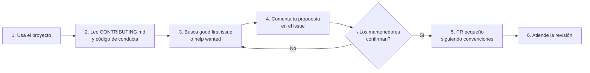

# Contribuir a open source

Parte de: [[14-Carrera-Liderazgo/06 Hábitos/_Índice Hábitos|Hábitos]]

> [!info] Cómo avanzar
> `progreso`: **pendiente** → **viendo** (estudiando) → **visto** (contestaste la autoevaluación sin abrir las respuestas) → **dominado** (hiciste el laboratorio o lo aplicaste de verdad).

## Contenido

### Qué es
**Contribuir a open source** es aportar a proyectos de código abierto: corregir documentación, agregar pruebas, reportar o arreglar bugs, implementar funcionalidades. Es una forma de aprender de código de alta calidad, de recibir revisiones de expertos, de practicar inglés técnico y de construir un portafolio verificable públicamente ([[Portafolio y GitHub]]).

### Cómo funciona
**Cómo empezar:**



1. **Usa el proyecto.** Es más fácil contribuir a algo que conoces: una librería de tu stack (FluentValidation, Polly, Dapper, alguna herramienta de Azure) o una herramienta que uses a diario.
2. **Lee `CONTRIBUTING.md`** y el código de conducta: cómo se compila, cómo se corren las pruebas, el formato de commits, si exigen firmar un acuerdo de contribución (CLA).
3. **Busca issues etiquetados** como *good first issue* o *help wanted*. GitHub recomienda a los mantenedores usar esas etiquetas justamente para orientar a quien llega.
4. **Empieza por lo pequeño:** documentación (un ejemplo que no compila, una explicación confusa), pruebas faltantes, bugs acotados.

**Antes de escribir código para un issue:** comenta en el issue tu propuesta y **espera confirmación** de los mantenedores. Así evitas invertir días en algo que no aceptarán (porque ya alguien lo está haciendo, porque no encaja con la dirección del proyecto o porque prefieren otra solución).

### Ejemplo
Encuentras que un ejemplo de la documentación de una librería de validación usa una API marcada como obsoleta.

Comentario en el issue (o abriendo uno nuevo):

```text
Hi! The "Custom validators" docs page still uses SetValidator with the
old signature, which is marked [Obsolete] in the current version.
I'd like to update the example to the current API.
Would a PR with only the docs change be welcome?
```

Cuando un mantenedor responde que sí:
1. Haces *fork* y clonas.
2. Creas una rama: `git switch -c docs/update-custom-validator-example`.
3. Cambias solo lo necesario y compilas la documentación si el proyecto lo pide.
4. PR con título claro y descripción en inglés: *What*, *Why*, *How to test* ([[Inglés técnico - escribir PRs, issues y design docs]]).
5. Atiendes los comentarios con calma; las revisiones de mantenedores son mentoría gratuita.

Después de 2–3 contribuciones pequeñas aceptadas, ya conoces el proyecto lo suficiente para tomar un bug más grande.

### Cuándo usarlo y cuándo no
Contribuye cuando tengas tiempo constante, aunque sea poco (un par de horas al mes), y en proyectos que usas. Es especialmente útil si tu experiencia laboral es privada y necesitas evidencia pública, o si buscas trabajo remoto en inglés. Revisa tu contrato laboral: algunas empresas tienen políticas sobre contribuciones externas. No lo hagas solo por "llenar el GitHub de cuadritos verdes": las contribuciones triviales (cambiar una coma en 50 repos) se notan y no suman. Antes, conviene practicar [[Leer código de otros]].

### Errores comunes
1. **Abrir un PR enorme sin contexto** ni acuerdo previo; suele quedar sin revisar o rechazado.
2. **No seguir las convenciones** del proyecto (estilo, commits, pruebas).
3. **Empezar a programar sin comentar en el issue**, y descubrir que otra persona ya lo resolvió.
4. **Tomar el rechazo como algo personal.** Los mantenedores protegen la dirección del proyecto.
5. **Desaparecer** después de abrir el PR sin atender los comentarios.

### Para profundizar
- [How to Contribute to Open Source — Open Source Guides](https://opensource.guide/how-to-contribute/)
- [Encouraging helpful contributions to your project with labels — GitHub Docs](https://docs.github.com/en/communities/setting-up-your-project-for-healthy-contributions/encouraging-helpful-contributions-to-your-project-with-labels)
- [FluentValidation en GitHub](https://github.com/FluentValidation/FluentValidation)

## Autoevaluación

Contesta primero en voz alta o en papel; luego despliega la respuesta.

> [!question]- ¿Cómo empiezas a contribuir?
> Usando el proyecto, leyendo `CONTRIBUTING.md`, buscando issues etiquetados como *good first issue*, empezando por documentación, pruebas o bugs pequeños.

> [!question]- ¿Qué haces antes de escribir código para un issue?
> Comentar en el issue tu propuesta y esperar confirmación de los mantenedores, para no invertir en algo que no aceptarán.

> [!question]- Error común.
> Abrir un PR enorme sin contexto o sin seguir las convenciones del proyecto.

