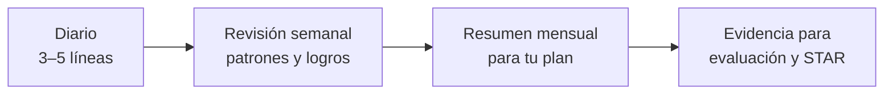

# Diario de aprendizaje

Parte de: [[14-Carrera-Liderazgo/06 Hábitos/_Índice Hábitos|Hábitos]]

> [!info] Cómo avanzar
> `progreso`: **pendiente** → **viendo** (estudiando) → **visto** (contestaste la autoevaluación sin abrir las respuestas) → **dominado** (hiciste el laboratorio o lo aplicaste de verdad).

## Contenido

### Qué es
Un **diario de aprendizaje** es un registro breve y frecuente (idealmente diario) de lo que aprendiste, dónde lo aplicaste y qué te costó. Sirve para tres cosas: **fijar lo aprendido** (escribirlo con tus palabras obliga a entenderlo), **detectar patrones** en tus errores y tener **evidencia de crecimiento** para evaluaciones, promociones y entrevistas. Es primo del *brag document* que propone Julia Evans: un registro de logros para que tu trabajo sea visible.

### Cómo funciona
El hábito funciona si es **pequeño y constante**. Tres líneas al día valen más que una entrada larga al mes.



**Qué escribir en una entrada:**
1. **Qué aprendí** (con tus palabras, no copiado).
2. **Dónde lo apliqué** (PR, incidente, nota).
3. **Qué me costó** o en qué me equivoqué.
4. **Qué haría distinto.**
5. **Enlaces**: a la nota de la bóveda, al PR, al ADR.

**Revisión semanal (10 minutos):** ¿qué se repite?, ¿qué logro merece ir al registro de logros?, ¿qué tema necesita una nota permanente?

**Resumen mensual:** alimenta tu [[Plan personal hacia senior]] y te da material para historias STAR ([[Entrevistas de comportamiento (método STAR)]]).

### Ejemplo
Entrada diaria en Obsidian, con plantilla:

```markdown
2026-11-09
- Aprendí: Dapper no mapea datetime2 a string; truena con InvalidCastException
  al leer, no al compilar.
- Lo apliqué: PR #412 en Itzamna.Dionisio, corregí ClienteDto.FechaAlta.
- Me costó: tardé 1 h porque busqué en el controller y no en el log.
- Haría distinto: empezar por Application Insights (traza completa).
- Enlaces: [[Pruebas de integración]], PR #412
```

Entrada del registro de logros (semanal):

```markdown
Semana 45
- Impacto: eliminé pagos duplicados del webhook (0 en 4 semanas; antes 3/mes). ADR-0007.
- Equipo: mentoría a Luis sobre diagnóstico con logs; propuso por su cuenta una prueba de integración.
- Comunicación: presenté la propuesta de idempotencia al equipo (10 min).
```

Con seis meses de estas entradas, la autoevaluación de desempeño se escribe en una hora y con datos. Antes de tu evaluación, filtra las entradas por categoría (impacto, equipo, comunicación, aprendizaje) y elige las tres o cuatro más fuertes de cada una; esas se vuelven tus ejemplos. Las mismas entradas, con un poco más de detalle, se convierten en historias STAR: la situación y la acción ya están escritas, y el resultado medible suele estar en la revisión semanal posterior.

Puedes automatizar la plantilla con el plugin de notas diarias de Obsidian y una plantilla con estos encabezados.

### Cuándo usarlo y cuándo no
Úsalo todos los días laborales, aunque sea una línea ("Hoy nada nuevo; terminé las pruebas de reembolsos" también es registro). Es especialmente útil cuando estás aprendiendo algo nuevo (un stack, un dominio) o preparando una promoción. No lo conviertas en una tarea pesada: si una entrada te toma más de 5 minutos, es demasiado larga. No guardes datos sensibles de la empresa (contraseñas, datos de clientes): escribe lo aprendido, no la información confidencial.

### Errores comunes
1. **Copiar documentación** en lugar de escribir con tus palabras; no fija nada.
2. **Entradas largas** que terminan en abandono a las dos semanas.
3. **Registrar solo lo técnico** y olvidar lo de equipo, comunicación e impacto, que es lo que más pesa para senior.
4. **No revisarlo nunca.** El valor está en la revisión semanal y mensual.
5. **Escribir sin enlaces.** Sin el PR o el ADR, después no puedes demostrar nada.

### Para profundizar
- [Get your work recognized: write a brag document — Julia Evans](https://jvns.ca/blog/brag-documents/)
- [A Work Log Template for Software Engineers — The Pragmatic Engineer](https://blog.pragmaticengineer.com/work-log-template-for-software-engineers/)

## Autoevaluación

Contesta primero en voz alta o en papel; luego despliega la respuesta.

> [!question]- ¿Para qué sirve un diario de aprendizaje?
> Para fijar lo aprendido (escribirlo obliga a entender), detectar patrones de errores y tener evidencia de crecimiento para evaluaciones y entrevistas.

> [!question]- ¿Qué escribes en una entrada?
> Qué aprendí, dónde lo apliqué, qué me costó, qué haría distinto y enlaces a la nota o al PR.

> [!question]- Error común.
> Copiar documentación en lugar de escribir con tus palabras, o abandonarlo por querer entradas largas. Tres líneas diarias bastan.

