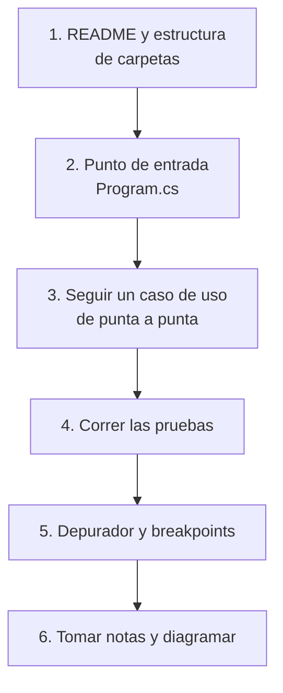

# Leer código de otros

Parte de: [[14-Carrera-Liderazgo/06 Hábitos/_Índice Hábitos|Hábitos]]

> [!info] Cómo avanzar
> `progreso`: **pendiente** → **viendo** (estudiando) → **visto** (contestaste la autoevaluación sin abrir las respuestas) → **dominado** (hiciste el laboratorio o lo aplicaste de verdad).

## Contenido

### Qué es
**Leer código de otros** es estudiar de forma intencional código que no escribiste: el de tu equipo, el de librerías que usas o el de proyectos de referencia. Acelera tu crecimiento porque ves patrones, convenciones y soluciones que no habrías inventado, y entrenas la habilidad que más usas en el trabajo real: entender código existente. La mayor parte de tu carrera la pasarás leyendo y modificando código, no escribiéndolo desde cero.

### Cómo funciona
**Cómo abordar un repositorio grande desconocido:**

1. **README y estructura:** qué hace, cómo se organiza (por capas, por *features*), dónde están las pruebas.
2. **Punto de entrada:** en .NET, `Program.cs`. Ahí ves qué servicios se registran, qué middleware se usa y cómo se configura.
3. **Un caso de uso completo:** elige una petición (por ejemplo, `POST /orders`) y síguela desde el controller hasta la base de datos. No intentes entender todo a la vez.
4. **Pruebas:** dicen cómo se espera que se use el código, a menudo mejor que la documentación.
5. **Depurador:** un breakpoint y "paso a paso" responden en minutos lo que la lectura tarda horas.
6. **Notas y diagramas:** un diagrama de secuencia del flujo que seguiste ([[Mermaid y diagramas como código]]).

**Además del código, lee:**
- **PRs y discusiones:** muestran por qué se hizo algo y qué alternativas se descartaron.
- **El historial** (`git log -p archivo`, `git blame`) para entender cómo evolucionó una pieza.

**Repos que vale la pena leer en .NET:**
- **ASP.NET Core** (`dotnet/aspnetcore`): cómo están hechos el middleware, el *model binding* o la autenticación JWT que usas a diario.
- **eShop** (`dotnet/eShop`): aplicación de referencia de Microsoft con varios servicios.
- Las librerías que ya usas: **FluentValidation**, **Polly**, **Dapper**. Leer cómo funciona `RuleFor` o cómo Dapper mapea columnas te quita "magia".

### Ejemplo
**Entender cómo valida tokens `AddJwtBearer`** (útil para Xolotl.Hecate):

1. En `dotnet/aspnetcore`, busca la carpeta del handler de JWT Bearer (en GitHub puedes usar la búsqueda del repo: `JwtBearerHandler`).
2. Lee `HandleAuthenticateAsync`: verás cómo obtiene el token del encabezado `Authorization`, cómo obtiene la configuración (incluido el JWKS cuando hay `Authority`) y cómo dispara los eventos `OnMessageReceived`, `OnTokenValidated` y `OnAuthenticationFailed`.
3. Lee las pruebas del handler para ver casos borde (token expirado, firma inválida).
4. Anota en tu bóveda: "Si la validación falla, el evento `OnAuthenticationFailed` recibe la excepción; útil para loguear la causa".

En tu equipo, el equivalente: antes de tocar un slice que no conoces de Itzamna.Dionisio, lee otro slice parecido completo (controller, handler, interfaz de consulta, archivo `.sql`, pruebas). Así imitas la convención en lugar de inventar una nueva.

### Cuándo usarlo y cuándo no
Hazlo al entrar a un proyecto nuevo, antes de modificar un módulo desconocido, cuando una librería se comporta raro y como hábito semanal (30 minutos leyendo un repo de referencia). También es la mejor preparación para [[Contribuir a open source]]. No intentes entender un repositorio grande completo: elige un flujo. Y no copies patrones de librerías a tu código de aplicación sin pensar; las librerías resuelven problemas de generalidad que tu app quizá no tiene.

### Errores comunes
1. **Leer archivo por archivo** sin un caso de uso que guíe; te pierdes.
2. **No ejecutar nada.** Sin pruebas ni depurador, todo queda en suposiciones.
3. **Ignorar las pruebas y los PRs**, que explican la intención.
4. **Juzgar en lugar de entender.** El código "feo" suele tener una razón histórica; búscala en el historial.
5. **No tomar notas.** A la semana olvidas lo que entendiste.

### Para profundizar
- [ASP.NET Core en GitHub](https://github.com/dotnet/aspnetcore)
- [eShop — aplicación de referencia de .NET](https://github.com/dotnet/eShop)
- [FluentValidation en GitHub](https://github.com/FluentValidation/FluentValidation)
- [Polly en GitHub](https://github.com/App-vNext/Polly)

## Autoevaluación

Contesta primero en voz alta o en papel; luego despliega la respuesta.

> [!question]- ¿Por qué leer código de otros acelera tu crecimiento?
> Ves patrones, convenciones y soluciones que no habrías inventado, y entrenas la habilidad más usada del trabajo: entender código existente.

> [!question]- ¿Cómo abordas un repositorio grande desconocido?
> README y estructura de carpetas, luego el punto de entrada (`Program.cs`), sigue un caso de uso de punta a punta, corre las pruebas y usa el depurador.

> [!question]- ¿Qué repos vale la pena leer en .NET?
> Código de ASP.NET Core, ejemplos oficiales de Microsoft (eShop) y librerías que usas (Polly, FluentValidation). Lee pruebas y PRs, no solo el código.

