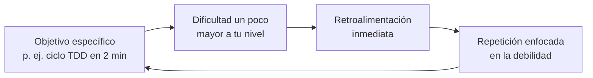

# Práctica deliberada (katas de código y de diseño)

Parte de: [[14-Carrera-Liderazgo/06 Hábitos/_Índice Hábitos|Hábitos]]

> [!info] Cómo avanzar
> `progreso`: **pendiente** → **viendo** (estudiando) → **visto** (contestaste la autoevaluación sin abrir las respuestas) → **dominado** (hiciste el laboratorio o lo aplicaste de verdad).

## Contenido

### Qué es
La **práctica deliberada** es entrenar una habilidad específica con un objetivo claro, un poco más allá de tu nivel actual, con retroalimentación inmediata y repitiendo hasta mejorar. Se distingue de "programar mucho" en que el trabajo diario te hace repetir lo que ya sabes; la práctica deliberada ataca tus debilidades. Las **katas** son ejercicios cortos y repetibles pensados para eso: de código (TDD, refactor) y de diseño (sistemas, modelado).

### Cómo funciona
Cuatro elementos que la hacen deliberada:



1. **Objetivo específico:** no "mejorar en C#", sino "escribir la prueba antes del código en cada paso" o "refactorizar sin romper ninguna prueba".
2. **Dificultad justa:** si es demasiado fácil, no aprendes; si es imposible, te frustras.
3. **Retroalimentación inmediata:** pruebas automatizadas, cronómetro, comparación con una solución de referencia.
4. **Repetición:** la misma kata varias veces, con una restricción distinta cada vez (sin `if`, sin mouse, en 20 minutos).

**Ejemplos de katas:**
- **De código:** FizzBuzz con [[TDD]] (para practicar el ciclo rojo-verde-refactor), Bowling Game (TDD con reglas un poco más complejas), **Gilded Rose** (refactorizar código legado: primero pruebas de caracterización, luego limpiar; muy parecido al trabajo real).
- **De diseño:** un caso de diseño de sistemas en 45 minutos con cronómetro ([[Entrevistas de diseño de sistemas]]), modelar el dominio de un problema con C4 o *event storming*, escribir un ADR en 20 minutos sobre una decisión ficticia.

**Retroalimentación al practicar solo:**
- Pruebas automatizadas que te dicen al instante si rompiste algo.
- Comparar con soluciones publicadas de otros después de terminar.
- Grabarte explicando tu diseño y escucharte.
- Pedir a un mentor o colega que revise tu solución como si fuera un PR.

### Ejemplo
**Kata Gilded Rose en C#, 45 minutos, una vez por semana durante un mes:**

- Semana 1: escribir pruebas de caracterización que capturen el comportamiento actual de `UpdateQuality()` sin entenderlo del todo.
- Semana 2: refactorizar el `if` anidado a métodos por tipo de artículo, con las pruebas en verde todo el tiempo.
- Semana 3: aplicar [[Patrón Strategy]] por tipo de artículo y agregar el requisito nuevo ("Conjured").
- Semana 4: repetir desde cero en 30 minutos.

Primera prueba de caracterización:

```csharp
[Fact]
public void Queso_brie_aumenta_su_calidad_con_el_tiempo()
{
    var items = new List<Item> { new() { Name = "Aged Brie", SellIn = 2, Quality = 0 } };
    var app = new GildedRose(items);

    app.UpdateQuality();

    Assert.Equal(1, items[0].SellIn);
    Assert.Equal(1, items[0].Quality);
}
```

Registra en tu [[Diario de aprendizaje]] qué mejoró (tiempo, número de veces que rompiste pruebas) para ver el avance.

### Cuándo usarlo y cuándo no
Dedica 1–2 sesiones semanales de 30–60 minutos, enfocadas en una debilidad concreta de tu plan. Antes de entrevistas, aumenta las katas de diseño y de código en vivo. No sustituye al trabajo real con usuarios y producción, que es donde se aprende criterio; es un complemento. Si una kata ya te sale fácil, cámbiale una restricción o pasa a otra.

### Errores comunes
1. **Repetir sin objetivo** ("hoy hago FizzBuzz otra vez") y sin medir nada.
2. **Elegir siempre lo cómodo**; si no cuesta, no es deliberado.
3. **Sin retroalimentación:** practicar diseño sin cronómetro ni revisión.
4. **Leer la solución antes de intentarlo.**
5. **Sesiones demasiado largas** que no se sostienen; mejor cortas y frecuentes.

### Para profundizar
- [Gilded Rose Refactoring Kata — Emily Bache](https://github.com/emilybache/GildedRose-Refactoring-Kata)
- [Gilded Rose — Coding Dojo](https://codingdojo.org/kata/gilded-rose/)
- [The System Design Primer](https://github.com/donnemartin/system-design-primer)

## Autoevaluación

Contesta primero en voz alta o en papel; luego despliega la respuesta.

> [!question]- ¿Qué distingue la práctica deliberada de solo "programar mucho"?
> Objetivo específico, un poco más allá de tu nivel actual, retroalimentación inmediata y repetición enfocada en la debilidad.

> [!question]- Ejemplos de katas.
> De código: FizzBuzz con TDD, Bowling, Gilded Rose (refactor de legado). De diseño: los casos de diseño de sistemas de esta bóveda en 45 min con cronómetro.

> [!question]- ¿Cómo obtienes retroalimentación al practicar solo?
> Pruebas automáticas, comparar con soluciones de referencia, grabarte explicando, o pedir revisión a un mentor.

