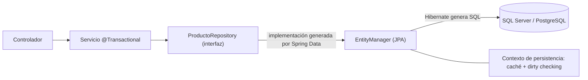

# JPA e Hibernate

Parte de: [[15-Java/_Índice Java|Java]]

> [!info] Cómo avanzar
> `progreso`: **pendiente** → **viendo** (estudiando) → **visto** (contestaste la autoevaluación sin abrir las respuestas) → **dominado** (hiciste el laboratorio o lo aplicaste de verdad).

## Contenido

### Qué es
Tres nombres que suelen aparecer juntos y conviene separar:

- **JPA** (*Jakarta Persistence*, antes *Java Persistence API*): la **especificación** estándar de ORM en Java. Define anotaciones (`@Entity`, `@Id`, `@OneToMany`), el `EntityManager`, el ciclo de vida de las entidades y el lenguaje de consultas **JPQL**. Es solo un contrato (paquete `jakarta.persistence`).
- **Hibernate ORM**: la **implementación** más usada de JPA. Es el motor que genera el SQL, administra la caché de primer nivel, el *dirty checking* y la carga perezosa.
- **Spring Data JPA**: una capa de Spring encima de JPA que **genera repositorios automáticamente**: declaras una interfaz que extiende `JpaRepository` y Spring crea la implementación con `save`, `findById`, `findAll`, paginación y consultas derivadas del nombre del método.

Juntos equivalen a **EF Core**: entidades ≈ clases del modelo, `EntityManager` ≈ `DbContext`, repositorio de Spring Data ≈ `DbSet` con métodos, JPQL ≈ LINQ to Entities (en texto). Si en .NET usas Dapper con SQL en archivos, el equivalente en Java es `JdbcClient`/`JdbcTemplate` de Spring, jOOQ o MyBatis; JPA es la opción "EF Core".

### Cómo funciona


1. **Entidades**: clases anotadas con `@Entity`, con un `@Id` y un constructor sin argumentos (puede ser `protected`). No pueden ser records porque Hibernate necesita crearlas y modificarlas.
2. **Contexto de persistencia**: dentro de una transacción, el `EntityManager` lleva el registro de las entidades cargadas. Si cambias un campo, al confirmar la transacción Hibernate detecta el cambio (*dirty checking*) y emite el `UPDATE`, igual que el *change tracker* de EF Core con `SaveChanges`.
3. **Transacciones**: `@Transactional` en el servicio abre y confirma (o revierte, si hay excepción no verificada) la transacción, como un `TransactionScope` o `BeginTransaction` alrededor del caso de uso.
4. **Relaciones**: `@ManyToOne`, `@OneToMany`, `@ManyToMany`, `@OneToOne`. Pueden cargarse en forma **ansiosa** (`EAGER`) o **perezosa** (`LAZY`, con un proxy que consulta al primer acceso). Recomendación: `LAZY` en todo y traer lo necesario explícitamente.
5. **Esquema**: en desarrollo, `spring.jpa.hibernate.ddl-auto=update` puede crear tablas; en producción usa migraciones versionadas con **Flyway** o **Liquibase** (como las migraciones de EF Core o tus scripts `.sql` versionados) y `ddl-auto=validate` o `none`.

### Ejemplo
```java
import jakarta.persistence.*;
import java.math.BigDecimal;

@Entity
@Table(name = "producto")
public class Producto {
    @Id
    @GeneratedValue(strategy = GenerationType.IDENTITY)   // columna IDENTITY de SQL Server
    private Long id;

    @Column(nullable = false, length = 120)
    private String nombre;

    @Column(nullable = false, precision = 12, scale = 2)
    private BigDecimal precio;

    @ManyToOne(fetch = FetchType.LAZY, optional = false)
    @JoinColumn(name = "categoria_id")
    private Categoria categoria;

    protected Producto() {}                                // requerido por JPA

    public Producto(String nombre, BigDecimal precio, Categoria categoria) {
        this.nombre = nombre; this.precio = precio; this.categoria = categoria;
    }

    public void cambiarPrecio(BigDecimal nuevo) { this.precio = nuevo; }
    public Long getId() { return id; }
    public String getNombre() { return nombre; }
    public BigDecimal getPrecio() { return precio; }
    public Categoria getCategoria() { return categoria; }
}
```

```java
import org.springframework.data.jpa.repository.*;
import org.springframework.data.repository.query.Param;
import java.math.BigDecimal;
import java.util.List;

public interface ProductoRepository extends JpaRepository<Producto, Long> {
    // Consulta derivada: Spring genera WHERE lower(nombre) LIKE lower('%texto%')
    List<Producto> findByNombreContainingIgnoreCase(String texto);

    // JPQL con parámetro nombrado y JOIN FETCH para evitar N+1
    @Query("select p from Producto p join fetch p.categoria where p.precio >= :minimo")
    List<Producto> caros(@Param("minimo") BigDecimal minimo);

    // Alternativa declarativa a JOIN FETCH
    @EntityGraph(attributePaths = "categoria")
    List<Producto> findByCategoriaNombre(String categoria);
}
```

```java
@Service
public class CambiarPrecio {
    private final ProductoRepository productos;
    public CambiarPrecio(ProductoRepository productos) { this.productos = productos; }

    @Transactional
    public void ejecutar(long id, BigDecimal nuevo) {
        var p = productos.findById(id).orElseThrow(() -> new ProductoNoEncontrado(id));
        p.cambiarPrecio(nuevo);   // sin save(): el dirty checking emite el UPDATE al confirmar
    }
}
```

### El problema N+1
Ocurre cuando cargas una lista con **1** consulta y luego, al recorrerla, cada elemento dispara **otra** consulta para su relación perezosa: con 100 productos, `p.getCategoria().getNombre()` genera 100 `SELECT` adicionales. Es silencioso y destruye el rendimiento. Se detecta activando el log de SQL (`spring.jpa.show-sql=true` solo en desarrollo, o el logger `org.hibernate.SQL`) y contando consultas. Se evita:

- **`JOIN FETCH`** en JPQL: trae la relación en la misma consulta (≈ `Include` en EF Core).
- **`@EntityGraph`** en el método del repositorio: lo mismo de forma declarativa.
- **Proyecciones a DTO**: `select new mx.itzamna.ProductoDto(p.id, p.nombre, c.nombre) from Producto p join p.categoria c`, o interfaces de proyección; traen solo las columnas necesarias (≈ `Select` a un DTO en EF Core).
- `@BatchSize` o `hibernate.default_batch_fetch_size` para agrupar cargas perezosas en lotes.

### Seguridad: JPQL e inyección
JPQL y SQL nativo son **seguros contra inyección cuando usas parámetros**: `:minimo` con `@Param`, o `query.setParameter("minimo", valor)` con el `EntityManager`. Los valores viajan como parámetros de la sentencia preparada (`PreparedStatement`), nunca como texto del SQL. Las consultas derivadas y el API de Criteria también parametrizan. Lo vulnerable es **concatenar** entrada del usuario: `"select p from Producto p where p.nombre = '" + nombre + "'"` permite inyección en JPQL igual que en SQL, exactamente como en C# (ver [[SQL injection - consultas parametrizadas]]). Los nombres de columnas para ordenar dinámicamente no se pueden parametrizar: valida contra una lista blanca o usa `Sort` de Spring Data.

### Cuándo usarlo y cuándo no
JPA brilla en CRUD con modelos de dominio ricos, relaciones y reglas sobre entidades. Para reportes, consultas complejas o cuando quieres control total del SQL (tu estilo con Dapper y procedimientos almacenados), usa `JdbcClient` con archivos `.sql`, o `@Query(nativeQuery = true)` puntual; ambos enfoques pueden convivir en la misma aplicación.

### Errores comunes
- **N+1** por relaciones perezosas recorridas en ciclos.
- **`LazyInitializationException`**: acceder a una relación perezosa fuera de la transacción (por ejemplo, al serializar la entidad en el controlador). Devuelve DTOs.
- **`EAGER` en todo**: consultas enormes; usa `LAZY` y trae lo necesario.
- **`ddl-auto=update` en producción**: cambios de esquema no controlados.
- **Concatenar texto en JPQL**: inyección.

### Para profundizar
- [Spring Data JPA (referencia)](https://docs.spring.io/spring-data/jpa/reference/index.html)
- [Documentación de Hibernate ORM](https://hibernate.org/orm/documentation/)
- [Especificación Jakarta Persistence](https://jakarta.ee/specifications/persistence/)
- [Acceso a datos con JPA (guía de Spring)](https://spring.io/guides/gs/accessing-data-jpa/)

## Autoevaluación

Contesta primero en voz alta o en papel; luego despliega la respuesta.

> [!question]- ¿Qué son JPA, Hibernate y Spring Data JPA?
> JPA (Jakarta Persistence) es la especificación de ORM; Hibernate es la implementación más usada; Spring Data JPA agrega repositorios generados automáticamente. Juntos son el equivalente de EF Core.

> [!question]- Define una entidad y un repositorio.
> ```java
> @Entity
> class Producto {
>     @Id @GeneratedValue(strategy = GenerationType.IDENTITY) Long id;
>     String nombre;
>     BigDecimal precio;
> }
> interface ProductoRepository extends JpaRepository<Producto, Long> {
>     List<Producto> findByNombreContainingIgnoreCase(String texto);
> }
> ```
> El método se traduce a SQL a partir de su nombre.

> [!question]- ¿Qué es el problema N+1 y cómo se evita?
> Cargar una lista y luego, por cada elemento, una consulta extra para su relación perezosa. Se evita con `JOIN FETCH` en JPQL o `@EntityGraph`, como `Include` en EF Core.

> [!question]- ¿JPQL con parámetros es seguro contra inyección?
> Sí si usas parámetros (`:nombre` con `setParameter` o `@Param`). Concatenar texto en JPQL o SQL nativo es vulnerable igual que en C# (ver [[SQL injection - consultas parametrizadas]]).

## Práctica

- [[Lab 2 - API REST con Spring Boot, JPA y H2]]

