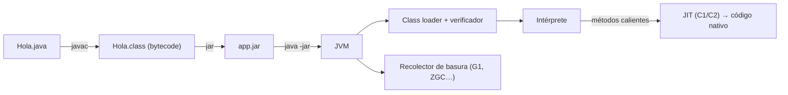

# Java - JVM, JDK y JRE

Parte de: [[15-Java/_Índice Java|Java]]

> [!info] Cómo avanzar
> `progreso`: **pendiente** → **viendo** (estudiando) → **visto** (contestaste la autoevaluación sin abrir las respuestas) → **dominado** (hiciste el laboratorio o lo aplicaste de verdad).

## Contenido

### Qué es
Java separa **el lenguaje** de **la plataforma que lo ejecuta**. Tu código `.java` se compila a **bytecode** (archivos `.class`), un formato intermedio que no es código máquina de ningún procesador. Ese bytecode lo ejecuta la **JVM** (*Java Virtual Machine*), que existe para Windows, Linux, macOS y varias arquitecturas. Por eso se dice "escribe una vez, ejecuta donde sea". Tres siglas aparecen siempre:

- **JVM**: la máquina virtual que carga el bytecode, lo verifica, lo interpreta y lo compila a código nativo con su **JIT**, y administra la memoria con el **recolector de basura** (GC).
- **JRE** (*Java Runtime Environment*): JVM + la biblioteca estándar (`java.lang`, `java.util`, `java.time`, `java.net`…). Lo necesario para **ejecutar** programas.
- **JDK** (*Java Development Kit*): JRE + herramientas de **desarrollo**: `javac` (compilador), `java` (lanzador), `jar` (empaquetador), `jshell` (consola interactiva), `jlink` (crear runtimes mínimos), `jpackage`, `javadoc`, `jcmd`, `jfr`.

Desde Java 11 ya no hay una descarga oficial de "JRE" separada: se instala el JDK, y si quieres un runtime pequeño para producción lo generas con `jlink` o usas una imagen de contenedor con solo el runtime.

### Cómo funciona


1. `javac` compila cada clase a un `.class`.
2. `jar` agrupa clases y recursos en un `.jar` (un ZIP con un manifiesto que puede indicar la clase `main`).
3. `java` arranca la JVM, que carga las clases bajo demanda, verifica el bytecode y empieza interpretándolo.
4. El JIT detecta los métodos que se ejecutan mucho y los compila a código nativo optimizado.
5. El GC libera los objetos que ya no se usan. G1 es el recolector por defecto en la JVM de servidor.

### Equivalencias con .NET
| Java | .NET | Comentario |
|---|---|---|
| JVM | CLR (runtime) | Ambos con JIT y GC |
| Bytecode (`.class`) | IL (CIL) | Código intermedio independiente de la CPU |
| `javac` | Compilador de C# (Roslyn) | |
| `.jar` | Ensamblado `.dll` | Un `.jar` agrupa muchas clases |
| JDK | .NET SDK | Compilar, probar, empaquetar |
| JRE / runtime de `jlink` | .NET Runtime / ASP.NET Core Runtime | Solo ejecutar |
| `jshell` | `dotnet-script` o el REPL de C# interactivo | Probar código rápido |
| GraalVM Native Image | Native AOT | Compilar a ejecutable nativo |

Una diferencia práctica: en .NET normalmente instalas un SDK y eliges el `TargetFramework`; en Java eliges una **distribución** del JDK (hay varios proveedores) y una **versión**.

### Versiones LTS
Java publica una versión nueva **cada seis meses** (marzo y septiembre). Algunas se designan **LTS** (*Long-Term Support*): los proveedores les dan años de actualizaciones de seguridad, mientras que las no-LTS solo reciben parches hasta que sale la siguiente versión. Las LTS han sido **8, 11, 17, 21 y 25** (Java 25 salió en septiembre de 2025). La versión más reciente es **Java 27**, publicada en septiembre de 2026, que **no** es LTS. Siguiendo el ritmo de una LTS cada dos años, la siguiente sería Java 29 (Pendiente de confirmar).

Para aprender y para proyectos nuevos, usa **la LTS más reciente que soporte tu framework** (revisa la matriz de compatibilidad de Spring Boot). Mucho código empresarial sigue en 17 o 21, y aún encontrarás sistemas en 8 u 11.

### Distribuciones gratuitas del JDK
Todas parten del código de **OpenJDK**; cambian el proveedor, las plataformas y la política de soporte:

- **Eclipse Temurin** (proyecto Adoptium): la opción neutral más usada.
- **Microsoft Build of OpenJDK**: buena opción si despliegas en Azure (App Service, Azure Container Apps) y para las imágenes de contenedor de Microsoft.
- **Amazon Corretto**, **Azul Zulu** (tiene ediciones gratuitas) y **Red Hat build of OpenJDK**.
- **OpenJDK de Oracle** en jdk.java.net: builds gratuitos, pero solo con parches durante los seis meses de cada versión.
- **Oracle JDK**: tiene su propia licencia; revisa las condiciones vigentes en la página de Oracle antes de usarlo en una empresa (Pendiente de confirmar los términos actuales).

### Ejemplo: comprobar tu instalación en Windows
```powershell
# Instalar Temurin 25 con winget (el id puede variar; búscalo con: winget search temurin)
winget install EclipseAdoptium.Temurin.25.JDK

java -version      # versión de la JVM
javac -version     # confirma que tienes el JDK y no solo un runtime
echo $env:JAVA_HOME
```

```java
// Hola.java
public class Hola {
    public static void main(String[] args) {
        System.out.println("JVM: " + System.getProperty("java.vm.name")
            + " " + Runtime.version());
    }
}
```

```powershell
javac Hola.java      # genera Hola.class
java Hola            # ejecuta
java Hola.java       # desde Java 11: compila en memoria y ejecuta un solo archivo
jshell               # consola interactiva: prueba expresiones sin crear clases
```

Si manejas varios JDK, herramientas como SDKMAN! (Linux/macOS/WSL) o configurar `JAVA_HOME` por proyecto en el IDE evitan sorpresas. En Azure DevOps, la tarea `JavaToolInstaller` o una imagen de agente con el JDK correcto fija la versión del pipeline.

### Cuándo usarlo y cuándo no
Siempre instalas un **JDK** para desarrollar; en producción, ejecuta con un runtime reducido o una imagen de contenedor ligera de la misma versión. Usa versiones no-LTS solo si estás dispuesto a actualizar cada seis meses.

### Errores comunes
- **Tener solo un runtime** y no encontrar `javac`: instala el JDK.
- **`JAVA_HOME` apuntando a otra versión** distinta a la del `PATH`: Maven y Gradle usan `JAVA_HOME`.
- **Compilar con una versión y ejecutar con otra más vieja**: `UnsupportedClassVersionError`. Fija `release` en el build.
- **Usar Oracle JDK sin revisar la licencia** en un entorno corporativo.
- **Quedarse en una versión sin soporte** (por ejemplo, una no-LTS vieja): sin parches de seguridad.

### Para profundizar
- [Eclipse Temurin (Adoptium)](https://adoptium.net/)
- [Microsoft Build of OpenJDK (Microsoft Learn)](https://learn.microsoft.com/java/openjdk/overview)
- [Proyecto OpenJDK y versiones](https://openjdk.org/)
- [Aprende Java en dev.java](https://dev.java/learn/)

## Autoevaluación

Contesta primero en voz alta o en papel; luego despliega la respuesta.

> [!question]- ¿Qué es cada uno: JVM, JRE y JDK?
> **JVM**: la máquina virtual que ejecuta bytecode (`.class`). **JRE**: JVM + librerías estándar para ejecutar programas. **JDK**: JRE + herramientas de desarrollo (`javac`, `jar`, `jshell`, `jlink`). Desde Java 11 ya no se distribuye un JRE separado oficial; se instala el JDK.

> [!question]- ¿Cuál es el equivalente en .NET?
> JVM ≈ CLR (runtime), bytecode ≈ IL, JDK ≈ .NET SDK, `javac` ≈ compilador de C# (Roslyn), JIT en ambos. `jar` ≈ ensamblado `.dll`.

> [!question]- ¿Qué es una versión LTS y cuáles conoces?
> Versión con soporte extendido. Las LTS recientes son Java 17, 21 y 25 (publicada en septiembre de 2025). Para empezar, usa la LTS más reciente que soporte tu framework.

> [!question]- ¿Qué distribución del JDK puedes usar gratis?
> Eclipse Temurin (Adoptium), Microsoft Build of OpenJDK, Amazon Corretto u OpenJDK de Oracle (jdk.java.net). Revisa la licencia del Oracle JDK antes de usarlo en una empresa (verificar en la página oficial).

## Práctica

- [[Lab 1 - Primer programa Java con javac, jar y jshell]]

