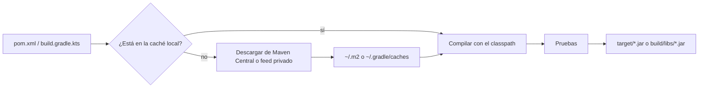

# Java - Maven y Gradle

Parte de: [[15-Java/_Índice Java|Java]]

> [!info] Cómo avanzar
> `progreso`: **pendiente** → **viendo** (estudiando) → **visto** (contestaste la autoevaluación sin abrir las respuestas) → **dominado** (hiciste el laboratorio o lo aplicaste de verdad).

## Contenido

### Qué es
**Maven** y **Gradle** son las dos herramientas de construcción (*build tools*) del mundo Java. Hacen lo que en .NET reparten el archivo `.csproj`, la CLI `dotnet` y NuGet: declarar las **dependencias** del proyecto y descargarlas, **compilar**, ejecutar **pruebas**, **empaquetar** (un `.jar`) y publicar. La diferencia entre ellas está en el estilo:

- **Maven** usa un archivo XML declarativo, `pom.xml` (*Project Object Model*), con una **convención estricta**: estructura de carpetas fija y un ciclo de vida de fases predefinido. Es predecible y fácil de leer.
- **Gradle** usa scripts en **Kotlin** (`build.gradle.kts`) o Groovy (`build.gradle`). Es más flexible y suele ser más rápido en builds grandes gracias a su caché y compilación incremental. Es la herramienta oficial de Android.

Ambas usan la misma estructura de carpetas: `src/main/java`, `src/main/resources`, `src/test/java`.

### Cómo funciona
#### Coordenadas y repositorios
Cada dependencia se identifica por **coordenadas** `groupId:artifactId:version`, por ejemplo `org.postgresql:postgresql:42.x`. Se descargan de **Maven Central** (el equivalente a nuget.org; ambas herramientas lo usan) a una **caché local**: `~/.m2/repository` en Maven y `~/.gradle/caches` en Gradle (en Windows, dentro de `C:\Users\<usuario>\`). Las empresas suelen tener un repositorio privado (Azure Artifacts soporta feeds Maven y Gradle, igual que feeds NuGet).



Las dependencias tienen **alcances** (*scopes*): `compile`/`implementation` (necesarias para compilar y ejecutar), `test`/`testImplementation` (solo pruebas, como un proyecto de pruebas en .NET), `runtime`/`runtimeOnly` (solo en ejecución, como un driver JDBC). Las dependencias **transitivas** se resuelven solas, igual que en NuGet.

#### Ciclo de vida de Maven
Maven ejecuta **fases** en orden; pedir una ejecuta todas las anteriores: `validate → compile → test → package → verify → install → deploy`. Así, `mvn package` compila, corre pruebas y genera el `.jar` en `target/`. `install` lo copia a tu caché local y `deploy` lo publica en un repositorio remoto. Gradle trabaja con **tareas** (`compileJava`, `test`, `jar`, `build`) que forman un grafo de dependencias.

#### El wrapper
`mvnw`/`mvnw.cmd` y `gradlew`/`gradlew.bat` son scripts que se guardan **en el repositorio** junto con un pequeño archivo de configuración que fija la **versión exacta** de Maven o Gradle. La primera vez la descargan y luego la usan. Ventajas: nadie necesita instalar la herramienta, todos (incluido el agente de Azure DevOps) compilan con la misma versión, y actualizarla es cambiar una línea. Es la idea de fijar el SDK con `global.json`. Usa siempre el wrapper en vez de un `mvn` o `gradle` instalado globalmente.

### Ejemplo: el mismo proyecto en ambos
Maven (`pom.xml`, recortado):

```xml
<project xmlns="http://maven.apache.org/POM/4.0.0">
  <modelVersion>4.0.0</modelVersion>
  <groupId>mx.itzamna</groupId>
  <artifactId>catalogo</artifactId>
  <version>1.0.0</version>
  <properties>
    <maven.compiler.release>25</maven.compiler.release>
  </properties>
  <dependencies>
    <dependency>
      <groupId>com.fasterxml.jackson.core</groupId>
      <artifactId>jackson-databind</artifactId>
      <version>2.18.2</version> <!-- versión de ejemplo (Pendiente de confirmar la vigente en Maven Central) -->
    </dependency>
    <dependency>
      <groupId>org.junit.jupiter</groupId>
      <artifactId>junit-jupiter</artifactId>
      <version>5.11.4</version> <!-- versión de ejemplo -->
      <scope>test</scope>
    </dependency>
  </dependencies>
</project>
```

Las versiones de los ejemplos son ilustrativas (Pendiente de confirmar las vigentes en Maven Central). Gradle con Kotlin DSL (`build.gradle.kts`):

```kotlin
plugins {
    java
}

java {
    toolchain { languageVersion = JavaLanguageVersion.of(25) } // Gradle consigue el JDK correcto
}

repositories { mavenCentral() }

dependencies {
    implementation("com.fasterxml.jackson.core:jackson-databind:2.18.2") // versión de ejemplo
    testImplementation("org.junit.jupiter:junit-jupiter:5.11.4")          // versión de ejemplo
    testRuntimeOnly("org.junit.platform:junit-platform-launcher")
}

tasks.test { useJUnitPlatform() }
```

En proyectos Spring Boot no escribes versiones de cada dependencia: el plugin o el *parent* de Spring Boot trae una lista de versiones compatibles (un BOM), parecido a un `Directory.Packages.props` centralizado.

### Equivalencias de comandos
| .NET | Maven | Gradle |
|---|---|---|
| `dotnet restore` | `./mvnw dependency:resolve` | `./gradlew dependencies` |
| `dotnet build` | `./mvnw compile` (o `package` para el `.jar`) | `./gradlew build` (compila, prueba y empaqueta) |
| `dotnet test` | `./mvnw test` | `./gradlew test` |
| `dotnet run` (Spring Boot) | `./mvnw spring-boot:run` | `./gradlew bootRun` |
| `dotnet publish` | `./mvnw package` → `target/*.jar` | `./gradlew bootJar` → `build/libs/*.jar` |
| `dotnet clean` | `./mvnw clean` | `./gradlew clean` |
| `dotnet list package --include-transitive` | `./mvnw dependency:tree` | `./gradlew dependencies` |

En Windows usa `mvnw.cmd` o `gradlew.bat` (en PowerShell, `.\mvnw`). Para saltar pruebas: `./mvnw package -DskipTests` o `./gradlew build -x test`.

### Cuándo usar cada uno
- **Maven**: equipos que valoran convención y legibilidad, la mayoría de proyectos empresariales y tutoriales de Spring; si empiezas, es el camino con menos sorpresas.
- **Gradle**: builds grandes con muchos módulos, necesidad de lógica personalizada, Android, o si prefieres Kotlin.

Spring Initializr ofrece ambos; elige uno por proyecto y no los mezcles.

### Errores comunes
- **No subir el wrapper al repositorio** (o sí subir `target/` y `build/`): agrégalos bien al `.gitignore`.
- **Versiones fijadas a mano en proyectos Spring Boot**: rompes la compatibilidad del BOM; deja que Spring Boot administre las versiones.
- **`JAVA_HOME` distinto al esperado**: compilas con otra versión; usa `release` o *toolchains*.
- **Credenciales del feed privado en el `pom.xml`**: van en `~/.m2/settings.xml` o variables del pipeline, nunca en el repositorio.
- **Ignorar conflictos de versiones transitivas**: revisa con `dependency:tree`.

### Para profundizar
- [Maven en 5 minutos (Apache Maven)](https://maven.apache.org/guides/getting-started/maven-in-five-minutes.html)
- [Introducción al ciclo de vida de Maven](https://maven.apache.org/guides/introduction/introduction-to-the-lifecycle.html)
- [Documentación de Gradle](https://docs.gradle.org/current/userguide/userguide.html)
- [Gradle Wrapper](https://docs.gradle.org/current/userguide/gradle_wrapper.html)

## Autoevaluación

Contesta primero en voz alta o en papel; luego despliega la respuesta.

> [!question]- ¿Qué son Maven y Gradle?
> Herramientas de construcción y manejo de dependencias. Maven usa `pom.xml` (declarativo, convención estricta); Gradle usa scripts en Groovy o Kotlin (`build.gradle(.kts)`), más flexible. Equivalen a `.csproj` + `dotnet` CLI + NuGet.

> [!question]- ¿Dónde se descargan las dependencias?
> De Maven Central (equivalente a nuget.org) a una caché local (`~/.m2/repository` en Maven, `~/.gradle/caches` en Gradle).

> [!question]- ¿Qué es el wrapper (`mvnw`, `gradlew`) y por qué usarlo?
> Un script en el repo que descarga y usa la versión exacta de Maven o Gradle del proyecto, así nadie necesita tenerla instalada y todos compilan igual (como fijar el SDK con `global.json`).

> [!question]- Comandos equivalentes a `dotnet build`, `dotnet test` y `dotnet run`.
> Maven: `./mvnw package`, `./mvnw test`, `./mvnw spring-boot:run`. Gradle: `./gradlew build`, `./gradlew test`, `./gradlew bootRun`.

## Práctica

- [[Lab 2 - API REST con Spring Boot, JPA y H2]]

