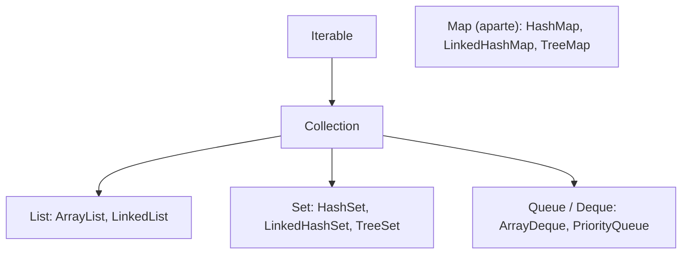

# Colecciones en Java (List, Set y Map)

Parte de: [[Java - colecciones y streams]]

> [!info] Cómo avanzar
> `progreso`: **pendiente** → **viendo** (estudiando) → **visto** (contestaste la autoevaluación sin abrir las respuestas) → **dominado** (hiciste el laboratorio o lo aplicaste de verdad).

## Contenido

### Qué es
El framework de colecciones de Java (`java.util`) es un conjunto de **interfaces** que definen comportamientos (`List`, `Set`, `Map`, `Queue`, `Deque`) y **clases** que los implementan con distintas estructuras de datos (`ArrayList`, `HashSet`, `HashMap`, `TreeMap`, `ArrayDeque`…). Es el equivalente de `System.Collections.Generic` en .NET. Todas son genéricas (`List<String>`) y solo guardan **objetos**, por lo que los primitivos se guardan como wrappers (`List<Integer>`).

### Cómo funciona
#### Las tres interfaces principales
- **`List<E>`**: secuencia **ordenada** que admite duplicados y acceso por índice (`get(i)`).
- **`Set<E>`**: **sin duplicados**; usa `equals` y `hashCode` (o un comparador) para decidir si dos elementos son iguales.
- **`Map<K,V>`**: pares **clave → valor** con claves únicas. Ojo: `Map` no hereda de `Collection`; para recorrerlo usas `keySet()`, `values()` o `entrySet()`.



#### Equivalencias con C#
| Java | C# | Notas |
|---|---|---|
| `ArrayList<T>` | `List<T>` | Arreglo dinámico; la opción por defecto |
| `LinkedList<T>` | `LinkedList<T>` | Rara vez conviene |
| `HashMap<K,V>` | `Dictionary<K,V>` | Sin orden garantizado |
| `LinkedHashMap<K,V>` | — (`OrderedDictionary` genérico en .NET 9) | Conserva el orden de inserción |
| `TreeMap<K,V>` | `SortedDictionary<K,V>` | Ordenado por clave |
| `HashSet<T>` | `HashSet<T>` | |
| `TreeSet<T>` | `SortedSet<T>` | |
| `ArrayDeque<T>` | `Queue<T>` y `Stack<T>` | Úsala en vez de la vieja clase `Stack` |
| `PriorityQueue<T>` | `PriorityQueue<T,P>` | |
| `ConcurrentHashMap<K,V>` | `ConcurrentDictionary<K,V>` | Para varios hilos |
| `List.of(...)` | `ImmutableList` / colección de solo lectura | No modificable |

#### Programar contra la interfaz
Se declara la variable con la **interfaz** y se crea con la **implementación**:

```java
List<String> nombres = new ArrayList<>();       // y no ArrayList<String> nombres
Map<String, Integer> existencias = new HashMap<>();
```

Así el resto del código depende solo del contrato. Si después necesitas orden de inserción, cambias a `new LinkedHashMap<>()` en una sola línea. Es lo mismo que recibir `IList<T>` o `IReadOnlyDictionary<K,V>` en C#. Los parámetros y valores de retorno de métodos también deben usar la interfaz. El operador diamante `<>` infiere los tipos genéricos del lado izquierdo.

#### `Map.get` devuelve `null`
Si la clave no existe, `map.get(clave)` devuelve **`null`**, no lanza excepción (en C#, el indexador de `Dictionary` lanza `KeyNotFoundException`). Si el valor es un wrapper y lo desempacas, obtienes un `NullPointerException` lejos del origen. Alternativas:

```java
int stock = existencias.getOrDefault("SKU-1", 0);           // valor por defecto
if (existencias.containsKey("SKU-1")) { ... }               // verificar antes
existencias.merge("SKU-1", 5, Integer::sum);                 // suma o inserta
existencias.computeIfAbsent("SKU-9", k -> 0);                // inserta si falta
Map<String, List<String>> porCliente = new HashMap<>();
porCliente.computeIfAbsent("Ana", k -> new ArrayList<>()).add("A-1"); // agrupar a mano
```

`merge` y `computeIfAbsent` sustituyen el patrón `TryGetValue` + asignación de C#.

### Ejemplo práctico
```java
import java.util.*;

public class Inventario {
    public static void main(String[] args) {
        List<String> movimientos = List.of("SKU-1", "SKU-2", "SKU-1", "SKU-3", "SKU-1");

        Set<String> distintos = new TreeSet<>(movimientos);       // ordenados y sin duplicados
        Map<String, Integer> conteo = new LinkedHashMap<>();
        for (String sku : movimientos) conteo.merge(sku, 1, Integer::sum);

        System.out.println(distintos);                     // [SKU-1, SKU-2, SKU-3]
        System.out.println(conteo);                        // {SKU-1=3, SKU-2=1, SKU-3=1}
        System.out.println(conteo.get("SKU-9"));           // null
        System.out.println(conteo.getOrDefault("SKU-9", 0)); // 0

        for (Map.Entry<String, Integer> e : conteo.entrySet()) {
            System.out.println(e.getKey() + " -> " + e.getValue());
        }

        List<String> pendientes = new ArrayList<>(movimientos);   // copia mutable
        pendientes.removeIf(s -> s.equals("SKU-1"));               // forma segura de quitar
        System.out.println(pendientes);                    // [SKU-2, SKU-3]
    }
}
```

### Modificar mientras recorres
Si quitas o agregas elementos a una colección dentro de un for-each sobre ella misma, el iterador detecta el cambio y lanza **`ConcurrentModificationException`** (C# lanza `InvalidOperationException` en el mismo caso). Soluciones:

- `lista.removeIf(condicion)`: la forma más clara.
- Un `Iterator` explícito y `it.remove()`.
- Recorrer una copia o construir una lista nueva (con streams: `filter(...).toList()`).

### Cuándo usar cada una
- `ArrayList` por defecto para listas; `HashMap` y `HashSet` por defecto para búsqueda.
- `LinkedHashMap`/`LinkedHashSet` si importa el orden de inserción (por ejemplo, columnas de un reporte).
- `TreeMap`/`TreeSet` si necesitas orden por clave o rangos (`headMap`, `ceilingKey`).
- `ArrayDeque` para pilas y colas.
- `List.of`/`Map.of` para datos fijos o para exponer colecciones sin permitir cambios.
- Para procesar y transformar, [[Streams en Java (map, filter y collect)]].

### Errores comunes
- **`ConcurrentModificationException`** al quitar en un for-each.
- **Asumir orden en `HashMap`/`HashSet`**: no está garantizado.
- **Objetos propios como clave sin `equals`/`hashCode`**: duplicados o búsquedas que fallan; usa records.
- **`list.remove(1)` en un `List<Integer>`**: quita el **índice** 1, no el valor 1; usa `remove(Integer.valueOf(1))`.
- **Desempacar el `null` de `map.get`**.

### Para profundizar
- [Colecciones y streams (dev.java)](https://dev.java/learn/api/collections-and-streams/)
- [Interfaz Map (Javadoc de Java 25)](https://docs.oracle.com/en/java/javase/25/docs/api/java.base/java/util/Map.html)
- [Interfaz List (Javadoc de Java 25)](https://docs.oracle.com/en/java/javase/25/docs/api/java.base/java/util/List.html)

## Autoevaluación

Contesta primero en voz alta o en papel; luego despliega la respuesta.

> [!question]- ¿Equivalencias con C#?
> `ArrayList` ≈ `List<T>`, `HashMap` ≈ `Dictionary<K,V>`, `HashSet` ≈ `HashSet<T>`, `LinkedList` ≈ `LinkedList<T>`, `ArrayDeque` ≈ `Queue<T>`/`Stack<T>`, `TreeMap` ≈ `SortedDictionary<K,V>`.

> [!question]- ¿Qué devuelve `map.get(clave)` si la clave no existe?
> `null` (no lanza excepción, a diferencia del indexador de `Dictionary` en C#). Usa `getOrDefault` o `containsKey`.

> [!question]- ¿Por qué se declara `List<String> l = new ArrayList<>();` y no `ArrayList<String>`?
> Programar contra la interfaz permite cambiar la implementación sin tocar el resto del código, igual que usar `IList<T>` en C#.

> [!question]- Error común: modificar una lista mientras se recorre con for-each.
> Lanza `ConcurrentModificationException`. Usa `removeIf` o un `Iterator` con `it.remove()`.

## Práctica

- [[Lab 3 - Colecciones y streams de Java comparados con LINQ]]

