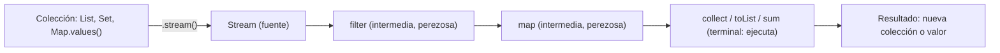

# Java - colecciones y streams

Parte de: [[15-Java/_Índice Java|Java]]

> [!info] Cómo avanzar
> `progreso`: **pendiente** → **viendo** (estudiando) → **visto** (contestaste la autoevaluación sin abrir las respuestas) → **dominado** (hiciste el laboratorio o lo aplicaste de verdad).

## Contenido

### Qué es
Para trabajar con conjuntos de datos, Java ofrece dos piezas que se complementan:

- El **framework de colecciones** (`java.util`): interfaces y estructuras para **guardar** datos en memoria. Las principales son `List` (secuencia ordenada con duplicados), `Set` (sin duplicados) y `Map` (pares clave-valor), con implementaciones como `ArrayList`, `HashSet` y `HashMap`. Es el equivalente de `System.Collections.Generic`. El detalle está en [[Colecciones en Java (List, Set y Map)]].
- La **API de streams** (`java.util.stream`, desde Java 8): una forma **declarativa** de **procesar** esos datos encadenando operaciones (`filter`, `map`, `sorted`, `collect`). Es lo más parecido a LINQ to Objects. El detalle está en [[Streams en Java (map, filter y collect)]].

Dicho corto: la colección es **dónde están** los datos; el stream es **qué haces** con ellos.

### Cómo funciona


1. Tienes una colección, por ejemplo `List<Pedido>`.
2. Llamas `.stream()` y obtienes un flujo de elementos. El stream **no guarda** datos ni modifica la colección original.
3. Encadenas operaciones **intermedias** (`filter`, `map`, `sorted`, `distinct`, `limit`), que son **perezosas**: solo describen el trabajo.
4. Una operación **terminal** (`toList()`, `collect(...)`, `count()`, `sum()`, `forEach`, `findFirst`) dispara la ejecución y produce el resultado.

#### Un stream se consume una sola vez
Un `Stream` es un recorrido de un solo uso: después de una operación terminal queda cerrado, y volver a usarlo lanza `IllegalStateException` ("stream has already been operated upon or closed"). Si necesitas procesar de nuevo, vuelve a llamar `.stream()` sobre la colección. Esto difiere de LINQ: un `IEnumerable<T>` se puede enumerar varias veces (y la consulta se vuelve a ejecutar cada vez, lo que a veces sorprende). En Java, si quieres reutilizar "la consulta", guárdala como un método o un `Supplier<Stream<T>>`.

```java
var activos = clientes.stream().filter(Cliente::activo);
long n = activos.count();
// activos.toList();  // IllegalStateException: el stream ya se consumió
var lista = clientes.stream().filter(Cliente::activo).toList(); // crea uno nuevo
```

#### Colecciones inmutables
Desde Java 9 existen fábricas `List.of(...)`, `Set.of(...)` y `Map.of(...)`, y desde Java 10 `List.copyOf(...)`. Crean colecciones **no modificables**: `add`, `remove` o `set` lanzan `UnsupportedOperationException`, y **no aceptan `null`** (lanzan `NullPointerException` al crearlas). Ventajas:

- Nadie puede cambiar por accidente una lista que expones desde un método o que guardas en un record.
- Son seguras para compartir entre hilos sin sincronización.
- Fallan temprano si se cuela un `null`.

`Stream.toList()` (Java 16) también devuelve una lista no modificable; `Collectors.toList()` devuelve una mutable (sin garantía de tipo). Es la misma idea que exponer `IReadOnlyList<T>` o usar `ImmutableList<T>` en .NET, pero aquí la inmutabilidad se comprueba en tiempo de ejecución, no en el tipo: `List.of(...)` sigue siendo una `List` con método `add`.

### Ejemplo: de colección a reporte
```java
import java.math.BigDecimal;
import java.util.*;
import java.util.stream.Collectors;

record Pedido(String folio, String cliente, String estado, BigDecimal total) {}

public class Reporte {
    public static void main(String[] args) {
        List<Pedido> pedidos = List.of(
            new Pedido("A-1", "Ana", "pagado", new BigDecimal("1200")),
            new Pedido("A-2", "Beto", "pendiente", new BigDecimal("300")),
            new Pedido("A-3", "Ana", "pagado", new BigDecimal("450")));

        // Colección para búsqueda rápida por folio
        Map<String, Pedido> porFolio = new HashMap<>();
        for (var p : pedidos) porFolio.put(p.folio(), p);

        // Stream para procesar: total pagado por cliente
        Map<String, BigDecimal> pagadoPorCliente = pedidos.stream()
            .filter(p -> p.estado().equals("pagado"))
            .collect(Collectors.groupingBy(Pedido::cliente,
                     Collectors.reducing(BigDecimal.ZERO, Pedido::total, BigDecimal::add)));

        System.out.println(porFolio.get("A-2").cliente()); // Beto
        System.out.println(pagadoPorCliente);              // {Ana=1650}
    }
}
```

En LINQ sería `pedidos.Where(p => p.Estado == "pagado").GroupBy(p => p.Cliente).ToDictionary(g => g.Key, g => g.Sum(p => p.Total))`.

### Cuándo usarlo y cuándo no
- Usa **colecciones** para guardar, buscar por clave (`Map`), evitar duplicados (`Set`) y mantener orden (`List`).
- Usa **streams** para transformar, filtrar, agrupar y agregar de forma legible.
- Un `for` clásico sigue siendo válido cuando necesitas salir temprano con lógica compleja, modificar varias estructuras a la vez o cuando el stream queda más confuso que el ciclo.
- Para datos que vienen de base de datos, filtra en la **consulta** (SQL o JPQL, ver [[JPA e Hibernate]]), no trayendo todo para filtrarlo con streams; es el mismo consejo que no hacer `ToList()` antes del `Where` en EF Core.

### Errores comunes
- **Reutilizar un stream**: `IllegalStateException`.
- **Intentar modificar `List.of(...)`**: `UnsupportedOperationException`. Si necesitas mutarla, `new ArrayList<>(List.of(...))`.
- **Meter `null` en `List.of`**: `NullPointerException`.
- **Efectos secundarios dentro de `map` o `filter`** (agregar a otra lista): usa `collect`.
- **Modificar la colección mientras la recorres** con for-each: `ConcurrentModificationException`; usa `removeIf`.

### Para profundizar
- [Colecciones y streams (dev.java)](https://dev.java/learn/api/collections-and-streams/)
- [Tutorial de colecciones (Oracle)](https://docs.oracle.com/javase/tutorial/collections/)
- [Paquete java.util.stream (Javadoc de Java 25)](https://docs.oracle.com/en/java/javase/25/docs/api/java.base/java/util/stream/package-summary.html)

## Subtemas

- [[Colecciones en Java (List, Set y Map)]]
- [[Streams en Java (map, filter y collect)]]

## Autoevaluación

Contesta primero en voz alta o en papel; luego despliega la respuesta.

> [!question]- ¿Qué ofrece el framework de colecciones y qué ofrecen los streams?
> Colecciones: estructuras para guardar datos (`List`, `Set`, `Map`). Streams: una API para procesarlos de forma declarativa (`filter`, `map`, `collect`), parecida a LINQ.

> [!question]- ¿Un stream se puede recorrer dos veces?
> No. Un stream se consume una sola vez; para volver a procesar debes crearlo de nuevo desde la colección. En LINQ, un `IEnumerable` sí se puede volver a enumerar (y se re-ejecuta).

> [!question]- ¿Qué ventaja tienen las colecciones inmutables `List.of(...)`?
> No se pueden modificar (lanzan `UnsupportedOperationException`) y no aceptan `null`, lo que evita cambios accidentales.

## Práctica

- [[Lab 3 - Colecciones y streams de Java comparados con LINQ]]

## Progreso de los subtemas

```base
filters:
  and:
    - file.inFolder("15-Java/Java - colecciones y streams")
    - file.name != "Java - colecciones y streams"
views:
  - type: table
    name: Progreso
    order:
      - file.name
      - progreso
      - nivel
```
