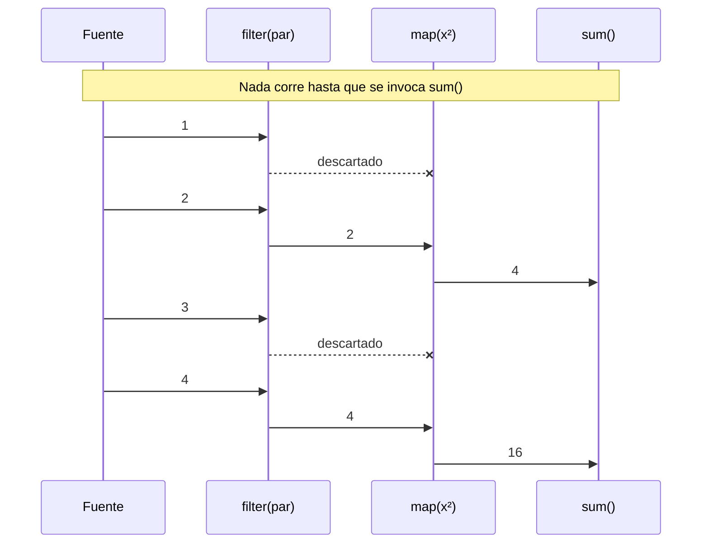

# Streams en Java (map, filter y collect)

Parte de: [[Java - colecciones y streams]]

> [!info] Cómo avanzar
> `progreso`: **pendiente** → **viendo** (estudiando) → **visto** (contestaste la autoevaluación sin abrir las respuestas) → **dominado** (hiciste el laboratorio o lo aplicaste de verdad).

## Contenido

### Qué es
La API de streams (`java.util.stream`, desde Java 8) permite **procesar secuencias de elementos de forma declarativa**: describes *qué* quieres (filtrar los pedidos pagados, tomar su total, sumarlos) encadenando operaciones, en vez de escribir ciclos con variables acumuladoras. Es el equivalente de **LINQ to Objects** en C#: `filter` ≈ `Where`, `map` ≈ `Select`, `collect`/`toList` ≈ `ToList`/`ToDictionary`. Un stream **no es una colección**: no guarda datos, no modifica la fuente y solo se puede recorrer una vez (ver [[Java - colecciones y streams]]).

### Cómo funciona
Un *pipeline* de stream tiene tres partes:

1. **Fuente**: `lista.stream()`, `Stream.of(...)`, `Arrays.stream(arreglo)`, `IntStream.range(0, 10)`, `Files.lines(ruta)`.
2. **Operaciones intermedias** (devuelven otro stream y son **perezosas**): `filter`, `map`, `flatMap`, `distinct`, `sorted`, `limit`, `skip`, `peek`, `mapToInt`.
3. **Operación terminal** (produce un resultado y **ejecuta** todo): `toList()`, `collect(...)`, `count()`, `sum()`, `forEach`, `reduce`, `anyMatch`, `findFirst`, `min`/`max`.

#### Ejecución perezosa
Mientras no haya una operación terminal, **no se ejecuta nada**: las intermedias solo arman la receta. Cuando llega la terminal, los elementos fluyen **uno por uno** por toda la cadena (no se crea una lista intermedia por cada paso), y operaciones como `limit`, `findFirst` o `anyMatch` pueden **cortar** el recorrido antes de procesar todo. Es el mismo modelo que la ejecución diferida de LINQ: `Where(...).Select(...)` no hace nada hasta `ToList()` o un `foreach`.



#### Streams de primitivos
`IntStream`, `LongStream` y `DoubleStream` evitan el *boxing* y traen `sum()`, `average()`, `max()`, `summaryStatistics()`. Pasas a ellos con `mapToInt`, `mapToLong`, `mapToDouble`, y regresas con `boxed()`.

#### Referencias a métodos
`Producto::nombre` es una referencia a método, una forma corta de la lambda `p -> p.nombre()`. Equivale a pasar un *method group* en C#. También existen `String::length`, `Integer::sum`, `ArrayList::new`.

### Ejemplos y su equivalente LINQ
```java
record Producto(String nombre, String categoria, BigDecimal precio) {}
```

| Objetivo | Java | C# (LINQ) |
|---|---|---|
| Filtrar y proyectar | `lista.stream().filter(p -> p.precio().compareTo(cien) > 0).map(Producto::nombre).toList()` | `lista.Where(p => p.Precio > 100).Select(p => p.Nombre).ToList()` |
| Suma de cuadrados de pares | `n.stream().filter(x -> x % 2 == 0).mapToInt(x -> x * x).sum()` | `n.Where(x => x % 2 == 0).Sum(x => x * x)` |
| Top 3 más caros | `.sorted(Comparator.comparing(Producto::precio).reversed()).limit(3).toList()` | `.OrderByDescending(p => p.Precio).Take(3).ToList()` |
| ¿Alguno agotado? | `.anyMatch(p -> p.precio().signum() == 0)` | `.Any(p => p.Precio == 0)` |
| Primero o nada | `.findFirst()` → `Optional<T>` | `.FirstOrDefault()` |
| Aplanar | `.flatMap(p -> p.etiquetas().stream())` | `.SelectMany(p => p.Etiquetas)` |
| Unir texto | `.map(Producto::nombre).collect(Collectors.joining(", "))` | `string.Join(", ", ...Select(...))` |

#### Agrupar con `Collectors.groupingBy`
`groupingBy` recibe la función que da la **clave** y, opcionalmente, un **colector descendente** que decide qué guardar por grupo:

```java
import static java.util.stream.Collectors.*;

// Palabras por longitud: Map<Integer, List<String>>
Map<Integer, List<String>> porLargo = palabras.stream().collect(groupingBy(String::length));

// Conteo por categoría: Map<String, Long>  ≈ GroupBy(...).ToDictionary(g => g.Key, g => g.Count())
Map<String, Long> cuantos = productos.stream().collect(groupingBy(Producto::categoria, counting()));

// Nombres por categoría, ordenado por categoría
Map<String, List<String>> nombres = productos.stream()
    .collect(groupingBy(Producto::categoria, TreeMap::new, mapping(Producto::nombre, toList())));

// Partir en dos grupos (true/false)
Map<Boolean, List<Producto>> caros = productos.stream()
    .collect(partitioningBy(p -> p.precio().compareTo(new BigDecimal("1000")) > 0));

// A Map simple: clave → valor (falla si hay claves repetidas, como ToDictionary)
Map<String, BigDecimal> precioPorNombre = productos.stream()
    .collect(toMap(Producto::nombre, Producto::precio));
```

Otros colectores descendentes útiles: `summingInt`, `averagingDouble`, `maxBy`, `reducing` (para `BigDecimal`), `toSet`.

#### `Optional`
`findFirst`, `min`, `max` y `reduce` sin identidad devuelven `Optional<T>`, un contenedor que puede estar vacío. En vez de comparar con `null`, usa `orElse(valor)`, `orElseThrow()`, `map(...)` o `ifPresent(...)`. En Spring, `repo.findById(id)` también devuelve `Optional` (ver [[Spring Boot - controladores REST]]).

### Cuándo usarlo y cuándo no
Úsalos para transformaciones y agregaciones legibles sobre colecciones en memoria: preparar DTOs, armar reportes, agrupar resultados. Prefiere un `for` cuando la lógica tiene muchas ramas, necesitas varios acumuladores a la vez, manejas excepciones verificadas dentro de la lambda (los streams no las admiten directamente) o el stream queda más difícil de leer. `parallelStream()` solo vale la pena con muchos datos y operaciones costosas sin estado compartido; mide antes de usarlo. Y si los datos vienen de una base de datos, filtra y agrupa **en la consulta** (ver [[JPA e Hibernate]]), no en memoria.

### Errores comunes
- **Olvidar la operación terminal**: el pipeline nunca corre (un `peek` con `println` no imprime nada).
- **Reutilizar un stream**: `IllegalStateException`.
- **Efectos secundarios en `map`/`filter`** (modificar listas externas): resultados frágiles, sobre todo en paralelo.
- **`toMap` con claves duplicadas**: `IllegalStateException`; pasa una función de fusión como tercer argumento.
- **`Collectors.toList()` contra `toList()`**: el segundo devuelve una lista no modificable.

### Para profundizar
- [Colecciones y streams (dev.java)](https://dev.java/learn/api/collections-and-streams/)
- [Paquete java.util.stream (Javadoc de Java 25)](https://docs.oracle.com/en/java/javase/25/docs/api/java.base/java/util/stream/package-summary.html)
- [Clase Collectors (Javadoc de Java 25)](https://docs.oracle.com/en/java/javase/25/docs/api/java.base/java/util/stream/Collectors.html)

## Ejercicios

Resuélvelos en papel o en la herramienta; la solución está plegada.

> [!question]- Dada `List<Integer> n = List.of(1,2,3,4,5,6)`, obtén la suma de los cuadrados de los pares.
> ```java
> int r = n.stream().filter(x -> x % 2 == 0).mapToInt(x -> x * x).sum(); // 4+16+36 = 56
> ```

> [!question]- Agrupa una lista de palabras por su longitud.
> ```java
> Map<Integer, List<String>> porLargo = palabras.stream()
>     .collect(Collectors.groupingBy(String::length));
> ```

> [!question]- Obtén los 3 productos más caros ordenados de mayor a menor.
> ```java
> var top = productos.stream()
>     .sorted(Comparator.comparing(Producto::precio).reversed())
>     .limit(3).toList();
> ```
> LINQ: `OrderByDescending(p => p.Precio).Take(3)`.

## Autoevaluación

Contesta primero en voz alta o en papel; luego despliega la respuesta.

> [!question]- Traduce a LINQ: `lista.stream().filter(p -> p.precio() > 100).map(Producto::nombre).toList();`
> `lista.Where(p => p.Precio > 100).Select(p => p.Nombre).ToList();`

> [!question]- ¿Cuándo se ejecuta un stream?
> Solo cuando hay una operación terminal (`collect`, `toList`, `count`, `forEach`). Las intermedias son perezosas, como en LINQ.

> [!question]- ¿Cómo agrupas con streams?
> `Collectors.groupingBy(Producto::categoria, Collectors.counting())`, equivalente a `GroupBy(...).ToDictionary(g => g.Key, g => g.Count())`.

## Práctica

- [[Lab 3 - Colecciones y streams de Java comparados con LINQ]]

