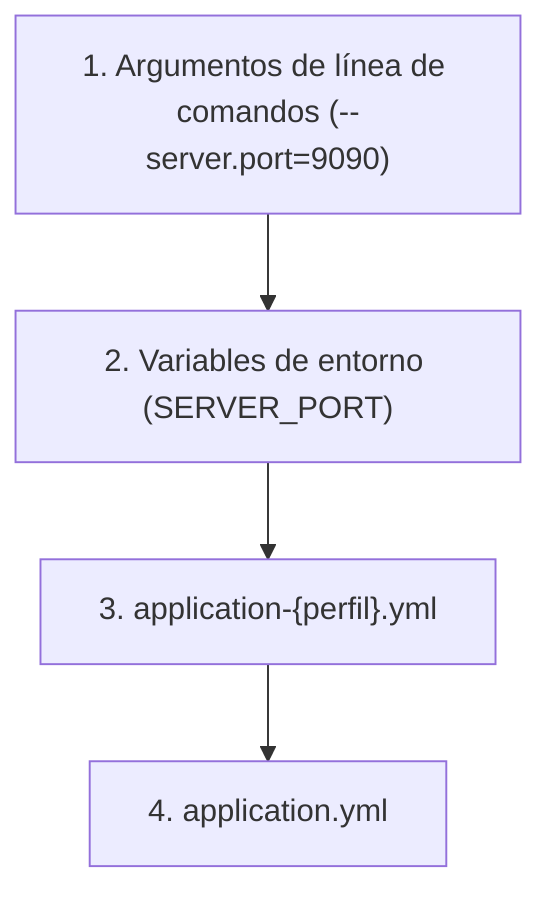

# Spring Boot - configuración y perfiles

Parte de: [[Spring Boot]]

> [!info] Cómo avanzar
> `progreso`: **pendiente** → **viendo** (estudiando) → **visto** (contestaste la autoevaluación sin abrir las respuestas) → **dominado** (hiciste el laboratorio o lo aplicaste de verdad).

## Contenido

### Qué es
La configuración externa de Spring Boot es el mecanismo para que la **misma aplicación compilada** se comporte distinto según el entorno (cadena de conexión, puerto, nivel de logs, URLs de servicios) sin cambiar código. Las propiedades se escriben en **`application.properties`** o **`application.yml`** dentro de `src/main/resources` —el equivalente de `appsettings.json`— y se pueden sobrescribir con archivos por **perfil**, variables de entorno o argumentos de línea de comandos. Un **perfil** es un nombre de entorno (`dev`, `test`, `prod`) que activa un conjunto de configuración y, si quieres, de beans.

### Cómo funciona
#### Formatos
```properties
# application.properties
server.port=8080
spring.datasource.url=jdbc:postgresql://localhost:5432/nomisma
logging.level.mx.itzamna=DEBUG
```

```yaml
# application.yml (lo mismo, en jerarquía)
server:
  port: 8080
spring:
  datasource:
    url: jdbc:postgresql://localhost:5432/nomisma
logging:
  level:
    mx.itzamna: DEBUG
```

Usa uno de los dos por proyecto. YAML es más legible con muchas propiedades anidadas.

#### Perfiles
Creas archivos `application-{perfil}.yml` (por ejemplo `application-dev.yml` y `application-prod.yml`). El archivo base siempre se carga y el del perfil activo se carga **encima**, sobrescribiendo lo que repita. El perfil se activa con:

- La propiedad `spring.profiles.active=dev` (en el archivo base para desarrollo local).
- La variable de entorno **`SPRING_PROFILES_ACTIVE=prod`** (lo habitual en servidores y contenedores).
- El argumento `--spring.profiles.active=prod` al ejecutar el `.jar`.

Es la misma idea que `appsettings.{Environment}.json` con `ASPNETCORE_ENVIRONMENT`. Con `@Profile("dev")` en un bean, este solo se registra cuando ese perfil está activo (por ejemplo, un notificador falso en desarrollo), como `if (env.IsDevelopment())` en `Program.cs`.

#### Orden de precedencia (simplificado)
Cuando la misma propiedad aparece en varios lugares, gana la fuente **más alta** de esta lista:



La lista completa tiene más niveles (propiedades del sistema de Java, archivos fuera del `.jar`, valores de prueba); la documentación oficial la detalla.

#### Variables de entorno y nombres "relajados"
Spring Boot aplica *relaxed binding*: una propiedad se puede escribir en formato de variable de entorno pasando a **mayúsculas**, cambiando **puntos por guiones bajos** y quitando guiones. Así, `spring.datasource.password` se define como **`SPRING_DATASOURCE_PASSWORD`**, y `app.correo.remitente` como `APP_CORREO_REMITENTE`. En .NET, el equivalente es `ConnectionStrings__Default` con doble guion bajo.

Esto es lo que permite cumplir la regla de **secretos fuera del repositorio** (ver [[Manejo de secretos]]): el archivo solo lleva valores no sensibles o referencias, y el secreto llega como variable de entorno desde el pipeline de Azure DevOps, la configuración de Azure App Service o un secreto de Azure Container Apps (idealmente respaldado en Azure Key Vault). También puedes referenciar variables dentro del archivo con marcadores: `password: ${DB_PASSWORD}` o con valor por defecto `${DB_PASSWORD:local}`.

### Ejemplo: configuración tipada
En vez de leer propiedades sueltas con `@Value("${app.correo.remitente}")`, agrúpalas en un record con `@ConfigurationProperties`, como el patrón Options de .NET (`IOptions<CorreoOptions>`):

```yaml
# application.yml
app:
  correo:
    remitente: no-responder@itzamna.mx
    reintentos: 3
spring:
  profiles:
    active: dev     # valor local; en servidores se sobrescribe con SPRING_PROFILES_ACTIVE
```

```yaml
# application-prod.yml (archivo aparte)
app:
  correo:
    reintentos: 5
spring:
  datasource:
    url: jdbc:postgresql://pg-prod.postgres.database.azure.com:5432/nomisma
    username: app_nomisma
    password: ${SPRING_DATASOURCE_PASSWORD}   # llega del entorno, nunca en el repo
```

```java
import jakarta.validation.constraints.*;
import org.springframework.boot.context.properties.ConfigurationProperties;
import org.springframework.validation.annotation.Validated;

@Validated
@ConfigurationProperties(prefix = "app.correo")
public record CorreoProperties(@NotBlank @Email String remitente, @Min(0) @Max(10) int reintentos) {}
```

```java
@SpringBootApplication
@ConfigurationPropertiesScan          // registra los @ConfigurationProperties del paquete
public class NomismaApplication { /* main */ }

@Service
class Notificaciones {
    private final CorreoProperties cfg;
    Notificaciones(CorreoProperties cfg) { this.cfg = cfg; } // inyectado como cualquier bean
}
```

Con `@Validated`, si falta `remitente` o tiene formato inválido, la aplicación **falla al arrancar** en lugar de fallar en producción a media operación (como `ValidateOnStart()` en .NET).

Ejecutarlo en producción:

```bash
export SPRING_PROFILES_ACTIVE=prod
export SPRING_DATASOURCE_PASSWORD='***'   # en Azure: configuración de la app o secreto
java -jar nomisma.jar
```

El *endpoint* de Actuator `/actuator/env` (protegido y no expuesto públicamente) o el arranque con `--debug` ayudan a ver qué valor ganó.

### Cuándo usarlo y cuándo no
Todo lo que cambia entre entornos va en configuración; lo que no cambia, en código. Usa perfiles para diferencias de entorno, no para "modos" de negocio (para eso, propiedades normales o *feature flags*). Evita multiplicar perfiles (`dev`, `dev2`, `qa-ana`): mantén pocos y usa variables de entorno para diferencias puntuales.

### Errores comunes
- **Secretos en `application-prod.yml`** dentro del repositorio: aunque sea privado, quedan en el historial de Git.
- **Nombre de variable de entorno mal formado** (`SPRING.DATASOURCE.PASSWORD` o con guiones): no se aplica. Mayúsculas y guiones bajos.
- **Activar perfiles en el archivo del perfil** (`spring.profiles.active` dentro de `application-prod.yml`): no está permitido; actívalos desde fuera.
- **Mezclar `.properties` y `.yml`** con la misma propiedad: confusión sobre cuál gana.
- **`@Value` regado por todo el código**: difícil de validar y de encontrar; agrupa con `@ConfigurationProperties`.

### Para profundizar
- [Configuración externa (referencia de Spring Boot)](https://docs.spring.io/spring-boot/reference/features/external-config.html)
- [Perfiles (referencia de Spring Boot)](https://docs.spring.io/spring-boot/reference/features/profiles.html)
- [Propiedades comunes de la aplicación (Spring Boot)](https://docs.spring.io/spring-boot/appendix/application-properties/index.html)

## Autoevaluación

Contesta primero en voz alta o en papel; luego despliega la respuesta.

> [!question]- ¿Dónde va la configuración?
> En `application.properties` o `application.yml` dentro de `src/main/resources`, equivalente a `appsettings.json`.

> [!question]- ¿Qué son los perfiles?
> Conjuntos de configuración por entorno: `application-dev.yml`, `application-prod.yml`, activados con `spring.profiles.active` o la variable `SPRING_PROFILES_ACTIVE`. Equivalen a `appsettings.{Environment}.json` + `ASPNETCORE_ENVIRONMENT`.

> [!question]- ¿Cómo sobrescribes una propiedad con una variable de entorno?
> Por relajación de nombres: `spring.datasource.password` se puede dar como `SPRING_DATASOURCE_PASSWORD`. Así los secretos no van en el archivo (ver [[Manejo de secretos]]).

## Práctica

- [[Lab 2 - API REST con Spring Boot, JPA y H2]]

