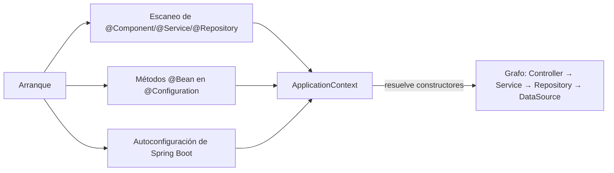

# Spring Boot - inyección de dependencias y beans

Parte de: [[Spring Boot]]

> [!info] Cómo avanzar
> `progreso`: **pendiente** → **viendo** (estudiando) → **visto** (contestaste la autoevaluación sin abrir las respuestas) → **dominado** (hiciste el laboratorio o lo aplicaste de verdad).

## Contenido

### Qué es
En Spring, un **bean** es un objeto que **crea, configura y administra el contenedor** de Spring (el `ApplicationContext`), en lugar de que tú lo instancies con `new`. Tus servicios, repositorios, controladores y clientes HTTP son beans. La **inyección de dependencias** (DI) es el mecanismo por el que el contenedor entrega a cada bean los otros beans que necesita. Es exactamente la idea de `IServiceCollection` + `IServiceProvider` de ASP.NET Core: registras tipos, el contenedor resuelve el grafo y controla el ciclo de vida.

### Cómo funciona
#### Registrar beans
Hay dos formas:

1. **Anotaciones de estereotipo** en tus clases, que el escaneo de componentes (`@ComponentScan`, incluido en `@SpringBootApplication`) detecta:
   - `@Component`: genérico.
   - `@Service`: lógica de negocio o casos de uso.
   - `@Repository`: acceso a datos (además traduce excepciones de persistencia a la jerarquía `DataAccessException`).
   - `@Controller` / `@RestController`: capa web.

   Las tres especializaciones funcionan igual que `@Component`; la diferencia es semántica (y el caso de `@Repository`).
2. **Métodos `@Bean`** dentro de una clase `@Configuration`, para objetos que no son tuyos (clases de bibliotecas) o que necesitan construcción especial. Es como `services.AddSingleton(sp => new Cliente(...))`.



#### Inyección por constructor (la recomendada)
Declaras las dependencias como parámetros del constructor y las guardas en campos `final`. Si la clase tiene **un solo constructor**, Spring lo usa automáticamente sin necesidad de `@Autowired`. Ventajas, las mismas que en .NET: dependencias explícitas, campos inmutables, objetos siempre completos y fáciles de probar con `new` y dobles de prueba, sin levantar Spring.

Existen la inyección por campo (`@Autowired private Repo repo;`) y por *setter*, pero se desaconsejan: ocultan dependencias, impiden `final` y obligan a usar reflexión en pruebas.

#### Varias implementaciones
Si hay dos beans del mismo tipo (dos `Notificador`), Spring no sabe cuál inyectar y falla al arrancar. Se resuelve con `@Primary` (el preferido), con `@Qualifier("correo")` en el parámetro, o inyectando `List<Notificador>` para recibirlos todos (como `IEnumerable<INotificador>` en .NET).

#### Ámbitos (ciclo de vida)
| Spring | Comportamiento | .NET |
|---|---|---|
| `singleton` (**por defecto**) | Una instancia por contenedor, creada al arrancar | `AddSingleton` |
| `prototype` | Instancia nueva cada vez que se pide | `AddTransient` |
| `request` | Una por petición HTTP | `AddScoped` (en web) |
| `session` | Una por sesión HTTP | — |

Ojo con la diferencia de *defaults*: en ASP.NET Core sueles registrar servicios como `Scoped`; en Spring **todo es singleton salvo que digas lo contrario**. Por eso un servicio Spring **no debe guardar estado por petición** en sus campos (el usuario actual, un carrito): todos los hilos comparten la misma instancia y tendrías condiciones de carrera y fugas de datos entre usuarios. El estado por petición va en parámetros, en el `SecurityContext` o en beans `@RequestScope`. Los recursos por transacción, como el `EntityManager`, Spring los maneja con proxies ligados al hilo.

### Ejemplo
```java
// Contrato
public interface Notificador {
    void enviar(String destino, String mensaje);
}

@Service
@Primary
class NotificadorCorreo implements Notificador {
    private final ClienteCorreo correo;   // otro bean tuyo
    NotificadorCorreo(ClienteCorreo correo) { this.correo = correo; }
    public void enviar(String destino, String mensaje) { correo.mandar(destino, mensaje); }
}

@Service
@Qualifier("sms")
class NotificadorSms implements Notificador {
    public void enviar(String destino, String mensaje) { /* proveedor SMS */ }
}

// Caso de uso: inyección por constructor, campos final, sin @Autowired
@Service
public class ConfirmarPedido {
    private final PedidoRepository pedidos;
    private final Notificador notificador;          // recibe el @Primary

    public ConfirmarPedido(PedidoRepository pedidos, Notificador notificador) {
        this.pedidos = pedidos;
        this.notificador = notificador;
    }

    public void ejecutar(long pedidoId) {
        var p = pedidos.findById(pedidoId).orElseThrow();
        p.confirmar();
        pedidos.save(p);
        notificador.enviar(p.getCorreoCliente(), "Tu pedido " + p.getFolio() + " está confirmado");
    }
}

// Bean de una clase de biblioteca: se registra con @Bean
@Configuration
class ClientesHttpConfig {
    @Bean
    java.net.http.HttpClient httpClient() {
        return java.net.http.HttpClient.newBuilder()
            .connectTimeout(java.time.Duration.ofSeconds(5))
            .build();
    }
}
```

Para una prueba unitaria no necesitas Spring: `new ConfirmarPedido(repoFalso, notificadorFalso)` con Mockito o implementaciones simples. Para pruebas de integración, `@SpringBootTest` levanta el contexto completo (como `WebApplicationFactory`).

Si te gusta tu regla de "una interfaz por consulta" del backend .NET, en Spring funciona igual: cada consulta es una interfaz con su implementación `@Repository` que usa `JdbcClient` y un archivo `.sql` en `resources`, y los casos de uso reciben solo las interfaces que necesitan.

### Cuándo usarlo y cuándo no
Todo lo que tenga dependencias o deba ser reemplazable en pruebas debe ser bean: servicios, repositorios, clientes externos. **No** conviertas en beans los objetos de datos (entidades, DTOs, records) ni utilidades puras sin estado (métodos estáticos bastan). Usa `@Configuration` + `@Bean` para clases que no puedes anotar.

### Errores comunes
- **Estado mutable en un singleton**: datos de un usuario visibles para otro.
- **Inyección por campo**: dependencias ocultas y pruebas difíciles.
- **Dos beans del mismo tipo sin `@Primary` ni `@Qualifier`**: `NoUniqueBeanDefinitionException` al arrancar.
- **Dependencias circulares** (A necesita B y B necesita A): Spring Boot las rechaza por defecto; rediseña separando responsabilidades.
- **Crear servicios con `new` dentro de otros beans**: se saltan el contenedor (sin transacciones, sin proxies, sin configuración).

### Para profundizar
- [Contenedor IoC de Spring Framework (referencia)](https://docs.spring.io/spring-framework/reference/core/beans.html)
- [Inyección de dependencias (Spring Framework)](https://docs.spring.io/spring-framework/reference/core/beans/dependencies/factory-collaborators.html)
- [Ámbitos de beans (Spring Framework)](https://docs.spring.io/spring-framework/reference/core/beans/factory-scopes.html)

## Autoevaluación

Contesta primero en voz alta o en papel; luego despliega la respuesta.

> [!question]- ¿Qué es un bean en Spring?
> Un objeto creado y administrado por el contenedor de Spring. Se registra con `@Component`, `@Service`, `@Repository`, `@Controller` o con métodos `@Bean` en una clase `@Configuration`.

> [!question]- ¿Cuál es la forma recomendada de inyectar?
> Por constructor (con un solo constructor ni siquiera hace falta `@Autowired`), igual que en ASP.NET Core.

> [!question]- ¿Cuál es el ciclo de vida por defecto de un bean y su equivalente en .NET?
> Singleton (una instancia por contenedor), como `AddSingleton`. Existen `prototype` (≈ `AddTransient`) y `request` (≈ `AddScoped` en web). Cuidado con guardar estado en servicios singleton.

## Práctica

- [[Lab 2 - API REST con Spring Boot, JPA y H2]]

