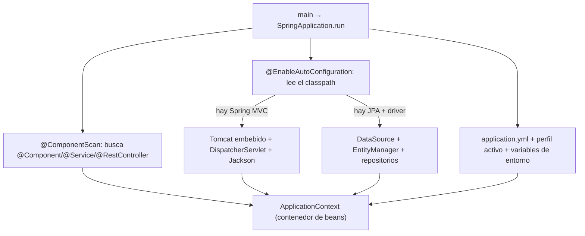

# Spring Boot

Parte de: [[15-Java/_Índice Java|Java]]

> [!info] Cómo avanzar
> `progreso`: **pendiente** → **viendo** (estudiando) → **visto** (contestaste la autoevaluación sin abrir las respuestas) → **dominado** (hiciste el laboratorio o lo aplicaste de verdad).

## Contenido

### Qué es
**Spring** es el framework empresarial más usado de Java: un contenedor de inyección de dependencias más módulos para web, datos, seguridad, mensajería y más. **Spring Boot** es la capa que lo vuelve práctico: arranca una aplicación Spring con **autoconfiguración** (configura sola lo que detecta en el classpath), un **servidor web embebido** (Tomcat por defecto, así que tu app es un `.jar` ejecutable, sin instalar un servidor aparte) y dependencias **"starter"** que traen paquetes compatibles entre sí. En la práctica es el equivalente de **ASP.NET Core** en el mundo Java: `Program.cs` + Kestrel + `IServiceCollection` + `appsettings.json` + middleware.

La línea actual es Spring Boot 4 (4.0 salió en noviembre de 2025 y 4.1 en junio de 2026), construida sobre Spring Framework 7 y Jakarta EE. Requiere Java 17 o superior; para proyectos nuevos usa la LTS más reciente que soporte (revisa la página de requisitos del sistema).

### Cómo funciona
#### Panorama de los subtemas
Spring Boot se apoya en tres ideas que verás en sus subtemas:

- **[[Spring Boot - inyección de dependencias y beans]]**: el contenedor crea y conecta los objetos (beans) de tu aplicación. Es la base de todo lo demás.
- **[[Spring Boot - controladores REST]]**: exponer endpoints HTTP con `@RestController`, mapear rutas, leer el cuerpo y validar.
- **[[Spring Boot - configuración y perfiles]]**: `application.yml`, perfiles por entorno y variables de entorno para secretos.

Y para datos, [[JPA e Hibernate]] con Spring Data JPA.



#### `@SpringBootApplication`
La clase principal lleva esta anotación, que **combina tres**:

- `@Configuration` (en concreto `@SpringBootConfiguration`): la clase puede declarar beans con métodos `@Bean`.
- `@EnableAutoConfiguration`: activa la autoconfiguración. Spring Boot revisa qué bibliotecas hay en el classpath y qué propiedades definiste, y registra beans por ti con reglas condicionales (`@ConditionalOnClass`, `@ConditionalOnMissingBean`). Si agregas el driver de PostgreSQL y `spring.datasource.url`, obtienes un `DataSource` con pool HikariCP sin escribir código. Si defines tu propio bean, la autoconfiguración se hace a un lado.
- `@ComponentScan`: busca componentes en el **paquete de esa clase y sus subpaquetes**. Por eso la clase principal va en el paquete raíz (`mx.itzamna.catalogo`) y lo demás debajo.

#### Starters
Un *starter* es una dependencia que agrupa todo lo necesario para una capacidad, con versiones probadas juntas: Spring Web MVC (`spring-boot-starter-webmvc` en Spring Boot 4; en versiones anteriores `spring-boot-starter-web`), `spring-boot-starter-data-jpa`, `spring-boot-starter-validation`, `spring-boot-starter-security`, `spring-boot-starter-actuator` (salud y métricas, como los health checks de ASP.NET Core), `spring-boot-starter-test`. Es como un metapaquete de NuGet con versiones centralizadas.

### Ejemplo: crear y arrancar un proyecto
1. Entra a **start.spring.io** (Spring Initializr), o usa el asistente de IntelliJ IDEA o de VS Code (Extension Pack for Java + Spring Boot Extension Pack). Elige Maven o Gradle, lenguaje Java, la versión de Spring Boot y de Java, el *group* (`mx.itzamna`) y el *artifact* (`catalogo`), y agrega dependencias: Spring Web, Validation, Spring Data JPA, H2 o PostgreSQL Driver.
2. Descarga el ZIP y ábrelo. La estructura:

```text
catalogo/
  mvnw, mvnw.cmd, pom.xml
  src/main/java/mx/itzamna/catalogo/CatalogoApplication.java
  src/main/resources/application.properties
  src/test/java/mx/itzamna/catalogo/CatalogoApplicationTests.java
```

```java
package mx.itzamna.catalogo;

import org.springframework.boot.SpringApplication;
import org.springframework.boot.autoconfigure.SpringBootApplication;
import org.springframework.web.bind.annotation.GetMapping;
import org.springframework.web.bind.annotation.RestController;

@SpringBootApplication
public class CatalogoApplication {
    public static void main(String[] args) {
        SpringApplication.run(CatalogoApplication.class, args); // como app.Run()
    }
}

@RestController
class SaludController {
    @GetMapping("/api/salud")
    String salud() { return "ok"; }
}
```

3. Ejecuta `./mvnw spring-boot:run` (o `.\mvnw.cmd spring-boot:run` en Windows) y abre `http://localhost:8080/api/salud`. Para producción, `./mvnw package` genera `target/catalogo-0.0.1-SNAPSHOT.jar`, que corres con `java -jar`. Ese `.jar` se empaqueta en una imagen de contenedor (con `./mvnw spring-boot:build-image` o un Dockerfile) y se publica en Azure Container Apps o Azure App Service, con un pipeline de Azure DevOps.

### Equivalencias rápidas con ASP.NET Core
| ASP.NET Core | Spring Boot |
|---|---|
| `WebApplication.CreateBuilder` + `app.Run()` | `SpringApplication.run` |
| Kestrel | Tomcat embebido (o Jetty, Undertow) |
| `builder.Services.Add…` | Beans con `@Service`, `@Component`, `@Bean` |
| Middleware | Filtros de servlet, `HandlerInterceptor` |
| `[ApiController]` | `@RestController` |
| `appsettings.json` | `application.properties` / `.yml` |
| Health checks | Actuator (`/actuator/health`) |
| ProblemDetails | `ProblemDetail` (soporte RFC 9457) |

### Cuándo usarlo y cuándo no
Spring Boot es la opción por defecto para APIs y servicios Java en empresas: ecosistema enorme, documentación abundante y mucha demanda laboral. Alternativas más ligeras y con arranque más rápido son Quarkus y Micronaut (populares para nativo con GraalVM). Para un script o una herramienta de línea de comandos, Spring Boot es demasiado.

### Errores comunes
- **Clase principal en un paquete "hermano"**: el escaneo no encuentra tus controladores y obtienes 404. Ponla en el paquete raíz.
- **No entender la autoconfiguración**: algo aparece "mágicamente" o falta. Ejecuta con `--debug` para ver el reporte de condiciones.
- **Fijar versiones de dependencias a mano**: rompe la compatibilidad que da Spring Boot.
- **Seguir tutoriales de Spring Boot 2** (`javax.*` en vez de `jakarta.*`): no compilan en versiones actuales.
- **Secretos en `application.properties`** dentro del repositorio: usa variables de entorno o Azure Key Vault.

### Para profundizar
- [Documentación de referencia de Spring Boot](https://docs.spring.io/spring-boot/index.html)
- [Spring Initializr](https://start.spring.io/)
- [Guías de Spring: construir un servicio REST](https://spring.io/guides/gs/rest-service/)
- [Spring Boot 4.1.0 (blog oficial)](https://spring.io/blog/2026/06/10/spring-boot-4/)

## Subtemas

- [[Spring Boot - inyección de dependencias y beans]]
- [[Spring Boot - controladores REST]]
- [[Spring Boot - configuración y perfiles]]

## Autoevaluación

Contesta primero en voz alta o en papel; luego despliega la respuesta.

> [!question]- ¿Qué es Spring Boot?
> Un framework sobre Spring que arranca aplicaciones con configuración automática, servidor embebido (Tomcat por defecto) y dependencias "starter". Es el equivalente práctico de ASP.NET Core en el mundo Java.

> [!question]- ¿Dónde generas un proyecto nuevo?
> En start.spring.io (Spring Initializr), desde el IDE o con la CLI de Spring. Eliges Maven o Gradle, versión de Java y starters como Spring Web y Spring Data JPA.

> [!question]- ¿Qué hace `@SpringBootApplication`?
> Combina `@Configuration`, `@EnableAutoConfiguration` y `@ComponentScan`: marca la clase principal, activa la autoconfiguración y busca componentes en su paquete y subpaquetes.

## Práctica

- [[Lab 2 - API REST con Spring Boot, JPA y H2]]

## Progreso de los subtemas

```base
filters:
  and:
    - file.inFolder("15-Java/Spring Boot")
    - file.name != "Spring Boot"
views:
  - type: table
    name: Progreso
    order:
      - file.name
      - progreso
      - nivel
```
