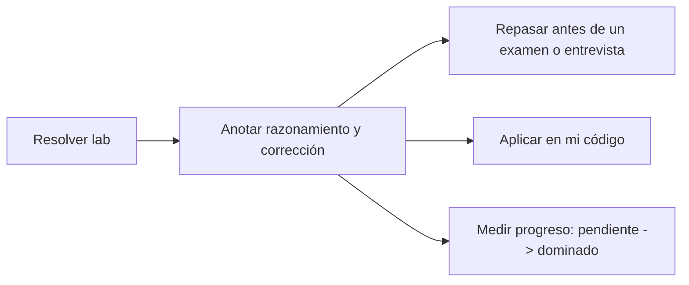

# Cómo llevar una bitácora de laboratorios resueltos

Parte de: [[16-Laboratorios-Practica/01 Laboratorios de seguridad/_Índice Laboratorios de seguridad|Laboratorios de seguridad]]

> [!info] Cómo avanzar
> `progreso`: **pendiente** → **viendo** (estudiando) → **visto** (contestaste la autoevaluación sin abrir las respuestas) → **dominado** (hiciste el laboratorio o lo aplicaste de verdad).

## Contenido

### Qué es
Una bitácora de laboratorios es un registro personal donde anotas, por cada laboratorio o reto que resuelves, **qué aprendiste y cómo se corrige** el problema, con tus propias palabras. No es una colección de soluciones copiadas: es tu memoria de aprendizaje, que te permite repasar, demostrar progreso y convertir la práctica en conocimiento aplicable a tu trabajo.

### Por qué llevarla


Sin bitácora, resuelves algo hoy y lo olvidas en una semana. Con ella, cada reto suma a un cuerpo de notas que puedes buscar y reutilizar.

### Qué anotar por laboratorio
Por cada lab, registra:

- **Fecha**, **plataforma** y **nombre** del lab.
- **Tema** o vulnerabilidad que cubre.
- **Cuánto tardaste** y si lo resolviste solo o con pistas.
- **Qué intentaste que no funcionó** (los callejones sin salida enseñan mucho).
- La **causa raíz**: por qué era vulnerable.
- La **corrección en tu stack**: cómo lo evitarías en C#, React o SQL.
- Un **enlace a la nota del tema** en esta bóveda.

### Por qué no copiar la solución completa
Dos razones:

1. **El valor está en tu razonamiento.** Copiar el *write-up* no te enseña a reproducirlo; escribir la causa y la defensa con tus palabras sí.
2. **Muchas plataformas lo prohíben.** [[OverTheWire]], [[Hack The Box]] (máquinas activas) y varios CTFs piden no publicar soluciones. Mantén la bitácora **privada** y guarda aprendizajes, no contraseñas ni banderas.

### Cómo encaja en esta bóveda
Usa la sección **"Notas personales"** de cada laboratorio para tu registro, y cambia la propiedad `progreso` de las notas de tema que el lab cubre a **`dominado`** cuando de verdad lo termines y lo entiendas. Así la bóveda refleja tu avance real, no solo lo que leíste.

### Ejemplo de entrada
```markdown
## 2026-11-10 — PortSwigger · SQL injection (UNION) — Practitioner
- Tema: [[SQL injection]] · 35 min · con 1 pista
- Qué intenté: contar columnas a ojo (falló); luego con ORDER BY.
- Causa raíz: la consulta concatena el parámetro de categoría.
- Corrección (mi stack): parámetro con Dapper + SQL en .sql.
  Ver [[SQL injection - consultas parametrizadas]].
- Progreso: subo [[SQL injection]] a "dominado".
```

### Cuándo usarla y cuándo no
Llévala siempre que practiques seguridad, SQL, redes o cualquier lab. Para notas de un solo paso tal vez baste una línea; para máquinas o retos largos, una entrada completa. No la conviertas en copia de soluciones: eso rompe reglas y no enseña.

### Errores comunes
- **Guardar la solución y no el razonamiento.** No aprendes y puedes violar reglas de la plataforma.
- **No anotar los intentos fallidos.** Suelen ser la parte más instructiva.
- **Olvidar la corrección en tu stack.** Sin eso, el lab no mejora tu código.
- **No actualizar `progreso`.** La bóveda deja de reflejar tu nivel real.

Un último consejo: revisa la bitácora cada cierto tiempo (por ejemplo, una vez al mes). Releer tus propias entradas refuerza lo aprendido y te muestra patrones: si varios labs distintos terminaron en la misma causa raíz (falta de validación, control de acceso en el cliente), ese es justo el tema que conviene reforzar en tu código y llevar primero a `dominado`.

### Para profundizar
- [OverTheWire: reglas (no publicar soluciones)](https://overthewire.org/information/)
- [Hack The Box: reglas y write-ups](https://help.hackthebox.com/)

## Autoevaluación

Contesta primero en voz alta o en papel; luego despliega la respuesta.

> [!question]- ¿Qué anotar por laboratorio?
> Fecha, plataforma y nombre del lab, tema, cuánto tardaste, qué intentaste que no funcionó, la causa raíz, la corrección en tu stack (C#, React, SQL) y un enlace a la nota del tema.

> [!question]- ¿Por qué no copiar la solución completa?
> Porque lo valioso es tu razonamiento; además, varias plataformas piden no publicar soluciones. Guarda la bitácora privada.

> [!question]- ¿Cómo encaja en esta bóveda?
> Usa la sección "Notas personales" de cada laboratorio y cambia `progreso` a `dominado` en las notas que cubre cuando lo termines.

