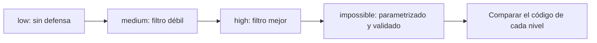

# DVWA

Parte de: [[16-Laboratorios-Practica/01 Laboratorios de seguridad/_Índice Laboratorios de seguridad|Laboratorios de seguridad]]

> [!info] Cómo avanzar
> `progreso`: **pendiente** → **viendo** (estudiando) → **visto** (contestaste la autoevaluación sin abrir las respuestas) → **dominado** (hiciste el laboratorio o lo aplicaste de verdad).

## Contenido

### Qué es
DVWA (Damn Vulnerable Web Application) es una aplicación web **deliberadamente vulnerable** escrita en PHP y MySQL. Es un clásico para practicar las vulnerabilidades web más comunes de forma controlada: inyección SQL, XSS reflejado y almacenado, inyección de comandos, CSRF, subida de archivos insegura e inclusión de archivos.

### Qué tiene de particular
Su rasgo distintivo es un **selector de nivel de seguridad**: *low*, *medium*, *high* e *impossible*. El mismo ejercicio cambia según el nivel, y puedes ver el código fuente de cada uno. Comparar el código *low* (vulnerable) con el *impossible* (bien hecho) es una de las mejores lecciones de defensa que ofrece: ves exactamente qué línea introduce el problema y cómo se corrige.



### Cómo empezar paso a paso
1. Levántala con Docker o con XAMPP, **solo en local**:

```bash
# Usa el repositorio oficial, que trae su propio archivo de Docker Compose
git clone https://github.com/digininja/DVWA.git
cd DVWA
docker compose up -d
```

2. Abre la dirección local que indica el README (revisa el puerto y que esté publicado solo en `127.0.0.1`), pulsa "Create / Reset Database" y entra con el usuario por defecto.
3. Ve a **DVWA Security** y empieza en nivel *low*.
4. Resuelve un ejercicio, luego sube el nivel y observa qué cambió en el código.
5. Anota en tu bitácora la diferencia entre *low* e *impossible* de cada tema.

Revisa en el repositorio oficial cómo levantarla, porque las imágenes de terceros pueden estar desactualizadas (verificar en la página oficial).

### Ejemplo
En el módulo de inyección SQL, el nivel *low* concatena la entrada en la consulta; el *impossible* usa sentencias preparadas con parámetros. Es el mismo principio que aplicas en Itzamna.Dionisio con Dapper y SQL parametrizado en archivos `.sql` (ver [[SQL injection - consultas parametrizadas]]).

### Cuándo usarlo y cuándo no
Úsala cuando quieras ver **el código** antes y después de la defensa, nivel por nivel; es su mayor ventaja didáctica. Para una app más moderna y variada, usa [[OWASP Juice Shop]]; para lecciones guiadas, [[OWASP WebGoat]]. DVWA sigue siendo útil por su simpleza y por el comparativo de niveles.

### Errores comunes
- **Dejarla accesible desde la red.** Con una base MySQL y usuarios por defecto, exponerla es un riesgo real.
- **Quedarse en nivel low.** El aprendizaje está en comparar los cuatro niveles.
- **No reiniciar la base.** Si algo se rompe, usa "Create / Reset Database".
- **Confundir el PHP vulnerable con buenas prácticas.** El código *low* es el ejemplo de lo que NO hacer.

Un consejo extra: trata DVWA como un "museo" de malas prácticas en PHP. Aunque no programes en PHP, leer el código vulnerable y su versión corregida te entrena el ojo para detectar los mismos patrones (concatenación de entradas, confianza ciega en el cliente, falta de validación) cuando revisas un pull request en C# o JavaScript. Resérvale una sesión por tema y compara siempre los cuatro niveles antes de pasar al siguiente.

### Para profundizar
- [DVWA en GitHub](https://github.com/digininja/DVWA)
- [OWASP Vulnerable Web Applications Directory](https://owasp.org/www-project-vulnerable-web-applications-directory/)

## Autoevaluación

Contesta primero en voz alta o en papel; luego despliega la respuesta.

> [!question]- ¿Qué es DVWA?
> Damn Vulnerable Web Application: una app en PHP y MySQL deliberadamente vulnerable para practicar inyección, XSS, subida de archivos, CSRF y más.

> [!question]- ¿Qué tiene de particular?
> Un selector de nivel de seguridad (low, medium, high, impossible). Comparar el código del nivel bajo con el "impossible" es una buena lección de defensa.

> [!question]- ¿Cuidados?
> Se instala con Docker o XAMPP; mantenla aislada de la red. Revisa en su repositorio oficial cómo levantarla, porque las imágenes de terceros pueden estar desactualizadas (verificar en la página oficial).

## Práctica

- [[Lab 1 - Laboratorio propio con Docker Compose y red aislada]]

