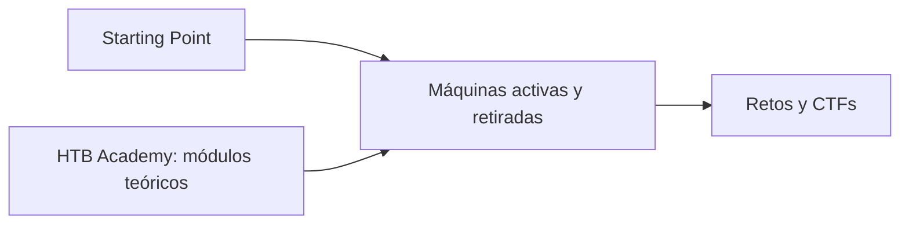

# Hack The Box

Parte de: [[16-Laboratorios-Practica/01 Laboratorios de seguridad/_Índice Laboratorios de seguridad|Laboratorios de seguridad]]

> [!info] Cómo avanzar
> `progreso`: **pendiente** → **viendo** (estudiando) → **visto** (contestaste la autoevaluación sin abrir las respuestas) → **dominado** (hiciste el laboratorio o lo aplicaste de verdad).

## Contenido

### Qué es
Hack The Box (HTB) es una plataforma de práctica ofensiva orientada a resolver **máquinas vulnerables** (boxes): servidores a los que debes entrar y escalar privilegios hasta capturar unas banderas. Es más tipo reto que tutorial: te dan la máquina y poca guía. Incluye varias partes: el laboratorio principal de máquinas, **Starting Point** para principiantes y **HTB Academy** con módulos teóricos.

### Qué ofrece

- **Máquinas**: Linux y Windows de dificultad variable; obtienes la bandera de usuario y la de root/administrador.
- **Starting Point**: una serie guiada que te lleva de la mano en las primeras máquinas.
- **HTB Academy**: cursos estructurados por tema, con su propio sistema de suscripción/créditos.
- **Retos** de web, cripto, forense e ingeniería inversa, y CTFs periódicos.

### Para qué nivel es
HTB es **más exigente que [[TryHackMe]]**. Conviene llegar con bases de Linux (por ejemplo tras [[OverTheWire]]), redes y seguridad web. Starting Point y HTB Academy sirven de puente para no estrellarte con las máquinas difíciles desde el día uno.

### Cómo empezar paso a paso
1. Crea tu cuenta y entra a **Starting Point**.
2. Conéctate por **VPN (OpenVPN)** a la red del laboratorio, o usa Pwnbox (máquina en el navegador, con límites en el plan gratuito).
3. Resuelve las máquinas de Starting Point en orden.
4. Cuando te sientas listo, pasa a las máquinas retiradas (hay write-ups oficiales para aprender) y luego a las activas.
5. Lleva bitácora de enumeración, vector de entrada y escalada.

### Ejemplo
Muchas máquinas entran por una app web mal configurada: un panel sin control de acceso, una subida de archivos insegura o credenciales por defecto. Cada una refuerza una defensa que aplicas en tus proyectos: control de acceso en el servidor, validación de archivos subidos, nada de secretos en el repo ([[Secretos en repositorios]]).

### Cuándo usarlo y cuándo no
Úsalo cuando ya tengas fundamentos y quieras practicar pentesting realista. Si empiezas de cero, TryHackMe es más amable. Para seguridad web específica, la PortSwigger Academy es gratuita y más enfocada. HTB brilla en la fase de enumeración y escalada de privilegios sobre sistemas completos.

### Cuidados
- **Parte del contenido es de pago** (suscripción o créditos); el alcance gratuito cambia (verificar en la página oficial).
- **Acceso por VPN**: estás en una red de laboratorio; desconéctate al terminar.
- **Nada fuera de la plataforma.** Usar lo aprendido contra sistemas ajenos sin autorización es ilegal ([[Marco legal y autorización por escrito]]).
- **No publiques write-ups de máquinas activas.** Las reglas lo prohíben hasta que se retiran.

Un consejo de ritmo: empieza por las **máquinas retiradas**, que tienen write-ups oficiales para aprender cuando te atores, y solo pasa a las activas cuando resuelvas varias sin mirar la solución. Combinar HTB Academy (teoría) con las máquinas (práctica) te da la mezcla que necesitas para no estrellarte.

### Para profundizar
- [Hack The Box](https://www.hackthebox.com/)
- [HTB Academy](https://academy.hackthebox.com/)

## Autoevaluación

Contesta primero en voz alta o en papel; luego despliega la respuesta.

> [!question]- ¿Qué ofrece?
> Máquinas vulnerables para resolver (más tipo reto que tutorial), "Starting Point" para principiantes y HTB Academy con módulos teóricos.

> [!question]- ¿Para qué nivel es?
> Es más exigente que TryHackMe; conviene llegar con bases de Linux, redes y web. Starting Point y Academy sirven de puente.

> [!question]- ¿Cuidados?
> Parte del contenido requiere suscripción o créditos (verificar en la página oficial). Las máquinas se acceden por VPN; nunca uses lo aprendido contra sistemas fuera de la plataforma.

