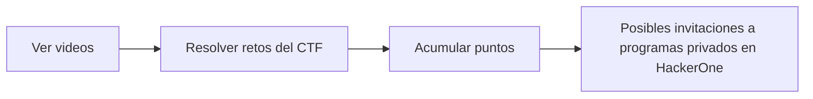

# Hacker101

Parte de: [[16-Laboratorios-Practica/01 Laboratorios de seguridad/_Índice Laboratorios de seguridad|Laboratorios de seguridad]]

> [!info] Cómo avanzar
> `progreso`: **pendiente** → **viendo** (estudiando) → **visto** (contestaste la autoevaluación sin abrir las respuestas) → **dominado** (hiciste el laboratorio o lo aplicaste de verdad).

## Contenido

### Qué es
Hacker101 es el programa educativo gratuito de **HackerOne**, una de las plataformas de bug bounty más grandes. Consiste en una serie de **videos** sobre seguridad web (desde fundamentos hasta temas avanzados) y un **CTF propio** con retos prácticos. Está pensado para quien quiere aprender a encontrar vulnerabilidades y, eventualmente, participar en programas de recompensas.

### Qué se practica ahí
Los videos cubren cómo funciona la web, los ataques más comunes (XSS, inyección, CSRF, SSRF), el uso de un proxy de interceptación y metodología de pruebas. El **CTF de Hacker101** ofrece retos agrupados por dificultad donde pones en práctica lo visto; al resolverlos acumulas puntos.

### Qué beneficio tiene el CTF

Además de practicar, juntar cierta cantidad de puntos (flags) puede dar **invitaciones a programas privados de bug bounty** en HackerOne (verificar en la página oficial). Es una vía para pasar del aprendizaje a la caza real de fallos con permiso.

### Cómo empezar paso a paso
1. Entra al sitio de Hacker101 y mira los videos de fundamentos en orden.
2. Crea una cuenta para el CTF.
3. Empieza por los retos de nivel fácil; usa un proxy como [[Burp Suite Community]] para interceptar peticiones.
4. Anota la técnica de cada reto resuelto en tu bitácora.
5. Cuando tengas base, lee sobre [[Programas de bug bounty]] antes de probar contra objetivos reales.

### Ejemplo
Un reto típico esconde una falla de control de acceso en un endpoint. La lección: en tu API, cada endpoint sensible valida permiso del lado del servidor, nunca solo oculta el botón en el front. Es el mismo principio que cuidas en Itzamna.Dionisio con autorización por recurso.

### Cuándo usarlo y cuándo no
Úsalo si te interesa el bug bounty o quieres material en video gratuito para entender seguridad web. Para una teoría más ordenada y exhaustiva, combínalo con la [[PortSwigger Web Security Academy]]. El CTF es ideal como puente hacia programas reales.

### Qué cuidado aplica
El CTF de Hacker101 es **legal**: los retos existen para ser resueltos. Lo que cambia son los **programas de bug bounty**: cada uno tiene su propio *scope* (alcance) y reglas que debes leer **antes** de probar nada. Salirte del alcance, aunque sea con buena intención, puede ser ilegal (ver [[Programas de bug bounty]] y [[Marco legal y autorización por escrito]]).

### Errores comunes
- **Probar en un dominio real creyendo que "es de HackerOne".** Solo el alcance declarado del programa está autorizado.
- **Saltarse los videos.** El CTF supone que conoces las técnicas.
- **No leer las reglas del programa.** Cada uno define qué está permitido y qué no.

Un apunte sobre la transición: antes de tu primer programa real de bug bounty, dedica tiempo a entender el **alcance** (qué dominios y qué tipos de prueba se permiten) y el proceso de reporte responsable. Hacker101 te prepara técnicamente, pero la diferencia entre investigador y problema legal está en respetar ese alcance al pie de la letra.

### Para profundizar
- [Hacker101](https://www.hacker101.com/)
- [Hacker101 CTF](https://ctf.hacker101.com/)
- [HackerOne](https://www.hackerone.com/)

## Autoevaluación

Contesta primero en voz alta o en papel; luego despliega la respuesta.

> [!question]- ¿Qué es Hacker101?
> El programa educativo gratuito de HackerOne: videos sobre seguridad web y un CTF propio.

> [!question]- ¿Qué beneficio tiene el CTF?
> Además de practicar, al juntar puntos puedes recibir invitaciones a programas privados de bug bounty en HackerOne (verificar en la página oficial).

> [!question]- ¿Qué cuidado aplica?
> El CTF es legal; los programas de bug bounty tienen reglas y alcance propios que debes leer antes de probar (ver [[Programas de bug bounty]]).

