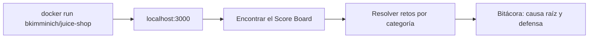

# OWASP Juice Shop

Parte de: [[16-Laboratorios-Practica/01 Laboratorios de seguridad/_Índice Laboratorios de seguridad|Laboratorios de seguridad]]

> [!info] Cómo avanzar
> `progreso`: **pendiente** → **viendo** (estudiando) → **visto** (contestaste la autoevaluación sin abrir las respuestas) → **dominado** (hiciste el laboratorio o lo aplicaste de verdad).

## Contenido

### Qué es
OWASP Juice Shop es una tienda web **insegura a propósito**, mantenida por la fundación OWASP y escrita en Node.js con un front en Angular. Es uno de los proyectos de aplicaciones vulnerables más completos: tiene decenas de retos que cubren el [[OWASP Top 10]] y muchas categorías más (control de acceso, criptografía, XSS, inyección, lógica de negocio). Está pensada para aprender atacando una app realista, en tu propia máquina.

### Qué se practica ahí
Cada reto es un objetivo concreto (acceder a un panel que no deberías, encontrar datos ocultos, saltarte una validación). El primer reto, de hecho, es **encontrar el Score Board**, un tablero oculto que lista todos los retos con su dificultad y pistas. A partir de ahí trabajas por categorías y vas marcando lo resuelto. Como es una app completa, te enfrentas a cosas que un lab aislado no muestra: flujos de compra, carrito, perfiles de usuario, subida de archivos.

### Cómo funciona


La app guarda tu progreso en el navegador. No necesitas conexión a internet una vez descargada la imagen.

### Cómo empezar paso a paso
1. Instala Docker Desktop (gratuito para uso personal; verificar sus condiciones de licencia).
2. Levántala **solo en tu equipo**, publicando el puerto en `127.0.0.1`:

```bash
# Descarga y ejecuta la imagen oficial, accesible solo desde tu máquina
docker run --rm -p 127.0.0.1:3000:3000 bkimminich/juice-shop
```

3. Abre `http://localhost:3000` y busca el Score Board.
4. Empieza por los retos de 1 estrella; usa las pistas del tablero si te atoras.
5. Anota cada reto resuelto en tu bitácora ([[Cómo llevar una bitácora de laboratorios resueltos]]).

Si prefieres tener Juice Shop, DVWA y WebGoat juntos en una red aislada, revisa [[Cómo montar un laboratorio propio con Docker y red aislada]] y su [[Lab 1 - Laboratorio propio con Docker Compose y red aislada]].

### Ejemplo
Un reto típico de control de acceso te pide ver el carrito o los datos de otro usuario cambiando un identificador. La lección para tu trabajo: en Itzamna.Dionisio toda operación sobre un recurso debe validar que el recurso pertenece al usuario del token, no solo que el token es válido (ver [[Control de acceso roto e IDOR]]).

### Cuándo usarlo y cuándo no
Úsala cuando quieras una app realista y variada en local, sin límites de tiempo ni de sesión. Si prefieres lecciones guiadas paso a paso, [[OWASP WebGoat]] explica más; Juice Shop es más tipo reto. Para seguir una teoría ordenada por tema, combínala con la [[PortSwigger Web Security Academy]].

### Errores comunes
- **Exponerla a la red.** Es vulnerable a propósito: publicarla sin el `127.0.0.1:` deja la app abierta a cualquiera en tu Wi-Fi. Nunca la despliegues en un servidor público.
- **Usar una imagen de terceros desactualizada.** Usa la imagen oficial `bkimminich/juice-shop`.
- **Resolver sin anotar.** El valor está en la causa raíz y la defensa, no en marcar retos.
- **Frustrarse con los retos de 6 estrellas.** Son difíciles a propósito; empieza por los de 1 y 2.

### Para profundizar
- [OWASP Juice Shop (sitio del proyecto)](https://owasp.org/www-project-juice-shop/)
- [Pwning OWASP Juice Shop (guía oficial gratuita)](https://pwning.owasp-juice.shop/)
- [Imagen en Docker Hub](https://hub.docker.com/r/bkimminich/juice-shop)

## Autoevaluación

Contesta primero en voz alta o en papel; luego despliega la respuesta.

> [!question]- ¿Qué es?
> Una tienda web deliberadamente insegura de OWASP, escrita en Node.js y Angular, con decenas de retos que cubren el [[OWASP Top 10]] y más.

> [!question]- ¿Cómo se usa?
> Localmente con Docker: `docker run --rm -p 127.0.0.1:3000:3000 bkimminich/juice-shop` y abrir `http://localhost:3000`. El primer reto es encontrar el Score Board, que lista todos los retos con pistas.

> [!question]- ¿Qué cuidados tiene?
> Publícalo solo en `127.0.0.1` o en una red aislada: es vulnerable a propósito. No lo despliegues en un servidor público.

## Práctica

- [[Lab 1 - Laboratorio propio con Docker Compose y red aislada]]

