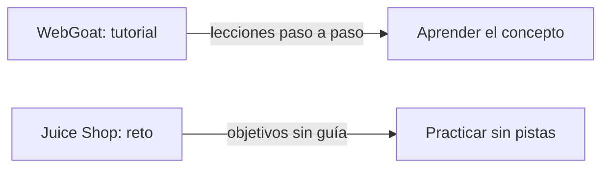

# OWASP WebGoat

Parte de: [[16-Laboratorios-Practica/01 Laboratorios de seguridad/_Índice Laboratorios de seguridad|Laboratorios de seguridad]]

> [!info] Cómo avanzar
> `progreso`: **pendiente** → **viendo** (estudiando) → **visto** (contestaste la autoevaluación sin abrir las respuestas) → **dominado** (hiciste el laboratorio o lo aplicaste de verdad).

## Contenido

### Qué es
OWASP WebGoat es una aplicación insegura a propósito, mantenida por OWASP y escrita en **Java con Spring Boot**. A diferencia de otras, está organizada como un **curso guiado**: cada lección explica una vulnerabilidad, te pide explotarla en un ejercicio dentro de la misma página y, en varias, también corregirla. Es un buen punto de entrada para entender el porqué de cada ataque antes de enfrentarte a retos más abiertos.

### Qué se practica ahí
Lecciones sobre inyección SQL, XSS, control de acceso, deserialización insegura, XXE, JWT, criptografía débil y más, cada una con teoría breve y un ejercicio interactivo. Trae también **WebWolf**, un compañero que simula el lado del atacante (servidor para recibir datos, correo de prueba) para lecciones que lo necesitan.

### En qué se diferencia de Juice Shop


[[OWASP Juice Shop]] es más tipo CTF: te da un objetivo y poca guía. WebGoat te lleva de la mano. Muchos empiezan por WebGoat para entender y luego pasan a Juice Shop para practicar sin ayuda.

### Cómo empezar paso a paso
1. Levántala con Docker (imagen oficial) **solo en local**:

```bash
# Expone WebGoat (8080) y WebWolf (9090) solo en tu máquina
docker run --rm -p 127.0.0.1:8080:8080 -p 127.0.0.1:9090:9090 webgoat/webgoat
```

2. Abre `http://localhost:8080/WebGoat`, crea un usuario local y entra.
3. Sigue las lecciones en orden dentro de cada categoría.
4. En las lecciones que piden corregir, fíjate en el patrón de defensa y anótalo en tu bitácora.

También puedes correrla con el `.jar` si tienes el JDK; revisa su repositorio para la versión vigente (verificar en la página oficial).

### Ejemplo
La lección de JWT muestra qué pasa cuando el servidor acepta un token con algoritmo `none` o no valida la firma. Trasládalo a Xolotl.Hecate: los tokens se firman con RS256 y el API **siempre** valida firma, emisor, audiencia y expiración; nunca confía en el `header alg` enviado por el cliente (ver [[JWT y autenticación con Bearer]]).

### Cuándo usarlo y cuándo no
Úsalo cuando quieras entender un tema a fondo con guía, sobre todo si te sientes verde en una categoría. Si ya tienes base y quieres retarte, pasa a Juice Shop o a los Practitioner de PortSwigger. Al ser Java, también te sirve para ver que estas vulnerabilidades no dependen del lenguaje.

### Errores comunes
- **Exponerlo a la red.** Igual que Juice Shop, publícalo solo en `127.0.0.1`.
- **Saltarse WebWolf.** Algunas lecciones no se pueden terminar sin él.
- **Usar una imagen vieja.** Usa la oficial `webgoat/webgoat` y revisa la versión en el repo.
- **Leer sin hacer el ejercicio.** El clic en "explotar" y "corregir" es donde se fija el concepto.

Un detalle útil: como WebGoat corre sobre Java y Spring, verás que una misma vulnerabilidad (por ejemplo una inyección o un control de acceso roto) aparece igual que en tu stack .NET; el lenguaje cambia, el principio de defensa no. Eso lo hace un buen recordatorio de que estas fallas son de diseño, no de un framework en particular.

### Para profundizar
- [OWASP WebGoat (sitio del proyecto)](https://owasp.org/www-project-webgoat/)
- [Repositorio e instrucciones](https://github.com/WebGoat/WebGoat)
- [Imagen en Docker Hub](https://hub.docker.com/r/webgoat/webgoat)

## Autoevaluación

Contesta primero en voz alta o en papel; luego despliega la respuesta.

> [!question]- ¿Qué es WebGoat?
> Una aplicación de OWASP en Java (Spring Boot) con lecciones guiadas: explica la vulnerabilidad, te pide explotarla en un ejercicio y a veces corregirla.

> [!question]- ¿En qué se diferencia de Juice Shop?
> WebGoat es más tutorial (lecciones paso a paso); Juice Shop es más tipo reto (CTF) con menos guía.

> [!question]- ¿Cómo se levanta?
> Con Docker (imagen oficial `webgoat/webgoat`) o con el `.jar`. Ejecútalo solo en local (verificar en la página oficial).

## Práctica

- [[Lab 1 - Laboratorio propio con Docker Compose y red aislada]]

