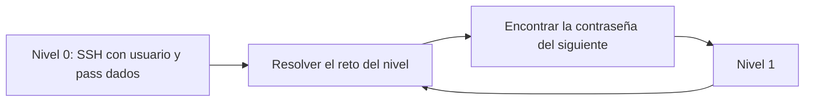

# OverTheWire

Parte de: [[16-Laboratorios-Practica/01 Laboratorios de seguridad/_Índice Laboratorios de seguridad|Laboratorios de seguridad]]

> [!info] Cómo avanzar
> `progreso`: **pendiente** → **viendo** (estudiando) → **visto** (contestaste la autoevaluación sin abrir las respuestas) → **dominado** (hiciste el laboratorio o lo aplicaste de verdad).

## Contenido

### Qué es
OverTheWire es una colección de **wargames** gratuitos que se juegan por SSH desde una terminal. Cada juego es una serie de niveles encadenados: en cada nivel resuelves un pequeño reto y, al hacerlo, obtienes la contraseña del nivel siguiente. Es una de las formas más amenas de aprender Linux, la línea de comandos y conceptos de seguridad, sin instalar nada más que un cliente SSH.

### Qué se practica ahí
El juego de entrada, **Bandit**, enseña lo esencial de Linux: comandos básicos, navegación de archivos, permisos, búsqueda de archivos y contenido, tuberías y redirección, redes básicas (`nc`, `ssh`, `openssl`) y hasta Git. Juegos posteriores (Natas para web, Leviathan, Krypton para cripto, Narnia para binarios) suben la dificultad hacia web y explotación de bajo nivel.

### Cómo funciona


### Cómo empezar paso a paso
1. Abre una terminal (en Windows, usa WSL, Git Bash o PowerShell con `ssh`).
2. Conéctate al nivel 0 de Bandit con los datos que publica el sitio:

```bash
# El puerto y la contraseña inicial vienen en la página de Bandit
ssh bandit0@bandit.labs.overthewire.org -p 2220
```

3. Lee el reto de cada nivel en la web, resuélvelo en la terminal y consigue la contraseña del siguiente.
4. Anota **qué comando aprendiste** en cada nivel, no la contraseña.

### Ejemplo
Un nivel típico te pide encontrar, entre miles, el único archivo con cierto tamaño y permisos. Resolverlo te enseña a combinar `find` con filtros:

```bash
# Buscar archivos de 1033 bytes, propiedad de un usuario y grupo dados
find / -type f -size 1033c -user bandit7 -group bandit6 2>/dev/null
```

Ese dominio de `find`, permisos y tuberías es justo lo que necesitas para moverte con soltura en un servidor Linux de despliegue o en [[Oracle Cloud - Always Free]].

### Cuándo usarlo y cuándo no
Úsalo para ganar fluidez en Linux y terminal, que es base para todo lo demás (redes, nube, contenedores). Es gratuito y no requiere cuenta. Para seguridad web específicamente, combínalo con la [[PortSwigger Web Security Academy]] o [[TryHackMe]]. No es un entorno guiado: si quieres lecciones con teoría, empieza por otro lado.

### Errores comunes
- **Publicar soluciones.** Las reglas piden no compartir contraseñas ni soluciones de los niveles.
- **Anotar contraseñas en vez de aprendizajes.** Guarda el comando y el concepto, no el secreto.
- **Rendirse al primer atasco.** El reto es googlear el `man` del comando correcto; esa búsqueda es parte del aprendizaje.
- **Saltarse Bandit.** Los juegos avanzados suponen que ya dominas la terminal.

Un apunte práctico: lleva abierto a un lado el manual del comando que uses (`man find`, `man grep`) y resuelve cada nivel entendiendo *por qué* funciona, no solo copiando la línea. Esa fluidez con la terminal es la base para moverte en un servidor de despliegue, en un contenedor o en una instancia de [[Oracle Cloud - Always Free]], así que el tiempo invertido en Bandit rinde mucho más allá de la seguridad.

### Para profundizar
- [OverTheWire: Wargames](https://overthewire.org/wargames/)
- [Bandit (juego de entrada)](https://overthewire.org/wargames/bandit/)
- [man find (documentación de find)](https://man7.org/linux/man-pages/man1/find.1.html)

## Autoevaluación

Contesta primero en voz alta o en papel; luego despliega la respuesta.

> [!question]- ¿Qué es OverTheWire?
> Una colección de "wargames" gratuitos que se juegan por SSH. Cada nivel te da la contraseña del siguiente.

> [!question]- ¿Por dónde empezar?
> Por **Bandit**, que enseña comandos de Linux, permisos, búsqueda de archivos, redes básicas y Git.

> [!question]- ¿Qué cuidado tiene?
> Las reglas piden no publicar soluciones de los niveles. Anota lo que aprendiste en tu bitácora, no las contraseñas.

