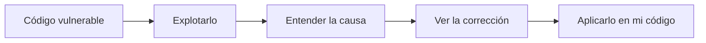

# PentesterLab

Parte de: [[16-Laboratorios-Practica/01 Laboratorios de seguridad/_Índice Laboratorios de seguridad|Laboratorios de seguridad]]

> [!info] Cómo avanzar
> `progreso`: **pendiente** → **viendo** (estudiando) → **visto** (contestaste la autoevaluación sin abrir las respuestas) → **dominado** (hiciste el laboratorio o lo aplicaste de verdad).

## Contenido

### Qué es
PentesterLab es una plataforma de ejercicios de seguridad web muy centrada en **entender el código y la mecánica** de las vulnerabilidades. En lugar de solo "captura la bandera", muchos de sus ejercicios muestran el código vulnerable, te hacen explotarlo y te explican la corrección. Tiene una fama especial por sus ejercicios de **revisión de código** y de **JWT**.

### Qué se practica ahí
Rutas (badges) por tema: fundamentos web, inyección, serialización, JWT y criptografía, revisión de código fuente en varios lenguajes, y temas más avanzados. El enfoque de "aquí está el código, encuentra y arregla el fallo" lo hace particularmente útil para desarrolladores, no solo para pentesters.

### Por qué le interesa a un desarrollador

Al trabajar con el código a la vista, lo que aprendes se traslada directo a tu día a día: reconocer en un *pull request* el patrón que abre un JWT a manipulación o una deserialización a ejecución de código. Para alguien que trabaja con Xolotl.Hecate (JWT RS256, PKCE), los ejercicios de JWT son oro.

### ¿Es gratis?
Tiene **algunos ejercicios gratuitos**, pero la mayor parte del contenido está en el **plan PRO de pago** (precio: Pendiente de confirmar). Antes de pagar, aprovecha lo gratuito y compáralo con alternativas sin costo como la [[PortSwigger Web Security Academy]].

### Cómo empezar paso a paso
1. Crea una cuenta gratuita.
2. Empieza por los ejercicios gratuitos de la ruta de fundamentos web.
3. Para cada ejercicio: explota el fallo, lee la explicación y **escribe la corrección** en tu bitácora.
4. Si te interesa JWT o revisión de código a fondo, evalúa el plan PRO.

### Ejemplo
En un ejercicio de JWT aprendes por qué el servidor nunca debe confiar en el campo `alg` del token ni aceptar `none`. Esto refuerza cómo validas tokens en tu API: firma RS256 verificada contra la llave pública, más emisor, audiencia y expiración (ver [[JWT y autenticación con Bearer]]).

### Cuándo usarlo y cuándo no
Úsalo cuando quieras profundizar en revisión de código y en JWT con material muy técnico. Si buscas algo gratuito y amplio, PortSwigger cubre más sin costo. PentesterLab destaca cuando ya tienes base y quieres el ángulo de "código vulnerable y su arreglo".

### Errores comunes
- **Pagar antes de agotar lo gratuito.** Prueba primero los ejercicios sin costo y las alternativas gratuitas.
- **Quedarse en la explotación.** El valor para ti está en la corrección del código.
- **No trasladarlo a tu stack.** Reescribe la defensa en C#/JavaScript aunque el ejercicio esté en otro lenguaje.

Un enfoque útil para desarrolladores: por cada ejercicio, abre a un lado la nota del tema en esta bóveda (por ejemplo [[JWT y autenticación con Bearer]]) y anota en qué línea de *tu* código podría aparecer el mismo fallo. Así el ejercicio deja de ser un reto aislado y se convierte en una revisión preventiva de tus proyectos.

### Para profundizar
- [PentesterLab](https://pentesterlab.com/)
- [Ejercicios (badges)](https://pentesterlab.com/exercises)

## Autoevaluación

Contesta primero en voz alta o en papel; luego despliega la respuesta.

> [!question]- ¿Qué es PentesterLab?
> Una plataforma de ejercicios de seguridad web muy enfocada en entender el código y las vulnerabilidades (incluye muchos ejercicios de revisión de código y de JWT).

> [!question]- ¿Es gratis?
> Tiene algunos ejercicios gratuitos; la mayor parte está en el plan PRO de pago (verificar en la página oficial).

> [!question]- ¿Por qué le interesa a un desarrollador?
> Porque muchos ejercicios muestran el código vulnerable y la corrección, lo que se traslada directo a tu trabajo diario.

