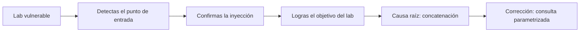

# PortSwigger - laboratorios de SQL injection

Parte de: [[16-Laboratorios-Practica/01 Laboratorios de seguridad/_Índice Laboratorios de seguridad|Laboratorios de seguridad]]

> [!info] Cómo avanzar
> `progreso`: **pendiente** → **viendo** (estudiando) → **visto** (contestaste la autoevaluación sin abrir las respuestas) → **dominado** (hiciste el laboratorio o lo aplicaste de verdad).

## Contenido

### Qué es
Es el bloque de laboratorios de la [[PortSwigger Web Security Academy]] dedicado a la inyección SQL: aplicaciones que insertan lo que escribe el usuario dentro de una consulta sin parametrizar, y que puedes explotar de forma legal para entender el riesgo. La teoría del tema explica el ataque y la defensa; los labs te obligan a verlo con tus manos. La nota conceptual del ataque está en [[SQL injection]].

### Qué cubren
De menor a mayor dificultad, los labs recorren las variantes clásicas:

- Manipular un filtro de la cláusula `WHERE` para ver registros que no deberías.
- Saltarse un inicio de sesión aprovechando una consulta de autenticación vulnerable.
- Ataques **UNION** para extraer datos de otras tablas.
- Inyección **ciega**: booleana (la respuesta cambia según una condición) y basada en tiempo (la respuesta tarda si la condición es verdadera).
- Variantes según el motor (SQL Server, Oracle, MySQL, PostgreSQL), porque la sintaxis de funciones y de comentarios cambia.

### Cómo funciona el aprendizaje


Lo importante no es el payload, sino el patrón: **el dato del usuario terminó siendo tratado como código SQL**. La corrección siempre es la misma familia de ideas: parámetros, procedimientos con parámetros y mínimo privilegio en la cuenta de base de datos.

### Cómo empezar paso a paso
1. Lee la teoría de SQL injection en la Academy.
2. Instala [[Burp Suite Community]]: para los niveles altos usarás el **Repeater** para repetir y ajustar una petición.
3. Resuelve primero los Apprentice; luego los Practitioner de UNION y ciega.
4. Por cada lab, escribe en tu bitácora: dónde entraba el dato, por qué funcionó y **cómo quedaría la consulta corregida** en tu stack.

### Ejemplo: de la causa raíz a la corrección en Dapper
En lugar de concatenar, en Itzamna.Dionisio toda consulta va parametrizada y el SQL vive en un archivo `.sql`:

```sql
-- BuscarClientesPorNombre.sql
SELECT ClienteId, Nombre, Correo
FROM   dbo.Clientes
WHERE  Nombre LIKE '%' + @Nombre + '%';
```

```csharp
// El valor viaja como parámetro; nunca se concatena en la cadena SQL.
var clientes = await conn.QueryAsync<Cliente>(
    sql, new { Nombre = filtro }); // Dapper lo manda como @Nombre
```

Así el motor trata `@Nombre` como dato, no como parte de la consulta. Para SQL dinámico dentro de procedimientos, se usa `sp_executesql` con parámetros y `QUOTENAME` para identificadores.

### Cuándo usarlo y cuándo no
Son el mejor camino para entender por qué la parametrización no es opcional. Si ya dominas la teoría, pasa directo a los Practitioner. No practiques estas técnicas contra ningún sistema real sin autorización por escrito ([[Marco legal y autorización por escrito]]); las instancias del lab existen justamente para eso.

### Errores comunes
- **Quedarse en el payload.** El objetivo es la causa raíz y la corrección, no coleccionar cadenas.
- **Creer que un ORM te salva siempre.** EF Core protege con LINQ, pero `FromSqlRaw` concatenado vuelve a ser vulnerable (ver [[SQL injection - EF Core (FromSqlRaw vs FromSqlInterpolated)]]).
- **Ignorar la inyección ciega.** Es la más común en producción y la que más cuesta detectar a ojo.
- **No bajar privilegios.** Aunque parametrices, la cuenta de la app no debería ser `db_owner` ([[SQL injection - mínimo privilegio en la cuenta de base de datos]]).

### Para profundizar
- [SQL injection (Web Security Academy)](https://portswigger.net/web-security/sql-injection)
- [Todos los labs de SQL injection](https://portswigger.net/web-security/all-labs#sql-injection)
- [OWASP: SQL Injection Prevention Cheat Sheet](https://cheatsheetseries.owasp.org/cheatsheets/SQL_Injection_Prevention_Cheat_Sheet.html)

## Autoevaluación

Contesta primero en voz alta o en papel; luego despliega la respuesta.

> [!question]- ¿Qué cubren estos laboratorios?
> Inyección en la cláusula WHERE, salto de inicio de sesión, ataques UNION, inyección ciega booleana y por tiempo, y variantes por tipo de base de datos.

> [!question]- ¿Cómo los aprovechas como desarrollador?
> Para cada lab, escribe la causa raíz y la consulta corregida con parámetros. Ver [[Lab 4 - PortSwigger - laboratorios de SQL injection nivel Apprentice]] y [[SQL injection]].

> [!question]- ¿Qué herramienta necesitas?
> Un navegador y, para los niveles altos, [[Burp Suite Community]] (Repeater). Algunos labs avanzados mencionan funciones de la versión Professional, pero suelen poder resolverse a mano.

