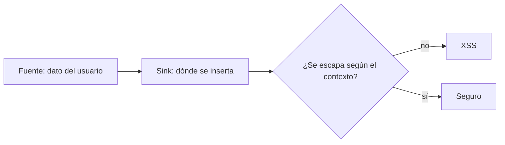

# PortSwigger - laboratorios de XSS

Parte de: [[16-Laboratorios-Practica/01 Laboratorios de seguridad/_Índice Laboratorios de seguridad|Laboratorios de seguridad]]

> [!info] Cómo avanzar
> `progreso`: **pendiente** → **viendo** (estudiando) → **visto** (contestaste la autoevaluación sin abrir las respuestas) → **dominado** (hiciste el laboratorio o lo aplicaste de verdad).

## Contenido

### Qué es
Es el bloque de laboratorios de la [[PortSwigger Web Security Academy]] sobre **Cross-Site Scripting (XSS)**: aplicaciones que reflejan o guardan datos del usuario y los mandan al navegador sin escapar, de modo que un atacante logra ejecutar JavaScript en la sesión de otra persona. Son instancias creadas para ser atacadas legalmente. La nota conceptual está en [[XSS]].

### Qué cubren
Los labs recorren los tres tipos y los contextos donde aparecen:

- **Reflejado**: el dato vuelve en la respuesta de inmediato (por ejemplo, en un buscador).
- **Almacenado**: el dato se guarda (un comentario) y afecta a quien lo vea después.
- **Basado en DOM**: el JavaScript del propio front toma un dato de una fuente (como la URL) y lo escribe en un *sink* peligroso sin sanear.
- Distintos **contextos de inserción**: dentro de HTML, de un atributo o de un bloque de JavaScript, cada uno con su forma de escapar.
- **Evasión de filtros y de CSP**, y casos con frameworks.

### Cómo funciona el aprendizaje


La clave que debes extraer de cada lab: **cuál era la fuente, en qué sink terminó y qué codificación o API lo habría evitado**. Eso es lo que anotas, no el payload.

### Cómo empezar paso a paso
1. Lee la teoría de XSS en la Academy.
2. Empieza por los Apprentice de reflejado y almacenado; luego el de DOM.
3. Por cada lab anota: fuente, sink/contexto, por qué funcionó y la defensa (escape por contexto, `textContent` en vez de `innerHTML`, CSP).
4. Repite el patrón en tu código de Itzamna.Clio.

### Ejemplo: la defensa en React
React escapa por defecto el contenido que pones entre llaves, así que la mayoría del XSS almacenado no ocurre si no te sales de ese camino. El riesgo aparece al insertar HTML crudo:

```jsx
// Peligroso si 'comentario' viene del usuario: inserta HTML sin escapar.
<div dangerouslySetInnerHTML={{ __html: comentario }} />

// Seguro: React escapa el texto automáticamente.
<div>{comentario}</div>
```

En JavaScript sin framework, el equivalente es preferir `elemento.textContent = dato` sobre `elemento.innerHTML = dato` (ver [[XSS - textContent vs innerHTML]]), y apoyarte en una [[Content Security Policy]] como segunda línea de defensa.

### Cuándo usarlo y cuándo no
Son ideales para entender por qué el escape depende del contexto y por qué los frameworks ayudan pero no bastan. Practica aquí y no en sitios ajenos: probar XSS en una página real sin autorización es ilegal ([[Marco legal y autorización por escrito]]). La instancia del lab existe para ser atacada.

### Errores comunes
- **Confiar ciegamente en el framework.** `dangerouslySetInnerHTML`, `v-html` o construir DOM a mano reabren la puerta.
- **Escapar en el contexto equivocado.** Lo que sirve dentro de HTML no sirve dentro de un atributo o de JavaScript.
- **Olvidar el XSS en DOM.** No pasa por el servidor, así que un filtro de backend no lo ve.
- **Guardar sin sanear "porque se escapa al mostrar".** Si en algún punto se renderiza como HTML, estalla.

### Para profundizar
- [Cross-site scripting (Web Security Academy)](https://portswigger.net/web-security/cross-site-scripting)
- [Todos los labs de XSS](https://portswigger.net/web-security/all-labs#cross-site-scripting)
- [OWASP: XSS Prevention Cheat Sheet](https://cheatsheetseries.owasp.org/cheatsheets/Cross_Site_Scripting_Prevention_Cheat_Sheet.html)

## Autoevaluación

Contesta primero en voz alta o en papel; luego despliega la respuesta.

> [!question]- ¿Qué cubren?
> XSS reflejado, almacenado y basado en DOM en distintos contextos (HTML, atributos, JavaScript), evasión de filtros y CSP, y casos con frameworks.

> [!question]- ¿Qué anotar en cada uno?
> Fuente del dato, sink o contexto, por qué funcionó y qué API o codificación lo evita. Ver [[Lab 6 - PortSwigger - laboratorios de XSS nivel Apprentice]] y [[XSS]].

> [!question]- ¿Por qué practicar aquí y no en un sitio real?
> Porque es legal y seguro: la instancia existe para ser atacada. Probar XSS en sitios ajenos sin autorización es ilegal (ver [[Marco legal y autorización por escrito]]).

