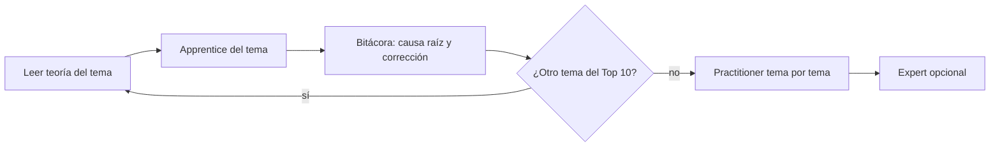

# PortSwigger - ruta recomendada (Apprentice, Practitioner y Expert)

Parte de: [[16-Laboratorios-Practica/01 Laboratorios de seguridad/_Índice Laboratorios de seguridad|Laboratorios de seguridad]]

> [!info] Cómo avanzar
> `progreso`: **pendiente** → **viendo** (estudiando) → **visto** (contestaste la autoevaluación sin abrir las respuestas) → **dominado** (hiciste el laboratorio o lo aplicaste de verdad).

## Contenido

### Qué es
Los laboratorios de la [[PortSwigger Web Security Academy]] están clasificados en tres niveles de dificultad. Entender qué significa cada uno te ayuda a planear el avance y a no frustrarte con labs que todavía no te tocan.

- **Apprentice**: el caso de libro de cada vulnerabilidad. La app no tiene defensas; el objetivo es entender el mecanismo. Se resuelven en minutos una vez leída la teoría.
- **Practitioner**: casos realistas. Hay filtros parciales, varios pasos encadenados o hay que descubrir dónde está el punto vulnerable. Aquí está el grueso del aprendizaje y es el nivel que pide la certificación BSCP.
- **Expert**: escenarios difíciles con defensas que hay que evadir, combinaciones de técnicas y poca guía. Son opcionales para un desarrollador.

### Cómo funciona la progresión

La idea es ir **a lo ancho primero y luego a lo profundo**: conocer el Apprentice de los temas principales antes de profundizar en uno solo. La Academy publica además rutas de aprendizaje sugeridas que ordenan los temas (consulta su página).

### Cómo empezar paso a paso
1. Haz una lista de los temas prioritarios para tu trabajo con APIs .NET y React: SQL injection, XSS, control de acceso, autenticación, CSRF, CORS, JWT y SSRF.
2. Para cada uno: teoría completa, todos los Apprentice y nota en tu bitácora.
3. Cuando termines esa vuelta, regresa al primer tema y ataca los Practitioner.
4. Define un **límite de tiempo** por lab (por ejemplo 30 minutos). Si lo pasas, relee la teoría y usa las pistas; la solución completa es el último recurso.
5. Lleva un conteo simple en tu bitácora: tema, nivel, resuelto con o sin ayuda.

### Ejemplo de plan de cuatro semanas
| Semana | Tema | Meta |
|---|---|---|
| 1 | SQL injection | Apprentice + 2 Practitioner |
| 2 | XSS | Apprentice de reflejado, almacenado y DOM |
| 3 | Control de acceso + autenticación | Apprentice completos |
| 4 | JWT y CORS | Apprentice + revisar Xolotl.Hecate y la política CORS de Dionisio |

Al final de cada semana, aplica lo aprendido en uno de tus proyectos: revisar que todas las consultas de Itzamna.Dionisio usen parámetros con Dapper, o que el front de Itzamna.Clio no inserte HTML del usuario sin escapar.

### Cuándo usarlo y cuándo no
Sigue este orden si tu objetivo es escribir código más seguro o preparar BSCP. Si vas a presentar BSCP, los Practitioner de casi todos los temas son obligatorios y conviene hacer los exámenes de práctica de la plataforma. Si solo quieres una base general, con los Apprentice de los temas del Top 10 y algunos Practitioner ya te llevas lo más valioso; los Expert rinden poco para un desarrollador frente al tiempo que piden.

### Errores comunes
- **Abrir la solución muy rápido.** Sientes que avanzas, pero no podrías repetirlo solo. Usa el límite de tiempo y las pistas.
- **Profundizar en un solo tema.** Llegar a Expert de un tema sin haber visto los demás deja huecos enormes.
- **No traducirlo a tu stack.** Si no escribes la corrección en C#, SQL o React, el lab se queda en curiosidad.
- **Copiar payloads sin entenderlos.** En Practitioner cambian según el contexto; memorizar no alcanza.

### Para profundizar
- [Rutas de aprendizaje de la Academy](https://portswigger.net/web-security/learning-paths)
- [Lista de laboratorios por tema y nivel](https://portswigger.net/web-security/all-labs)
- [Burp Suite Certified Practitioner](https://portswigger.net/web-security/certification)

## Autoevaluación

Contesta primero en voz alta o en papel; luego despliega la respuesta.

> [!question]- ¿Qué significan los tres niveles?
> Apprentice: labs introductorios de cada tema. Practitioner: casos realistas que requieren combinar técnicas. Expert: escenarios difíciles con defensas parciales.

> [!question]- ¿En qué orden conviene avanzar?
> Hacer los Apprentice de los temas del [[OWASP Top 10]] primero (SQL injection, XSS, control de acceso, autenticación), luego Practitioner tema por tema. La Academy también publica rutas de aprendizaje sugeridas (verificar en la página oficial).

> [!question]- Error común al avanzar.
> Abrir la solución a los pocos minutos. Date un tiempo límite (por ejemplo 30 minutos), usa las pistas del material y documenta lo aprendido en tu bitácora.

