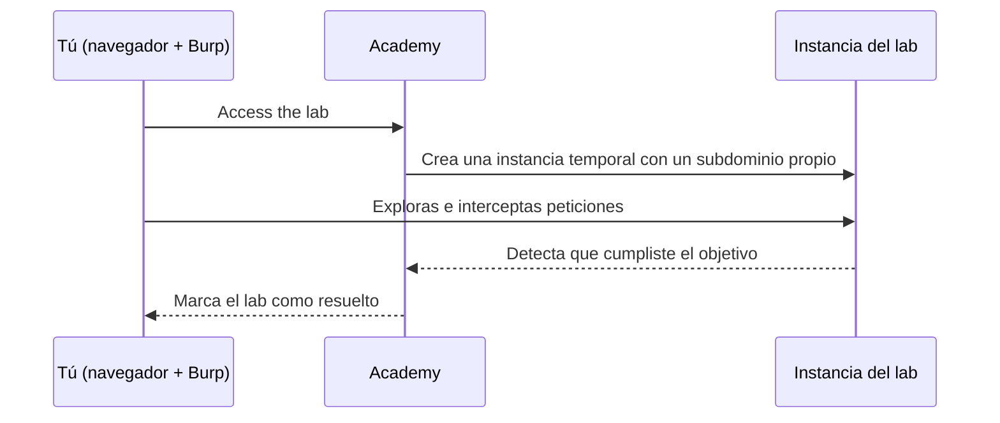

# PortSwigger Web Security Academy

Parte de: [[16-Laboratorios-Practica/01 Laboratorios de seguridad/_Índice Laboratorios de seguridad|Laboratorios de seguridad]]

> [!info] Cómo avanzar
> `progreso`: **pendiente** → **viendo** (estudiando) → **visto** (contestaste la autoevaluación sin abrir las respuestas) → **dominado** (hiciste el laboratorio o lo aplicaste de verdad).

## Contenido

### Qué es
La Web Security Academy es el centro de entrenamiento gratuito de PortSwigger, la empresa que hace Burp Suite. Combina explicaciones escritas de cada vulnerabilidad web con **laboratorios en línea**: aplicaciones vulnerables a propósito que la plataforma levanta solo para ti, y que puedes atacar sin problemas legales. Para un desarrollador .NET es probablemente el mejor lugar para entender, desde el lado del atacante, qué permite una API o un front mal escritos.

Solo necesitas una cuenta gratuita. La certificación Burp Suite Certified Practitioner (BSCP) es aparte y de pago (precio: Pendiente de confirmar); ver [[Burp Suite Certified Practitioner (PortSwigger)]].

### Qué se practica ahí
Los temas cubren casi todo el [[OWASP Top 10]] y bastante más:

- Inyección: [[PortSwigger - laboratorios de SQL injection]], inyección de comandos, NoSQL.
- Del lado del cliente: [[PortSwigger - laboratorios de XSS]], CSRF, clickjacking, CORS mal configurado.
- Lógica y acceso: control de acceso roto e IDOR, autenticación, lógica de negocio, OAuth y JWT.
- Del lado del servidor: SSRF, XXE, path traversal, deserialización insegura, request smuggling.

Cada tema trae la teoría, cómo detectarlo, cómo prevenirlo, y labs de tres niveles: Apprentice, Practitioner y Expert (ver [[PortSwigger - ruta recomendada (Apprentice, Practitioner y Expert)]]).

### Cómo funciona un laboratorio


El enunciado dice el objetivo concreto. Cuando lo logras, la página cambia a *Solved*. La instancia caduca sola después de un rato; si se te acaba, la vuelves a abrir.

### Cómo empezar paso a paso
1. Crea tu cuenta en la Academy.
2. Instala [[Burp Suite Community]] (gratuita) y usa su navegador integrado, que ya trae el proxy configurado.
3. Abre un tema y lee la teoría completa antes de entrar al primer lab.
4. Resuelve los Apprentice de ese tema sin ver la solución; date un límite de tiempo.
5. Anota en tu bitácora la causa raíz y cómo lo evitarías en tu código ([[Cómo llevar una bitácora de laboratorios resueltos]]).

### Ejemplo
Después de resolver el lab de IDOR que cambia un identificador en la URL, tradúcelo a tu API: en Itzamna.Dionisio un `GET /api/pedidos/{id}` no debe confiar en el `id`, sino validar contra el usuario del token.

```csharp
[HttpGet("{id:int}")]
public async Task<IActionResult> Obtener(int id, CancellationToken ct)
{
    var usuarioId = User.FindFirstValue(ClaimTypes.NameIdentifier)!;
    // La consulta filtra por dueño; no basta con buscar por id.
    var pedido = await _consulta.EjecutarAsync(id, usuarioId, ct);
    return pedido is null ? NotFound() : Ok(pedido);
}
```

### Cuándo usarlo y cuándo no
Úsala como ruta principal para seguridad web: es gratuita, está bien escrita y los labs son realistas. No sustituye revisar tu propio código; combínala con [[OWASP Juice Shop]] en local y con revisiones de tus proyectos. Para Linux y redes, mejor [[OverTheWire]] o [[TryHackMe]].

### Errores comunes
- **Atacar fuera del lab.** Solo la instancia que te da la plataforma (su subdominio) está autorizada. Probar lo mismo en un sitio real sin permiso es delito ([[Marco legal y autorización por escrito]]).
- **Saltarse la teoría.** Los labs suponen que la leíste; sin ella terminas copiando payloads que no entiendes.
- **Abrir la solución a los cinco minutos.** Pierdes el aprendizaje; usa primero las pistas del texto.
- **Pensar que necesitas Burp Professional.** Casi todo se resuelve con Community; solo algunos labs que usan Burp Collaborator dependen de Professional.

### Para profundizar
- [Web Security Academy](https://portswigger.net/web-security)
- [Todos los laboratorios](https://portswigger.net/web-security/all-labs)
- [Rutas de aprendizaje](https://portswigger.net/web-security/learning-paths)
- [Descargar Burp Suite Community](https://portswigger.net/burp/communitydownload)

## Autoevaluación

Contesta primero en voz alta o en papel; luego despliega la respuesta.

> [!question]- ¿Para qué sirve?
> Para aprender seguridad web con material teórico y laboratorios en línea creados para ser atacados legalmente. La hace PortSwigger, los creadores de Burp Suite.

> [!question]- ¿Qué ofrece?
> Temas como SQL injection, XSS, CSRF, control de acceso, JWT, SSRF y más, cada uno con explicación y labs que levantan una instancia temporal. Requiere cuenta; el acceso a la Academy es gratuito (verificar en la página oficial). Funciona con [[Burp Suite Community]].

> [!question]- ¿Qué cuidados tiene?
> Ataca solo la instancia del lab (dominio que te da la plataforma), nunca otros sitios. La certificación Burp Suite Certified Practitioner es aparte y de pago (verificar en la página oficial).

