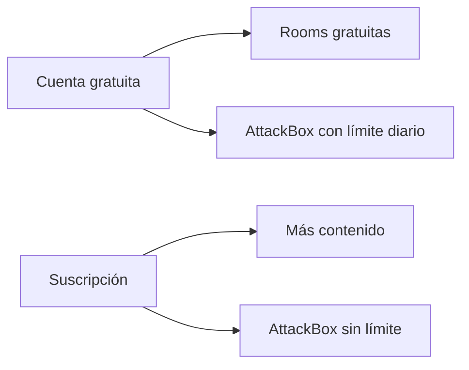

# TryHackMe

Parte de: [[16-Laboratorios-Practica/01 Laboratorios de seguridad/_Índice Laboratorios de seguridad|Laboratorios de seguridad]]

> [!info] Cómo avanzar
> `progreso`: **pendiente** → **viendo** (estudiando) → **visto** (contestaste la autoevaluación sin abrir las respuestas) → **dominado** (hiciste el laboratorio o lo aplicaste de verdad).

## Contenido

### Qué es
TryHackMe es una plataforma de aprendizaje de ciberseguridad basada en **"rooms"** (salas): lecciones que combinan teoría con una máquina virtual lista para practicar. Está pensada para principiantes e intermedios, con rutas de aprendizaje ("learning paths") que ordenan las salas por tema: fundamentos, web, redes, defensa (blue team) y ofensiva (red team).

### Qué se practica ahí
Cada room mezcla texto, preguntas y una máquina objetivo. Hay rutas completas para empezar desde cero (Linux, redes, cómo funciona la web) y rutas más avanzadas de pentesting, análisis forense o respuesta a incidentes. Para un desarrollador, las rutas de fundamentos web y de OWASP son las más directamente útiles.

### Qué ofrece gratis y qué es de pago

Hay rooms gratuitas y una suscripción de pago con más contenido y más tiempo de máquina en el navegador. Según la información vigente, el plan gratuito limita la **AttackBox** (la máquina de ataque en el navegador) a cerca de **1 hora al día**, y la suscripción cuesta alrededor de 10–11 EUR al mes si pagas anual; los límites y precios cambian (verificar en la página oficial).

### Cómo te conectas a las máquinas
Dos opciones:

1. **AttackBox**: una máquina de ataque que corre en tu navegador, sin instalar nada. Es lo más cómodo para empezar.
2. **VPN (OpenVPN)**: descargas un archivo de configuración y te conectas desde tu propia Kali/Linux a la red del lab.

### Cómo empezar paso a paso
1. Crea tu cuenta gratuita.
2. Empieza por la ruta "Pre Security" o "Introduction to Cyber Security".
3. Usa la AttackBox del navegador para las primeras rooms.
4. Responde las preguntas de cada tarea (la plataforma valida tus respuestas).
5. Si usas la VPN desde tu equipo, **desconéctala al terminar**.

### Ejemplo
La ruta de seguridad web incluye rooms sobre el [[OWASP Top 10]] donde explotas, en una máquina controlada, las mismas fallas que luego cuidas en tu código: control de acceso roto, inyección, componentes vulnerables. Tras cada room, revisa si tu API Itzamna.Dionisio tiene esos puntos cubiertos.

### Cuándo usarlo y cuándo no
Úsalo si quieres una entrada guiada y amena a la ciberseguridad, con máquinas listas y poca fricción. Es el paso previo natural a [[Hack The Box]], que es más exigente y menos guiado. Para seguridad web pura con teoría de referencia, la [[PortSwigger Web Security Academy]] es gratuita y muy completa.

### Errores comunes
- **Dejar la VPN conectada.** Mientras esté activa, tu equipo está en una red de laboratorio; desconéctala al acabar.
- **Atacar fuera del alcance.** Solo las máquinas que te asigna la room están autorizadas ([[Marco legal y autorización por escrito]]).
- **Depender del límite diario de la AttackBox gratuita.** Si te quedas corto, planifica sesiones o monta tu propia máquina de ataque.
- **Avanzar sin anotar.** Lleva bitácora de técnicas y comandos ([[Cómo llevar una bitácora de laboratorios resueltos]]).

### Para profundizar
- [TryHackMe](https://tryhackme.com/)
- [Rutas de aprendizaje](https://tryhackme.com/paths)
- [Precios (verificar vigentes)](https://tryhackme.com/pricing)

## Autoevaluación

Contesta primero en voz alta o en papel; luego despliega la respuesta.

> [!question]- ¿Para qué sirve?
> Plataforma de aprendizaje guiado con "rooms" (lecciones con máquinas virtuales) y rutas por tema: fundamentos, web, redes, defensa (blue team) y ofensiva.

> [!question]- ¿Qué ofrece gratis y qué es de pago?
> Hay rooms gratuitas y un plan de suscripción con más contenido y más tiempo de máquina en el navegador (AttackBox). Los límites cambian (verificar en la página oficial).

> [!question]- ¿Cómo te conectas a las máquinas?
> Con la AttackBox en el navegador o con una VPN (OpenVPN) desde tu equipo. Si usas la VPN, desconéctala al terminar.

