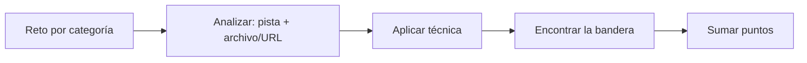

# picoCTF y retos CTF

Parte de: [[16-Laboratorios-Practica/01 Laboratorios de seguridad/_Índice Laboratorios de seguridad|Laboratorios de seguridad]]

> [!info] Cómo avanzar
> `progreso`: **pendiente** → **viendo** (estudiando) → **visto** (contestaste la autoevaluación sin abrir las respuestas) → **dominado** (hiciste el laboratorio o lo aplicaste de verdad).

## Contenido

### Qué es
Un **CTF** (Capture The Flag) es una competencia o conjunto de retos de seguridad informática donde resuelves problemas para encontrar una **"bandera"** (flag): una cadena de texto oculta, normalmente con un formato como `picoCTF{...}`. Entregas la bandera para ganar puntos. Los retos se agrupan en categorías: web, criptografía, forense, ingeniería inversa, explotación de binarios (pwn) y OSINT.

**picoCTF** es un CTF gratuito creado por Carnegie Mellon University, pensado para **principiantes**. Tiene una competencia anual y **picoGym**, una colección de retos abiertos todo el año para practicar a tu ritmo.

### Qué se practica ahí


picoGym cubre lo básico de cada categoría con dificultad progresiva: decodificar, analizar un archivo, encontrar una falla web simple, revertir un programa pequeño. Es un buen primer contacto con herramientas y con la mentalidad de "buscar lo que no debería estar".

### Cómo empezar paso a paso
1. Crea tu cuenta en picoCTF y entra a **picoGym**.
2. Empieza por la categoría **General Skills** y por retos de menor puntaje.
3. Ten a la mano una terminal Linux (WSL o una VM) con utilidades como `file`, `strings`, `base64` y un editor hex.
4. Lee la pista con calma; muchos retos se resuelven identificando una codificación o un dato escondido.
5. Anota la técnica y la herramienta de cada reto en tu bitácora.

### Ejemplo
Un reto de "General Skills" puede darte un archivo con texto codificado. El primer paso es siempre inspeccionarlo:

```bash
# Ver el tipo de archivo y cadenas legibles antes de decodificar
file reto.bin
strings reto.bin | head
```

Reconocer una codificación Base64 o un encabezado de archivo es la clase de habilidad que también te sirve al depurar un token, un adjunto o una respuesta de API rara en tu trabajo.

### Cuándo usarlo y cuándo no
Úsalo para empezar en seguridad de forma lúdica y amplia (no solo web). Para profundizar en web, combina con la [[PortSwigger Web Security Academy]]; para Linux, con [[OverTheWire]]. Si buscas máquinas completas, mejor [[TryHackMe]] o [[Hack The Box]]. Puedes seguir otros CTFs listados en **CTFtime**.

### Cuidados con otros CTF
Participa solo en **CTFs oficiales** (por ejemplo, los listados en CTFtime) y respeta sus reglas. Atacar la **infraestructura** del propio CTF (los servidores que lo hospedan) fuera de los retos suele estar prohibido y puede sacarte de la competencia o tener consecuencias legales. Las banderas se buscan dentro del alcance del reto, no en el sistema que lo sirve ([[Marco legal y autorización por escrito]]).

### Errores comunes
- **Atacar la plataforma en vez del reto.** Prohibido en casi todos los CTFs.
- **Compartir banderas o soluciones durante una competencia activa.** Rompe las reglas.
- **Saltar a pwn o cripto avanzada sin base.** Empieza por General Skills y Forensics.
- **No anotar la técnica.** La próxima vez volverás a empezar de cero.

### Para profundizar
- [picoCTF](https://picoctf.org/)
- [picoGym](https://play.picoctf.org/practice)
- [CTFtime (calendario y rankings de CTFs)](https://ctftime.org/)

## Autoevaluación

Contesta primero en voz alta o en papel; luego despliega la respuesta.

> [!question]- ¿Qué es un CTF?
> Capture The Flag: competencias o retos donde resuelves problemas de seguridad (web, criptografía, forense, ingeniería inversa) para encontrar una "bandera" de texto.

> [!question]- ¿Qué es picoCTF?
> Un CTF gratuito de Carnegie Mellon University pensado para principiantes, con una competencia anual y picoGym para practicar todo el año.

> [!question]- ¿Cuidados con otros CTF?
> Participa solo en los CTF oficiales (por ejemplo los listados en CTFtime) y respeta sus reglas: atacar la infraestructura del propio CTF fuera de los retos suele estar prohibido.

