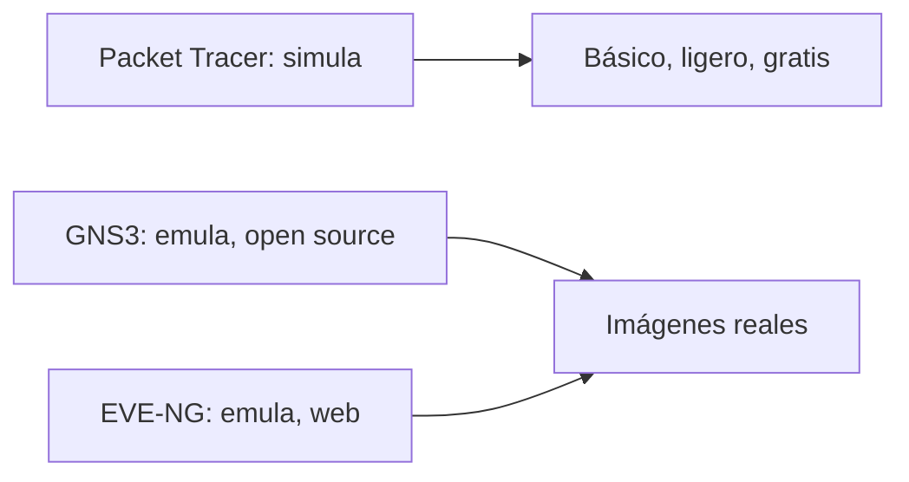

# GNS3 y EVE-NG

Parte de: [[16-Laboratorios-Practica/02 Laboratorios de redes/_Índice Laboratorios de redes|Laboratorios de redes]]

> [!info] Cómo avanzar
> `progreso`: **pendiente** → **viendo** (estudiando) → **visto** (contestaste la autoevaluación sin abrir las respuestas) → **dominado** (hiciste el laboratorio o lo aplicaste de verdad).

## Contenido

### Qué es
GNS3 y EVE-NG son **emuladores de red**: en vez de simular el comportamiento de un router (como hace [[Cisco Packet Tracer]]), ejecutan las **imágenes reales** del sistema operativo de los equipos (Cisco IOS, firewalls, routers Linux) dentro de máquinas virtuales. El resultado es una topología que se comporta casi como el hardware real, ideal para practicar configuraciones avanzadas y para preparar certificaciones de nivel medio-alto.

### Qué se practica ahí
Topologías con routing dinámico (OSPF, BGP), VLANs y trunking, NAT, VPNs, firewalls, y la integración de equipos de distintos fabricantes o de sistemas Linux como nodos de red. Es el entorno típico para labs de CCNP y para probar escenarios que Packet Tracer no soporta.

### Qué diferencias tienen

- **GNS3**: de **código abierto y gratuito**. Tiene un cliente de escritorio y una VM que hace de servidor donde corren los nodos.
- **EVE-NG**: tiene una **edición Community gratuita** y una **Pro de pago**; se opera desde el **navegador**. (Verificar ediciones y precios en la página oficial.)

Ambos son el "paso siguiente" después de Packet Tracer, cuando necesitas imágenes reales.

### Cómo empezar paso a paso
1. Decide la herramienta: GNS3 si quieres todo gratis y de escritorio; EVE-NG Community si prefieres el navegador.
2. Instala el programa y su VM de servidor (requiere virtualización activada en la BIOS).
3. Consigue imágenes **con licencia** o usa alternativas libres: **VyOS**, **FRRouting** u **OpenWrt** como routers.
4. Arma una topología pequeña (dos routers y un enlace) y verifica conectividad con `ping` y `traceroute`.
5. Sube la complejidad: añade OSPF, VLANs o un firewall.

### Ejemplo
Para practicar OSPF sin imágenes de Cisco, puedes usar dos nodos VyOS. En cada uno configuras las interfaces y activas OSPF; luego verificas que las rutas se aprendan entre ellos. Es el mismo concepto que estudiaste en [[Routing entre VLANs (router on a stick y switch capa 3)]], pero sobre software de red real.

### Qué cuidado importante tienen
Las **imágenes de los fabricantes (como Cisco IOS) no vienen incluidas** y requieren licencia; usar imágenes descargadas de dudosa procedencia infringe los términos de Cisco. Usa imágenes con licencia que poseas o alternativas libres (VyOS, FRRouting, OpenWrt). Además, **consumen bastante RAM y CPU**: cada nodo es una VM, así que una topología grande puede exigir mucho a tu equipo (una PC con pocos GB de RAM se queda corta pronto).

### Cuándo usarlo y cuándo no
Úsalos cuando necesites comportamiento realista, imágenes reales o escenarios multifabricante (CCNP y superiores). Para fundamentos de CCNA, Packet Tracer es más ligero y suficiente. Para redes efímeras y sin hardware, también considera un [[Laboratorio de redes en casa]] con máquinas virtuales.

### Errores comunes
- **Usar imágenes IOS pirata.** Infringe la licencia; usa alternativas libres si no tienes las tuyas.
- **Subestimar el consumo.** Topologías grandes agotan la RAM; empieza con pocos nodos.
- **No activar la virtualización.** Sin VT-x/AMD-V en la BIOS, la VM de servidor no arranca.
- **Saltar de Packet Tracer directo a topologías enormes.** Crece de a poco.

### Para profundizar
- [GNS3](https://www.gns3.com/)
- [EVE-NG](https://www.eve-ng.net/)
- [VyOS (router libre)](https://vyos.io/)

## Autoevaluación

Contesta primero en voz alta o en papel; luego despliega la respuesta.

> [!question]- ¿Para qué sirven?
> Para emular redes con imágenes reales de sistemas de red (routers, firewalls, Linux) en lugar de un simulador. Son el paso siguiente después de Cisco Packet Tracer.

> [!question]- ¿Qué diferencias tienen?
> GNS3 es de código abierto y gratuito, con cliente de escritorio y una VM de servidor. EVE-NG tiene edición Community gratuita y edición Pro de pago, y se usa desde el navegador (verificar en la página oficial).

> [!question]- ¿Qué cuidado importante tienen?
> Las imágenes de los fabricantes (por ejemplo Cisco IOS) no vienen incluidas y requieren licencia; usa imágenes con licencia o alternativas libres (VyOS, FRRouting, OpenWrt). Además consumen bastante RAM y CPU.

