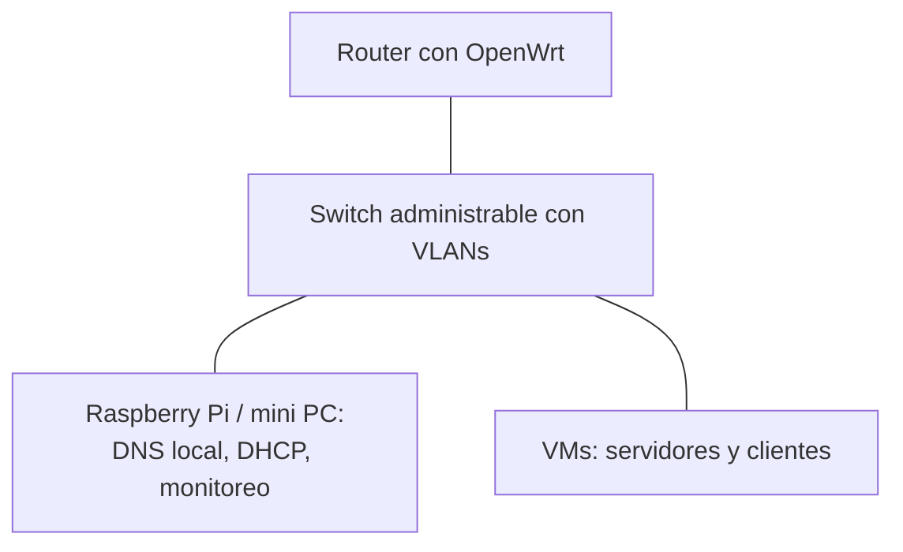

# Laboratorio de redes en casa

Parte de: [[16-Laboratorios-Practica/02 Laboratorios de redes/_Índice Laboratorios de redes|Laboratorios de redes]]

> [!info] Cómo avanzar
> `progreso`: **pendiente** → **viendo** (estudiando) → **visto** (contestaste la autoevaluación sin abrir las respuestas) → **dominado** (hiciste el laboratorio o lo aplicaste de verdad).

## Contenido

### Qué es
Un laboratorio de redes en casa es un entorno físico o virtual donde practicas administración de redes y servicios con tus propios equipos, sin arriesgar la red de tu familia ni la de nadie más. Puede ir desde algo totalmente virtual (máquinas y emuladores en tu PC) hasta un pequeño rack con equipo de segunda mano. La idea es tener un espacio seguro para configurar, romper y aprender.

### Qué puedes armar en casa

- Un **router con firmware configurable** (OpenWrt) para practicar firewall, VLANs y QoS.
- Un **switch administrable** para VLANs y trunking reales.
- Una **Raspberry Pi o mini PC** con servicios: DNS local, DHCP, un panel de monitoreo, un servidor web interno.
- **Máquinas virtuales** como clientes y servidores de prueba.

### ¿Hay que comprar equipo?
**No para empezar.** Con [[Cisco Packet Tracer]], [[GNS3 y EVE-NG]] y máquinas virtuales cubres casi todo lo que necesitas para aprender y para certificaciones. El hardware sirve **después**, cuando quieras la experiencia de cables, equipos reales y problemas físicos (un enlace que no levanta, un SFP incompatible). Empieza virtual y compra solo si un objetivo concreto lo justifica.

### Cómo empezar paso a paso
1. Monta primero todo virtual: un router VyOS u OpenWrt en una VM, un par de clientes Linux/Windows en otras VMs.
2. Practica lo básico: asignar IPs, DHCP, DNS local, reglas de firewall.
3. Separa tu laboratorio de la red de casa (una VLAN o una subred distinta, o un router aparte).
4. Añade un servicio útil (por ejemplo un DNS que resuelva nombres internos) y monitoréalo.
5. Solo si lo necesitas, incorpora un switch administrable o un mini PC físico.

### Qué cuidados tener
- **Separar el laboratorio de la red de la familia**: usa una VLAN o un router aparte para que un experimento no tumbe el internet de la casa.
- **No exponer servicios a internet** sin necesidad; si lo haces, con firewall y autenticación fuerte.
- **No escanear ni probar sobre redes que no son tuyas.** Tu laboratorio es tuyo; la red del vecino o la del trabajo, no ([[Marco legal y autorización por escrito]]).

### Ejemplo
Un primer objetivo realista: montar OpenWrt en una VM, crear dos VLANs (una "confiable" y una "invitados") y comprobar con reglas de firewall que la VLAN de invitados no puede alcanzar la confiable. Eso conecta con lo que estudiaste en [[VLANs]] y en [[Routing entre VLANs (router on a stick y switch capa 3)]], pero ahora lo configuras y lo verificas tú.

### Cuándo usarlo y cuándo no
Úsalo para afianzar lo aprendido en los simuladores con un entorno más real y permanente, y para servicios que quieras tener encendidos (DNS, monitoreo). Si tu meta inmediata es aprobar CCNA, Packet Tracer basta. El hardware físico rinde cuando ya dominaste la teoría y quieres la capa práctica que un simulador no da.

### Errores comunes
- **Mezclar el laboratorio con la red de casa.** Un error puede dejar sin internet a todos; sepáralo.
- **Comprar hardware antes de tiempo.** Primero virtual; el equipo llega cuando hay un objetivo claro.
- **Exponer servicios sin protección.** Firewall y autenticación siempre.
- **Tocar redes ajenas.** Practica solo en lo tuyo.

### Para profundizar
- [OpenWrt (firmware de router)](https://openwrt.org/)
- [Cisco Networking Academy](https://www.netacad.com/)
- [VyOS (router libre para VMs)](https://vyos.io/)

## Autoevaluación

Contesta primero en voz alta o en papel; luego despliega la respuesta.

> [!question]- ¿Qué puedes armar en casa?
> Un router con firmware configurable (OpenWrt), un switch administrable con VLANs, una Raspberry Pi o mini PC con servicios (DNS local, DHCP, monitoreo) y máquinas virtuales.

> [!question]- ¿Qué cuidados tener?
> Separar el laboratorio de la red de la familia (VLAN o router aparte), no exponer servicios a internet sin necesidad y no hacer escaneos sobre redes que no son tuyas.

> [!question]- ¿Hay que comprar equipo?
> No para empezar: con Packet Tracer, GNS3 y máquinas virtuales cubres casi todo. El hardware sirve después, para practicar con equipos reales.

