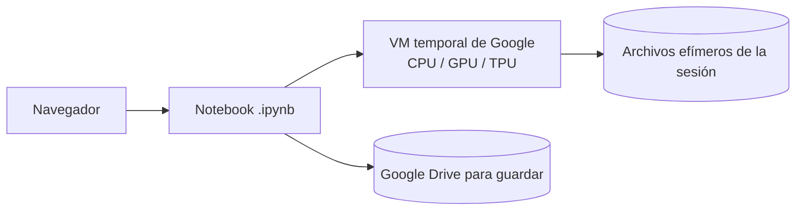

# Google Colab

Parte de: [[16-Laboratorios-Practica/03 Laboratorios de IA y datos/_Índice Laboratorios de IA y datos|Laboratorios de IA y datos]]

> [!info] Cómo avanzar
> `progreso`: **pendiente** → **viendo** (estudiando) → **visto** (contestaste la autoevaluación sin abrir las respuestas) → **dominado** (hiciste el laboratorio o lo aplicaste de verdad).

## Contenido

### Qué es
Google Colab (Colaboratory) es un servicio gratuito para ejecutar **notebooks de Python en la nube** desde el navegador, sin instalar nada. Cada notebook corre en una máquina virtual de Google con Python y las librerías de ciencia de datos más comunes ya instaladas, y con **acceso limitado a GPU/TPU** en el plan gratuito. Es la forma más rápida de probar código de datos o de IA sin pelear con tu entorno local, especialmente útil con una PC de GPU modesta como la GTX 1660 Ti de 6 GB.

### Qué se practica ahí
Análisis de datos con [[pandas]] y NumPy, visualización, entrenamiento de modelos pequeños, probar modelos de [[Hugging Face]], y aprender los [[Jupyter notebooks]] en general. Es el entorno recomendado para los labs de datos e IA de la bóveda (por ejemplo [[Lab 1 - NumPy y pandas en Google Colab]]).

### Cómo funciona


La VM es **temporal**: al desconectarte se borra, con todo lo que hayas dejado en su disco. Por eso, lo que quieras conservar va a Google Drive o lo descargas.

### Qué límites tiene el plan gratuito
- Las **sesiones se desconectan** por inactividad y tienen un **tiempo máximo** de ejecución.
- La **GPU no está garantizada**: depende de disponibilidad y de tu uso reciente; Google describe el acceso gratuito a GPU como "muy limitado".
- Los planes de pago (Colab Pro/Pro+) dan más recursos y prioridad (precios y cuotas: verificar en la página oficial).

### Cómo empezar paso a paso
1. Entra a Colab con tu cuenta de Google y crea un notebook nuevo.
2. Para usar GPU: menú **Entorno de ejecución → Cambiar tipo de entorno de ejecución → GPU**.
3. Escribe y ejecuta celdas con `Shift+Enter`.
4. Guarda el notebook en Drive (se hace solo) y descarga los resultados importantes.
5. Para secretos (llaves de API), usa el **panel de secretos** de Colab, no celdas con el valor a la vista.

### Ejemplo
```python
# Comprobar si hay GPU disponible en la sesión actual
import torch
print("GPU disponible:", torch.cuda.is_available())
print("Dispositivo:", torch.cuda.get_device_name(0) if torch.cuda.is_available() else "CPU")
```

Si la celda imprime una GPU (por ejemplo una T4), puedes entrenar modelos pequeños mucho más rápido que en tu equipo.

### Qué cuidado hay con los datos
Los **archivos de la sesión se borran al desconectar**: guarda en Google Drive o descarga lo que necesites. Y **no pegues llaves de API en celdas**: quedan en el notebook y podrían subir a un repositorio por error. Usa la sección de secretos de Colab y trátalas como en [[Secretos en repositorios]].

### Cuándo usarlo y cuándo no
Úsalo para prototipos, aprendizaje y cuando tu GPU local no alcance. Para trabajar sin conexión o con datos que no deben salir de tu equipo, usa Jupyter local o [[Modelos locales con Ollama]]. Para competir y versiones con datasets integrados, [[Kaggle]] da cuota de GPU semanal más predecible.

### Errores comunes
- **Confiar en que la sesión seguirá viva.** Se desconecta; guarda seguido en Drive.
- **Dejar la GPU ociosa.** Consume tu cuota aunque no entrenes; libera el entorno al terminar.
- **Pegar secretos en celdas.** Usa el panel de secretos.
- **Reinstalar todo en cada sesión sin automatizarlo.** Guarda una celda de `pip install` al inicio.

### Para profundizar
- [Google Colab](https://colab.research.google.com/)
- [Preguntas frecuentes de Colab](https://research.google.com/colaboratory/faq.html)
- [Documentación de Jupyter](https://docs.jupyter.org/)

## Autoevaluación

Contesta primero en voz alta o en papel; luego despliega la respuesta.

> [!question]- ¿Para qué sirve?
> Para ejecutar notebooks de Python en la nube desde el navegador, con acceso gratuito a GPU/TPU limitado, sin instalar nada.

> [!question]- ¿Qué límites tiene el plan gratuito?
> Las sesiones se desconectan por inactividad o por tiempo máximo, y la GPU no está garantizada. Los planes de pago dan más recursos (verificar en la página oficial).

> [!question]- ¿Qué cuidado hay con los datos?
> Los archivos de la sesión se borran al desconectar: guarda en Google Drive o descarga. No pegues llaves de API en celdas; usa la sección de secretos de Colab.

