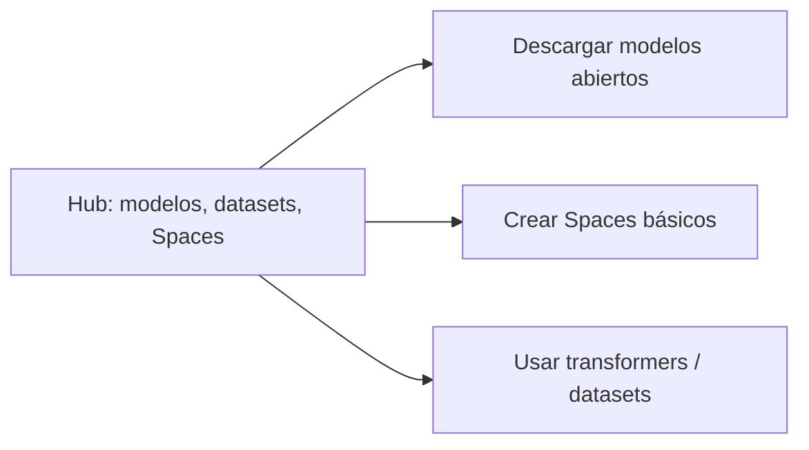

# Hugging Face

Parte de: [[16-Laboratorios-Practica/03 Laboratorios de IA y datos/_Índice Laboratorios de IA y datos|Laboratorios de IA y datos]]

> [!info] Cómo avanzar
> `progreso`: **pendiente** → **viendo** (estudiando) → **visto** (contestaste la autoevaluación sin abrir las respuestas) → **dominado** (hiciste el laboratorio o lo aplicaste de verdad).

## Contenido

### Qué es
Hugging Face es una plataforma central para la comunidad de aprendizaje automático. Su **Hub** aloja miles de **modelos**, **datasets** y **demos** (llamados *Spaces*), y mantiene librerías de código abierto muy usadas como `transformers`, `datasets` y `diffusers`. Es, en la práctica, el "GitHub de los modelos de IA": el lugar donde encuentras, descargas y compartes modelos.

### Qué puedes hacer gratis


- **Descargar modelos abiertos** y ejecutarlos en tu equipo o en [[Google Colab]].
- **Probar demos** en Spaces (muchos corren en CPU gratis).
- **Crear tus propios Spaces** básicos (por ejemplo con Gradio) en hardware gratuito (CPU).
- Usar las librerías para cargar modelos con pocas líneas.

Sobre la **API de inferencia alojada** (Inference Providers): según la información vigente, las cuentas gratuitas **no incluyen créditos mensuales** de inferencia y deben comprar créditos o pasar a PRO (que incluye una pequeña cantidad de crédito mensual); esto cambia seguido (verificar en la página oficial). Para practicar sin costo, descarga el modelo y ejecútalo tú.

### Cómo empezar paso a paso
1. Crea una cuenta en huggingface.co.
2. Explora el Hub filtrando por tarea (clasificación de texto, resumen, imágenes).
3. Instala la librería y carga un modelo pequeño localmente:

```python
# Pipeline de análisis de sentimiento con un modelo abierto
from transformers import pipeline
clf = pipeline("sentiment-analysis")
print(clf("Me encantó este laboratorio"))
```

4. Para algo más pesado, ejecútalo en Colab con GPU.
5. Crea un token de acceso **de solo lectura** si necesitas bajar modelos privados o publicar.

### Ejemplo
Para resumir texto de forma local, cargas un modelo de resumen y lo aplicas:

```python
resumidor = pipeline("summarization")
texto = "..."  # un documento largo
print(resumidor(texto, max_length=60, min_length=20))
```

Esto conecta con los temas del área de IA de la bóveda, como [[Fine-tuning vs RAG vs prompting]], cuando decides si te basta un modelo abierto o necesitas algo mayor.

### Qué cuidados hay
- **Revisa la licencia del modelo**: algunas (ciertos Llama, modelos "non-commercial") restringen el uso comercial o piden aceptar términos.
- **No subas datos privados** a repos o Spaces públicos: quedan expuestos.
- **Cuida tus tokens**: usa permisos mínimos (solo lectura si basta) y trátalos como secretos ([[Secretos en repositorios]]).

### Cuándo usarlo y cuándo no
Úsalo para encontrar y ejecutar modelos abiertos, probar demos y aprender. Para datos que no deben salir de tu equipo o uso sin internet, combínalo con [[Modelos locales con Ollama]]. Para entrenar en serio, necesitarás GPU (Colab o pago).

### Errores comunes
- **Asumir que todo modelo es de uso libre comercial.** Lee la licencia.
- **Esperar inferencia gratuita ilimitada vía API.** El modelo gratuito es descargar y ejecutar tú.
- **Publicar tokens o datos privados.** Permisos mínimos y nada sensible en repos públicos.
- **Bajar un modelo gigante a una GPU de 6 GB.** Elige modelos acordes a tu hardware o usa Colab.

Un apunte sobre hardware: antes de descargar, fíjate en el tamaño del modelo y en si existe una versión cuantizada; con una GPU de 6 GB cabrán modelos pequeños, y los grandes conviene ejecutarlos en [[Google Colab]] con GPU. Combinar el Hub (para encontrar y evaluar) con Colab o [[Modelos locales con Ollama]] (para ejecutar) es el flujo más cómodo sin pagar.

### Para profundizar
- [Hugging Face Hub](https://huggingface.co/)
- [Documentación de transformers](https://huggingface.co/docs/transformers)
- [Inference Providers: precios](https://huggingface.co/docs/inference-providers/pricing)

## Autoevaluación

Contesta primero en voz alta o en papel; luego despliega la respuesta.

> [!question]- ¿Qué es Hugging Face?
> Una plataforma (Hub) con miles de modelos, datasets y demos (Spaces), más librerías como `transformers` y `datasets`.

> [!question]- ¿Qué puedes hacer gratis?
> Descargar modelos abiertos, probar demos, crear Spaces básicos y usar algunas APIs de inferencia con límites (verificar en la página oficial).

> [!question]- ¿Qué cuidados hay?
> Revisar la licencia del modelo (algunas restringen uso comercial), no subir datos privados a repos públicos y cuidar tus tokens de acceso (permisos mínimos, de solo lectura si basta).

