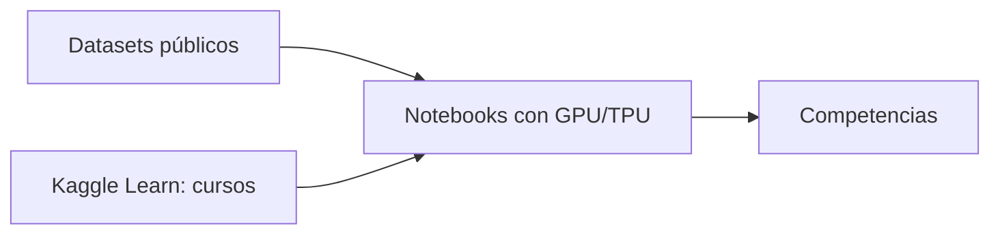

# Kaggle

Parte de: [[16-Laboratorios-Practica/03 Laboratorios de IA y datos/_Índice Laboratorios de IA y datos|Laboratorios de IA y datos]]

> [!info] Cómo avanzar
> `progreso`: **pendiente** → **viendo** (estudiando) → **visto** (contestaste la autoevaluación sin abrir las respuestas) → **dominado** (hiciste el laboratorio o lo aplicaste de verdad).

## Contenido

### Qué es
Kaggle es una plataforma de Google para ciencia de datos y aprendizaje automático. Ofrece **datasets públicos**, **notebooks en la nube** con cuota gratuita de GPU/TPU, **competencias** de modelado y **cursos cortos** (Kaggle Learn). Es a la vez un lugar para practicar, para conseguir datos y para aprender leyendo el trabajo de otros.

### Qué ofrece


- **Datasets**: miles de conjuntos de datos listos para usar.
- **Notebooks (Kernels)**: entorno tipo Jupyter en la nube con aceleradores. Las sesiones de GPU/CPU duran hasta unas 12 horas y las de TPU algo menos; la cuota semanal de GPU no está publicada oficialmente pero los usuarios reportan alrededor de 30 horas (verificar en la página oficial).
- **Competencias**: retos con datos reales y una tabla de posiciones.
- **Kaggle Learn**: microcursos de Python, pandas, machine learning, visualización y SQL.

### Para qué te sirve si estás empezando
Para **practicar con datasets reales**, leer notebooks bien hechos de otras personas (una de las mejores formas de aprender estilo y técnicas) y completar los cursos de Python, pandas y ML introductorio. Es un complemento ideal de [[Google Colab]]: Colab para tu propio entorno, Kaggle para datos, cursos y una cuota de GPU más predecible.

### Cómo empezar paso a paso
1. Crea tu cuenta y verifica el teléfono para habilitar GPU/TPU e internet en los notebooks.
2. Haz el curso "Python" y luego "Pandas" en Kaggle Learn.
3. Abre un dataset que te interese y crea un notebook sobre él.
4. Para activar acelerador: en el panel lateral del notebook, **Settings → Accelerator → GPU**.
5. Entra a una competencia tipo "Getting Started" (como Titanic) para practicar el flujo completo.

### Ejemplo
```python
# En un notebook de Kaggle, los datasets se montan en /kaggle/input
import pandas as pd
df = pd.read_csv("/kaggle/input/titanic/train.csv")
print(df.shape)
print(df["Survived"].value_counts())
```

Ese flujo de cargar, explorar y modelar es el mismo que usarás si algún día preparas datos para Wee.Reporteria o un reporte en Power BI Desktop.

### Cuidados
- Revisa la **licencia de cada dataset** antes de usarlo en un proyecto: no todas permiten uso comercial.
- Lee las **reglas de cada competencia**: algunas prohíben compartir código fuera de la plataforma o limitan el uso de datos externos.
- La **cuota de GPU/TPU tiene límites** semanales (verificar en la página oficial); planifica las corridas pesadas.

### Cuándo usarlo y cuándo no
Úsalo para aprender, conseguir datos y competir. Para tus propios experimentos con control total del entorno, Colab o Jupyter local. Para datos privados de tu empresa, **no** los subas a Kaggle: trabaja en local o en una nube con las garantías adecuadas.

### Errores comunes
- **Ignorar la licencia del dataset.** Puede impedir un uso que creías permitido.
- **Subir datos privados a un notebook público.** Quedan expuestos.
- **Agotar la cuota de GPU en pruebas.** Resérvala para las corridas que de verdad la necesiten.
- **Copiar notebooks sin entenderlos.** Léelos y reescribe; ahí está el aprendizaje.

### Para profundizar
- [Kaggle](https://www.kaggle.com/)
- [Kaggle Learn (cursos gratuitos)](https://www.kaggle.com/learn)
- [Documentación de notebooks de Kaggle](https://www.kaggle.com/docs/notebooks)

## Autoevaluación

Contesta primero en voz alta o en papel; luego despliega la respuesta.

> [!question]- ¿Qué ofrece?
> Datasets públicos, notebooks en la nube con cuota gratuita semanal de GPU/TPU, competencias de ciencia de datos y cursos cortos (Kaggle Learn).

> [!question]- ¿Para qué te sirve si estás empezando?
> Para practicar con datasets reales, leer notebooks de otros y completar los cursos de Python, pandas y ML intro.

> [!question]- ¿Cuidados?
> Revisa la licencia de cada dataset antes de usarlo en un proyecto y las reglas de cada competencia (algunas prohíben compartir código fuera de la plataforma). La cuota de GPU tiene límites (verificar en la página oficial).

