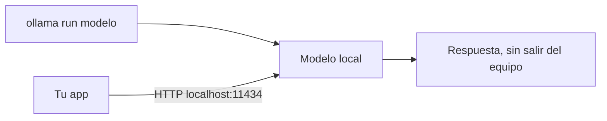

# Modelos locales con Ollama

Parte de: [[16-Laboratorios-Practica/03 Laboratorios de IA y datos/_Índice Laboratorios de IA y datos|Laboratorios de IA y datos]]

> [!info] Cómo avanzar
> `progreso`: **pendiente** → **viendo** (estudiando) → **visto** (contestaste la autoevaluación sin abrir las respuestas) → **dominado** (hiciste el laboratorio o lo aplicaste de verdad).

## Contenido

### Qué es
Ollama es una herramienta para **descargar y ejecutar modelos de lenguaje abiertos en tu propio equipo**, con una interfaz muy simple. Expone una línea de comandos (`ollama run <modelo>`) y una **API HTTP local** en el puerto `11434`, de modo que puedes conversar con el modelo en la terminal o integrarlo en tus apps como si fuera un servicio local. Todo corre en tu máquina: sin costo por uso y sin que tus datos salgan a internet.

### Para qué sirve


Probar modelos abiertos (Llama, Mistral, Phi, Gemma y otros), prototipar funciones de IA, generar texto o código, y experimentar con [[Fine-tuning vs RAG vs prompting]] sin pagar una API. Es ideal cuando los datos son sensibles o cuando quieres trabajar sin conexión.

### Qué ventajas y límites tiene
**Ventajas**: sin costo por token, datos que no salen de tu equipo, funciona sin internet una vez descargado el modelo, y una API local compatible con flujos tipo OpenAI.

**Límites**: el rendimiento depende de tu **RAM y VRAM**. Con una GTX 1660 Ti de 6 GB puedes correr modelos pequeños y cuantizados (de pocos miles de millones de parámetros), pero los modelos grandes no caben en la GPU y caen a CPU, donde van lentos. Conviene elegir modelos acordes al hardware (versiones cuantizadas, tamaños 3B–8B según la memoria).

### Cómo empezar paso a paso
1. Descarga e instala Ollama para tu sistema operativo.
2. Baja y ejecuta un modelo pequeño:

```bash
# Descarga el modelo (si falta) y abre un chat en la terminal
ollama run llama3.2
```

3. Para integrarlo desde código, usa la API local:

```bash
# Generar texto vía la API HTTP local
curl http://localhost:11434/api/generate -d '{
  "model": "llama3.2",
  "prompt": "Explica qué es un índice en SQL Server en dos frases",
  "stream": false
}'
```

4. Lista y borra modelos con `ollama list` y `ollama rm <modelo>` para no llenar el disco.

### Ejemplo
Puedes conectar Ollama a un pequeño script en C# o JavaScript que mande prompts al endpoint local, útil para prototipar una función de resumen en Wee.Reporteria sin exponer datos de clientes a un servicio externo.

### Qué cuidado de seguridad hay
La **API local no tiene autenticación por defecto**. Mantenla escuchando solo en `127.0.0.1` (su valor predeterminado) y **no la expongas a la red** ni la publiques a internet: cualquiera que alcance el puerto `11434` podría usar tu modelo y tus recursos. Si necesitas acceso remoto, ponla detrás de un proxy con autenticación. Revisa además la **licencia de cada modelo** que descargues.

### Cuándo usarlo y cuándo no
Úsalo para privacidad, trabajo sin conexión y evitar costos de API en prototipos. Para modelos muy grandes o cargas pesadas, una GPU en la nube ([[Google Colab]]) o una API de pago rinden más. Para encontrar modelos, combínalo con [[Hugging Face]].

### Errores comunes
- **Exponer el puerto 11434 a la red.** Sin autenticación, es un riesgo; mantenlo en localhost.
- **Intentar correr un modelo enorme en 6 GB.** Elige tamaños y cuantizaciones acordes.
- **Ignorar la licencia del modelo.** No todos permiten uso comercial.
- **Llenar el disco de modelos.** Borra los que no uses con `ollama rm`.

### Para profundizar
- [Ollama](https://ollama.com/)
- [Biblioteca de modelos](https://ollama.com/library)
- [Documentación de la API de Ollama](https://github.com/ollama/ollama/blob/main/docs/api.md)

## Autoevaluación

Contesta primero en voz alta o en papel; luego despliega la respuesta.

> [!question]- ¿Para qué sirve Ollama?
> Para descargar y ejecutar modelos de lenguaje abiertos en tu equipo, con una CLI (`ollama run <modelo>`) y una API HTTP local en el puerto 11434.

> [!question]- ¿Qué ventajas y límites tiene?
> Ventajas: sin costo por uso, datos sin salir de tu equipo, funciona sin internet. Límites: depende de tu RAM/VRAM; los modelos grandes no caben o van lentos.

> [!question]- ¿Qué cuidado de seguridad hay?
> La API no tiene autenticación por defecto: mantenla escuchando solo en `127.0.0.1` y no la expongas a la red. Revisa la licencia de cada modelo.

