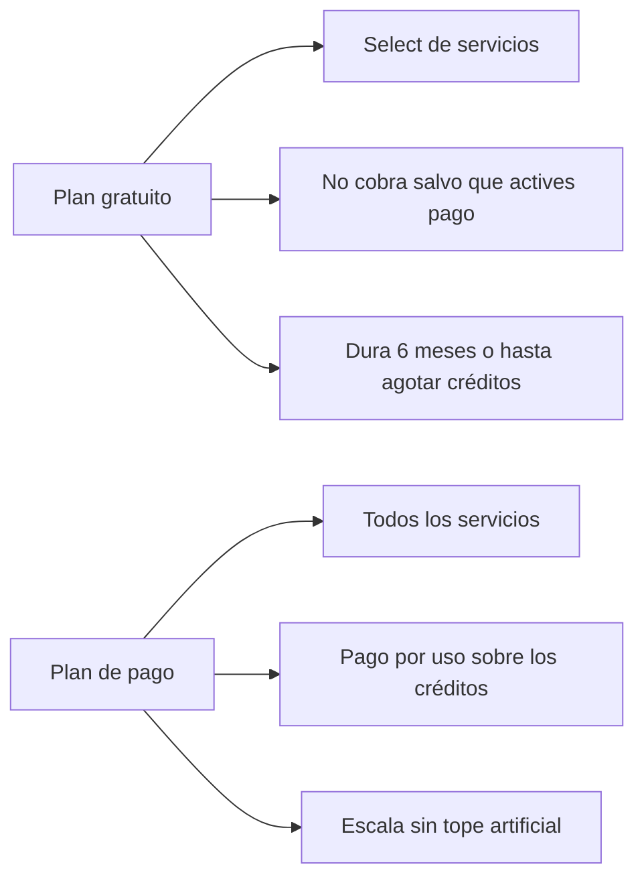

# AWS - plan gratuito vs plan de pago (qué pasa cuando se acaban los créditos)

Parte de: [[16-Laboratorios-Practica/04 Otras nubes para probar servicios de pago/_Índice Otras nubes para probar servicios de pago|Otras nubes para probar servicios de pago]]

> [!info] Cómo avanzar
> `progreso`: **pendiente** → **viendo** (estudiando) → **visto** (contestaste la autoevaluación sin abrir las respuestas) → **dominado** (hiciste el laboratorio o lo aplicaste de verdad).

## Contenido

### Qué es
Desde el nuevo esquema de AWS (**15 de julio de 2025**), al crear una cuenta eliges entre un **plan gratuito** y un **plan de pago**. Esta nota aclara la diferencia y, sobre todo, **qué pasa cuando se acaban los créditos o el periodo**, que es la duda que más angustia al practicar. Complementa a [[AWS Free Tier - plan gratuito, créditos y servicios siempre gratuitos]].

### Qué diferencia hay entre el plan gratuito y el de pago

- **Plan gratuito**: acceso a un subconjunto de servicios; **no se cobra** mientras duren el periodo y los créditos. No puedes escalar más allá de los créditos ni usar servicios exclusivos de pago.
- **Plan de pago**: habilita **todos** los servicios y cobra por uso lo que exceda los créditos. Es el modelo "pago por uso" tradicional.

(Los detalles exactos cambian; verificar en la página oficial.)

### Qué pasa al terminar el periodo o los créditos en el plan gratuito
El plan gratuito termina cuando pasan **6 meses** o se agotan los créditos, **lo que ocurra primero**. Según la política vigente:

- AWS avisa con antelación (15, 7 y 2 días antes del fin del periodo).
- Si **no cambias a plan de pago**, la cuenta se **suspende** y luego puede **cerrarse**. Hay un plazo (AWS menciona hasta **90 días** para reabrir la cuenta pasándola a plan de pago) durante el cual podrías recuperarla; después, los recursos se pierden (verificar en la página oficial).
- **Respalda** lo que quieras conservar antes de que termine.

### Cuándo conviene pasar a plan de pago
Solo cuando **necesites un servicio no disponible en el plan gratuito** o debas escalar más allá de los créditos, y **ya tengas presupuestos y alertas configurados** ([[Cómo evitar cobros inesperados en la nube (presupuestos y alertas)]]). Pasar a pago sin topes ni vigilancia es la receta del recibo sorpresa.

### Cómo empezar paso a paso
1. Si solo vas a aprender, quédate en **plan gratuito** y pon un presupuesto el día uno.
2. Marca en tu calendario la fecha de fin del periodo de 6 meses.
3. Antes de que termine, **exporta o respalda** lo que valga la pena (configuraciones, datos).
4. Decide: ¿necesitas seguir? Si sí, pasa a plan de pago con alertas activas; si no, deja que cierre tras respaldar.

### Ejemplo
Montas una API .NET en una instancia EC2 pequeña para aprender despliegues. Si al mes 6 aún la necesitas y pasas a plan de pago, esa instancia empezará a cobrarse por hora. Si solo era práctica, respalda tu `Dockerfile` y tus scripts (que ya viven en tu repo de Azure DevOps) y deja que la cuenta cierre.

### Errores comunes
- **Pasar a plan de pago sin presupuesto.** Expone a cobros sin tope.
- **No respaldar antes del cierre.** Pierdes datos y configuraciones.
- **Creer que el cierre es inmediato.** Hay avisos y un plazo, pero no lo dejes al límite.
- **Olvidar recursos "siempre gratuitos" que ya no lo son al escalar.** Pasar su límite mensual sí cobra.

### Para profundizar
- [AWS Free Tier](https://aws.amazon.com/free/)
- [Anuncio del nuevo Free Tier (jul-2025)](https://aws.amazon.com/blogs/aws/aws-free-tier-update-new-customers-can-get-started-and-explore-aws-with-up-to-200-in-credits/)

## Autoevaluación

Contesta primero en voz alta o en papel; luego despliega la respuesta.

> [!question]- ¿Qué diferencia hay entre el plan gratuito y el de pago?
> El plan gratuito limita servicios y no cobra mientras duren créditos y tiempo; el de pago habilita todo y cobra lo que excede los créditos (verificar en la página oficial).

> [!question]- ¿Qué pasa al terminar el periodo o los créditos en el plan gratuito?
> Según la política vigente, la cuenta se suspende o cierra si no la cambias a plan de pago, y podrías perder los recursos tras un periodo de gracia (verificar en la página oficial). Respalda lo que quieras conservar.

> [!question]- ¿Cuándo conviene pasar a plan de pago?
> Solo cuando necesites un servicio no disponible en el plan gratuito y ya tengas presupuestos y alertas configurados ([[Cómo evitar cobros inesperados en la nube (presupuestos y alertas)]]).

