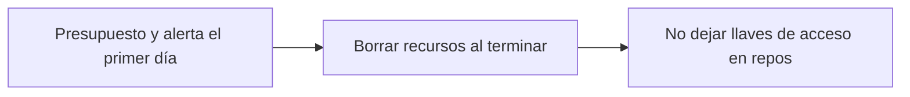

# Comparativa de capas gratuitas de nubes (AWS, Azure, Google Cloud y Oracle)

Parte de: [[16-Laboratorios-Practica/04 Otras nubes para probar servicios de pago/_Índice Otras nubes para probar servicios de pago|Otras nubes para probar servicios de pago]]

> [!info] Cómo avanzar
> `progreso`: **pendiente** → **viendo** (estudiando) → **visto** (contestaste la autoevaluación sin abrir las respuestas) → **dominado** (hiciste el laboratorio o lo aplicaste de verdad).

## Contenido

### Qué es
Esta nota compara, a grandes rasgos, lo que ofrecen gratis las cuatro grandes nubes para que elijas dónde practicar según tu objetivo. Cada una mezcla tres tipos de beneficio, pero con montos y condiciones distintos, y todas cambian su oferta con frecuencia (verificar en la página oficial de cada una).

### Qué tipos de beneficio gratuito comparten las cuatro
```mermaid
flowchart TB
  C[Créditos iniciales por tiempo limitado]
  P[Servicios gratis por 12 meses o por tiempo limitado]
  S[Servicios "siempre gratuitos" con límites mensuales]
```

Las cuatro combinan: **créditos** iniciales, **servicios gratis por un periodo** (12 meses en el esquema clásico, o un plan de meses) y **servicios siempre gratuitos** con cuotas mensuales permanentes.

### Panorama por nube
| Nube | Crédito inicial | Siempre gratis destacado | Nota |
|---|---|---|---|
| **AWS** | Hasta 200 USD, plan de 6 meses (desde jul-2025) | ~30+ servicios con límites | Ver [[AWS Free Tier - plan gratuito, créditos y servicios siempre gratuitos]] |
| **Azure** | 200 USD por 30 días + 12 meses de servicios | 65+ servicios con cuotas | Tu nube de trabajo; ver [[Microsoft Learn - rutas gratuitas de Azure]] |
| **Google Cloud** | 300 USD por 90 días | e2-micro, Cloud Run, 5 GB Storage | Ver [[Google Cloud - prueba gratuita (crédito por 90 días) y Free Tier]] |
| **Oracle** | Crédito de prueba + Always Free | 2 VMs AMD + ARM Ampere (2 OCPU / 12 GB en total) | La más generosa en "siempre gratis"; ver [[Oracle Cloud - Always Free]] |

(Montos vigentes al momento de escribir; verificar en cada sitio oficial.)

### Cuál elegir para practicar
- **La que uses en tu trabajo.** Para ti, **Azure**: aprovecha sus rutas y ejercicios en [[Microsoft Learn - rutas gratuitas de Azure]].
- **Un servidor siempre encendido sin reloj**: **Oracle Always Free** (sus instancias ARM son potentes y permanentes).
- **Probar servicios puntuales de Google** (Cloud Run, BigQuery): la prueba de **Google Cloud**.
- **Preparar una certificación de AWS**: el plan gratuito de AWS.

Las demás nubes sirven para **comparar servicios equivalentes** o probar algo que tu nube principal no tiene gratis.

### Qué regla aplica en todas


Tres hábitos, sin excepción:
1. **Presupuesto y alerta el primer día** ([[Cómo evitar cobros inesperados en la nube (presupuestos y alertas)]]).
2. **Borrar recursos al terminar** cada práctica.
3. **No dejar llaves de acceso en repositorios** ([[Secretos en repositorios]]).

### Ejemplo
Si quieres practicar Kubernetes gestionado, podrías comparar: GKE en Google (con la prueba), AKS en Azure (con crédito) y EKS en AWS. Para solo tener un clúster pequeño permanente, Oracle Always Free con sus 2 OCPU ARM puede alcanzar sin cobrar.

### Cuándo usar esta comparativa
Cuando dudes **dónde** hacer un laboratorio de nube. Si el objetivo es tu trabajo o una certificación concreta, la decisión ya está tomada (la nube correspondiente). La comparativa ayuda cuando el objetivo es aprender un concepto y cualquier nube sirve: elige por generosidad del free tier y por comodidad.

### Errores comunes
- **Abrir cuentas en las cuatro "por si acaso".** Más superficies que vigilar y más riesgo de cobros olvidados.
- **Comparar solo por el crédito inicial.** Lo "siempre gratis" importa más para practicar a largo plazo.
- **Ignorar las regiones.** El free tier suele limitarse a regiones específicas.
- **No cerrar recursos.** Aun en nubes distintas, lo olvidado cuesta.

### Para profundizar
- [AWS Free Tier](https://aws.amazon.com/free/)
- [Azure: cuenta gratuita](https://azure.microsoft.com/free/)
- [Google Cloud: gratis](https://cloud.google.com/free)
- [Oracle Cloud Free Tier](https://www.oracle.com/cloud/free/)

## Autoevaluación

Contesta primero en voz alta o en papel; luego despliega la respuesta.

> [!question]- ¿Qué tipos de beneficio gratuito comparten las cuatro?
> Créditos iniciales por tiempo limitado, servicios gratuitos por 12 meses o por tiempo limitado (según la nube) y servicios siempre gratuitos con límites mensuales. Los montos cambian (verificar en la página oficial).

> [!question]- ¿Cuál elegir para practicar?
> La que vayas a usar en tu trabajo (para ti, Azure: los ejercicios de Microsoft Learn ahora se hacen en tu propia suscripción, porque los sandboxes se retiraron; usa la cuenta gratuita con presupuesto y borra el grupo de recursos al terminar). Las demás sirven para comparar servicios equivalentes o probar algo que tu nube principal no tiene gratis.

> [!question]- ¿Qué regla aplica en todas?
> Presupuesto y alerta el primer día, borrar recursos al terminar y no dejar llaves de acceso en repos (ver [[Cómo evitar cobros inesperados en la nube (presupuestos y alertas)]] y [[Secretos en repositorios]]).

