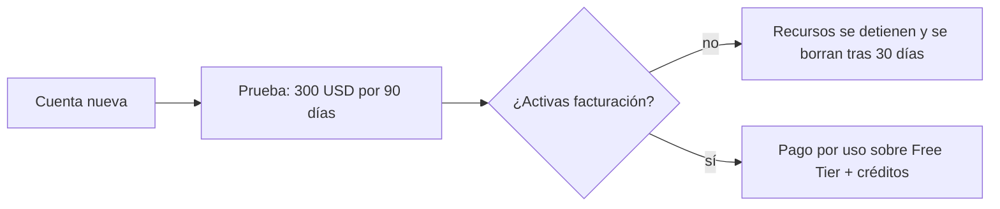

# Google Cloud - prueba gratuita (crédito por 90 días) y Free Tier

Parte de: [[16-Laboratorios-Practica/04 Otras nubes para probar servicios de pago/_Índice Otras nubes para probar servicios de pago|Otras nubes para probar servicios de pago]]

> [!info] Cómo avanzar
> `progreso`: **pendiente** → **viendo** (estudiando) → **visto** (contestaste la autoevaluación sin abrir las respuestas) → **dominado** (hiciste el laboratorio o lo aplicaste de verdad).

## Contenido

### Qué es
Google Cloud ofrece dos cosas distintas que conviene no confundir: una **prueba gratuita** con un crédito temporal para cuentas nuevas, y un **Free Tier** permanente con límites mensuales en ciertos productos. Juntas permiten aprender la plataforma sin pagar, siempre que entiendas dónde termina lo gratis.

### Qué incluye la prueba gratuita
Un **crédito de 300 USD** para usar en casi cualquier servicio durante **90 días** (para cuentas nuevas). Durante la prueba, Google indica que **"no se te cobra"**: aunque registres una tarjeta para verificación, no te cobran hasta que **actives manualmente** la cuenta de facturación completa.

### Qué es el Free Tier de Google Cloud
Uso **mensual gratuito permanente** de ciertos productos, con límites, que sigue disponible **aun después** de la prueba. Entre los más útiles:

- **Compute Engine**: una VM pequeña **e2-micro** al mes en regiones de EE. UU. (us-west1, us-central1, us-east1), más 30 GB de disco estándar y algo de salida de datos.
- **Cloud Run**: millones de peticiones y cierta cantidad de cómputo de memoria/CPU al mes.
- **Cloud Storage**: 5 GB-mes de almacenamiento regional en EE. UU.
- **[[Google Cloud Shell]]**: terminal gratuita con 5 GB de disco persistente.

(Los montos exactos cambian; verificar en la página oficial.)

### Te cobran automáticamente al terminar la prueba
**No**, mientras no actives manualmente la facturación completa. Si no la activas, al terminar la prueba los recursos **se detienen** y se **borran de forma permanente tras un periodo de gracia de 30 días**. Si **sí** la activas, todo lo que pase de los límites gratuitos se cobra: por eso debes configurar **presupuestos y alertas** ([[Cómo evitar cobros inesperados en la nube (presupuestos y alertas)]]).

### Cómo empezar paso a paso
1. Activa la prueba con tu cuenta de Google (registra tarjeta solo para verificación).
2. Configura un **presupuesto con alertas** desde el inicio.
3. Crea recursos dentro del Free Tier (por ejemplo una e2-micro en us-central1) para que sigan gratis tras la prueba.
4. Usa [[Google Cloud Shell]] para administrar sin instalar nada.
5. Decide antes del día 90: ¿activas facturación o dejas que se detenga?

### Ejemplo
Para practicar despliegues sin reloj de cuenta regresiva, crea una **e2-micro** en una región del Free Tier: queda gratis mes a mes incluso después de la prueba, mientras respetes los límites. Es comparable a lo que ofrece [[Oracle Cloud - Always Free]], aunque Oracle da instancias ARM más potentes.

### Cuándo usarlo y cuándo no
Úsalo para aprender servicios de Google (Cloud Run, BigQuery, GKE) o para los labs de [[Google Cloud Skills Boost (laboratorios con credenciales temporales)]]. Para tu trabajo diario, tu nube es Azure. Si solo quieres un servidor siempre encendido, compara con Oracle. Para comparar las cuatro nubes, ver [[Comparativa de capas gratuitas de nubes (AWS, Azure, Google Cloud y Oracle)]].

### Errores comunes
- **Confundir la prueba (300 USD/90 días) con el Free Tier (permanente).** Son cosas distintas.
- **Crear la e2-micro fuera de las regiones del Free Tier.** Fuera de us-west1/us-central1/us-east1 se cobra.
- **Activar facturación sin presupuesto.** Exposición a cobros.
- **Olvidar recursos al terminar la prueba.** Se borran tras 30 días si no activas pago; respalda lo valioso.

### Para profundizar
- [Google Cloud: prueba gratuita y Free Tier](https://cloud.google.com/free)
- [Documentación del Free Tier](https://docs.cloud.google.com/free)
- [Presupuestos y alertas de facturación](https://cloud.google.com/billing/docs/how-to/budgets)

## Autoevaluación

Contesta primero en voz alta o en papel; luego despliega la respuesta.

> [!question]- ¿Qué incluye la prueba gratuita?
> Un crédito para usar en casi cualquier servicio durante 90 días para cuentas nuevas; el monto y condiciones (verificar en la página oficial).

> [!question]- ¿Qué es el Free Tier de Google Cloud?
> Uso mensual gratuito permanente de ciertos productos con límites (por ejemplo una VM pequeña en regiones específicas, Cloud Run, Cloud Storage), aún después de la prueba (verificar en la página oficial).

> [!question]- ¿Te cobran automáticamente al terminar la prueba?
> No mientras no actives manualmente la cuenta de facturación completa. Si la activas, todo lo que pase de los límites gratuitos se cobra: configura presupuestos y alertas.

