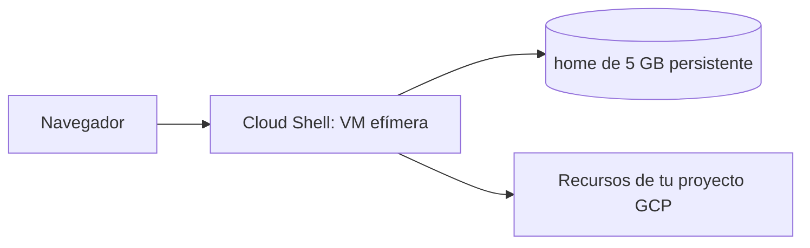

# Google Cloud Shell

Parte de: [[16-Laboratorios-Practica/04 Otras nubes para probar servicios de pago/_Índice Otras nubes para probar servicios de pago|Otras nubes para probar servicios de pago]]

> [!info] Cómo avanzar
> `progreso`: **pendiente** → **viendo** (estudiando) → **visto** (contestaste la autoevaluación sin abrir las respuestas) → **dominado** (hiciste el laboratorio o lo aplicaste de verdad).

## Contenido

### Qué es
Google Cloud Shell es una **terminal Linux en el navegador**, ligada a tu cuenta de Google Cloud, con las herramientas de administración ya instaladas: `gcloud`, `kubectl`, `docker`, `git`, editores y runtimes comunes. Te permite administrar tu proyecto y practicar comandos **sin instalar nada** en tu equipo. Es gratuita por sí misma; lo que cobra es lo que crees *con* ella.

### Qué se practica ahí
Administrar recursos con `gcloud`, desplegar a Cloud Run, manejar clústeres con `kubectl`, clonar repos y editar código con el editor integrado (basado en Code OSS). Es el entorno natural para los primeros pasos en Google Cloud y para seguir tutoriales sin fricción.

### Cómo funciona


La máquina que te asignan es **efímera**, pero tu directorio **home (5 GB) persiste** entre sesiones. Lo que instales fuera de `$HOME` o dejes en `/tmp` se pierde al reconectar.

### Qué limitaciones tiene
- **Cuota de uso semanal**: alrededor de **50 horas por semana** (verificar en la página oficial).
- **Desconexión por inactividad**: la VM se termina tras unos **40 minutos** sin actividad.
- **Sesión máxima**: hasta **12 horas**, luego se reinicia.
- **Home de 5 GB**: incluye software y configuración; si no accedes a Cloud Shell por **120 días**, el home se borra (con aviso previo).

### Qué cuidado hay
El cuidado clave: **Cloud Shell es gratis, pero lo que creas desde ahí no**. Si lanzas una VM de Compute Engine, un clúster GKE o una base de datos, esos recursos se cobran en tu proyecto igual que si los crearas desde la consola. Cloud Shell solo te da la terminal; la factura la generan los recursos. Pon presupuestos y alertas ([[Cómo evitar cobros inesperados en la nube (presupuestos y alertas)]]).

### Cómo empezar paso a paso
1. Entra a la consola de Google Cloud y pulsa el icono de **Activate Cloud Shell** (arriba a la derecha).
2. Autoriza y espera a que se aprovisione la VM.
3. Verifica tu proyecto activo:

```bash
# Ver el proyecto y la cuenta actuales
gcloud config list
```

4. Guarda tus scripts en `$HOME` (persiste); no dejes trabajo valioso en `/tmp`.
5. Al terminar, cierra la sesión; recuerda que lo que creaste en el proyecto sigue vivo (y cobrando) hasta que lo borres.

### Ejemplo
Para desplegar un contenedor a Cloud Run desde la terminal, sin instalar el SDK en tu PC:

```bash
# Despliega una imagen a Cloud Run (esto SÍ puede consumir Free Tier o cobrar)
gcloud run deploy mi-api --image gcr.io/mi-proyecto/mi-api --region us-central1
```

### Cuándo usarlo y cuándo no
Úsalo para administrar Google Cloud, seguir tutoriales y practicar `gcloud`/`kubectl` sin instalar nada. Para un entorno desechable que no toque tu cuenta de nube, [[Killercoda]] o [[Play with Docker]]. Para labs guiados con recursos temporales, [[Google Cloud Skills Boost (laboratorios con credenciales temporales)]].

### Errores comunes
- **Creer que todo lo lanzado es gratis.** Cloud Shell sí; los recursos que crea, no.
- **Guardar trabajo fuera de `$HOME`.** Se pierde al reconectar.
- **No usar Cloud Shell por meses.** Tras 120 días se borra el home (con aviso).
- **Olvidar recursos creados desde la terminal.** Bórralos al terminar.

### Para profundizar
- [Google Cloud Shell](https://cloud.google.com/shell)
- [Cuotas y límites de Cloud Shell](https://cloud.google.com/shell/docs/quotas-limits)

## Autoevaluación

Contesta primero en voz alta o en papel; luego despliega la respuesta.

> [!question]- ¿Qué es Cloud Shell?
> Una terminal Linux en el navegador con `gcloud`, `kubectl`, Docker y editores ya instalados, ligada a tu cuenta de Google Cloud.

> [!question]- ¿Qué limitaciones tiene?
> Tiene una cuota de uso semanal, se desconecta por inactividad y solo conserva un directorio home pequeño entre sesiones (verificar en la página oficial).

> [!question]- ¿Qué cuidado hay?
> Lo que crees desde Cloud Shell (VMs, clusters) sí se cobra en tu proyecto. Cloud Shell en sí es gratuito.

