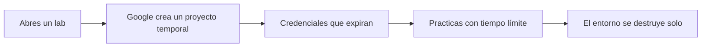

# Google Cloud Skills Boost (laboratorios con credenciales temporales)

Parte de: [[16-Laboratorios-Practica/04 Otras nubes para probar servicios de pago/_Índice Otras nubes para probar servicios de pago|Otras nubes para probar servicios de pago]]

> [!info] Cómo avanzar
> `progreso`: **pendiente** → **viendo** (estudiando) → **visto** (contestaste la autoevaluación sin abrir las respuestas) → **dominado** (hiciste el laboratorio o lo aplicaste de verdad).

## Contenido

### Qué es
Google Cloud Skills Boost es la plataforma de formación de Google para su nube: cursos y, sobre todo, **laboratorios guiados** que se ejecutan en **proyectos temporales** de Google Cloud creados solo para ti, con **credenciales que expiran** al terminar el tiempo del lab. Así practicas sobre la nube real sin usar tu propia cuenta ni tu tarjeta. En octubre de 2025 Google presentó **Google Skills** como el nuevo hogar de este contenido; Skills Boost sigue siendo el punto de referencia para estos labs (verificar en la página oficial).

### Qué ofrece Skills Boost

Laboratorios paso a paso sobre Compute, Kubernetes (GKE), BigQuery, redes, IA y más, con un objetivo concreto y validación. Al abrir un lab te entregan un usuario y proyecto temporales; cuando se acaba el tiempo, todo se borra.

### Qué ventaja tiene frente a usar tu propia cuenta
- **No usas tu tarjeta ni tu proyecto**: el entorno es de Google y se destruye solo.
- **Sin riesgo de cobros por olvidos**: como las credenciales expiran y el proyecto se elimina, no quedan recursos encendidos cobrando (a diferencia de practicar en tu propia cuenta, donde una VM olvidada sí factura).

### Cuidados
- Los labs tienen **tiempo límite**; si se acaba, el entorno se cierra aunque no hayas terminado.
- Parte del contenido requiere **créditos o suscripción** (verificar en la página oficial).
- Abre la consola del lab en una **ventana de incógnito** para no mezclar las credenciales temporales con tu cuenta personal de Google.

### Cómo empezar paso a paso
1. Crea una cuenta en Skills Boost (o Google Skills).
2. Elige un lab gratuito o una ruta introductoria.
3. Pulsa **Start Lab**; copia el usuario y la contraseña temporales.
4. Abre la consola en **incógnito** e inicia sesión con esas credenciales.
5. Sigue los pasos antes de que se agote el tiempo; al terminar, pulsa **End Lab**.

### Ejemplo
Un lab típico te pide crear una VM, instalar un servidor web y verificar que responde, todo en el proyecto temporal. Comparado con hacerlo en tu cuenta (ver [[Google Cloud - prueba gratuita (crédito por 90 días) y Free Tier]]), aquí no hay nada que apagar después: el riesgo de cobro desaparece porque el entorno se autodestruye.

### Cuándo usarlo y cuándo no
Úsalo para practicar servicios de Google Cloud sin tocar tu cuenta y sin miedo a cobros, o para preparar sus certificaciones. Para experimentar con libertad y conservar lo que construyes, usa tu propia cuenta con presupuesto. Para entornos desechables ajenos a Google, [[Killercoda]] o [[Play with Docker]].

### Errores comunes
- **Mezclar las credenciales del lab con tu cuenta personal.** Usa incógnito.
- **Confiar en terminar sin reloj.** El tiempo corre; planea la sesión.
- **Creer que todos los labs son gratis.** Algunos piden créditos o suscripción.
- **Intentar guardar recursos del lab.** Se destruyen al cerrar; no persisten.

### Para profundizar
- [Google Cloud Skills Boost](https://www.cloudskillsboost.google/)
- [Anuncio de Google Skills (oct-2025)](https://cloud.google.com/blog/topics/training-certifications/google-skills-new-home-AI-learning)

## Autoevaluación

Contesta primero en voz alta o en papel; luego despliega la respuesta.

> [!question]- ¿Qué ofrece Skills Boost?
> Laboratorios guiados en proyectos temporales de Google Cloud creados para ti, con credenciales que expiran al terminar el tiempo del lab.

> [!question]- ¿Qué ventaja tiene frente a usar tu propia cuenta?
> No usas tu tarjeta ni tu proyecto: el entorno se destruye solo y no hay riesgo de cobros por olvidos.

> [!question]- ¿Cuidados?
> Los labs tienen tiempo límite y algunos requieren créditos o suscripción (verificar en la página oficial). Abre la consola del lab en una ventana de incógnito para no mezclarla con tu cuenta personal.

