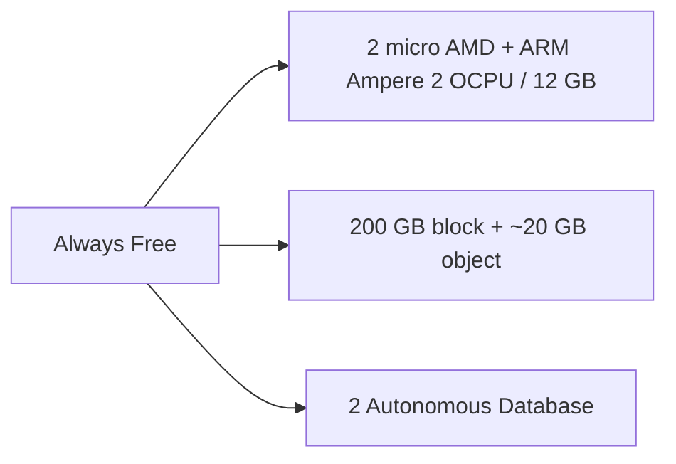

# Oracle Cloud - Always Free

Parte de: [[16-Laboratorios-Practica/04 Otras nubes para probar servicios de pago/_Índice Otras nubes para probar servicios de pago|Otras nubes para probar servicios de pago]]

> [!info] Cómo avanzar
> `progreso`: **pendiente** → **viendo** (estudiando) → **visto** (contestaste la autoevaluación sin abrir las respuestas) → **dominado** (hiciste el laboratorio o lo aplicaste de verdad).

## Contenido

### Qué es
Oracle Cloud Infrastructure (OCI) tiene un **Always Free**: un conjunto de recursos **gratuitos de forma permanente** (no una prueba que caduca), disponibles mientras la cuenta esté activa. Es la capa gratuita más generosa de las grandes nubes para quien quiere un **servidor Linux siempre encendido** donde practicar, porque incluye instancias ARM con bastante CPU y memoria.

### Qué ofrece Always Free
Según la referencia oficial (verificar, cambia con el tiempo):

- **Compute AMD**: hasta **2 instancias** micro (VM.Standard.E2.1.Micro), 1/8 de OCPU y 1 GB de RAM cada una.
- **Compute ARM (Ampere A1)**: un pool de **1,500 OCPU-hora y 9,000 GB-hora al mes**, equivalente a **2 OCPU y 12 GB de RAM** en total, que puedes usar en una instancia o repartir en dos de 1 OCPU.
- **Block Volume**: **200 GB** en total (boot + bloque) y 5 respaldos.
- **Object Storage**: alrededor de 20 GB combinados.
- **Autonomous Database**: **2 bases** con 1 OCPU y 20 GB cada una.

> Nota: Oracle redujo a la mitad el pool ARM (antes eran 4 OCPU y 24 GB); muchas guías en internet siguen citando las cifras viejas. Confirma los números vigentes en la página oficial.

### Qué cuidados tiene
- **Capacidad ARM limitada**: puede no haber disponibilidad en tu región para crear la instancia Ampere; a veces hay que reintentar.
- **Recuperación de instancias ociosas**: Oracle puede **reclamar** instancias Always Free que considere inactivas (si durante 7 días la CPU, red y memoria quedan por debajo del 20%). Mantén algo de actividad o acepta que puede apagarse.
- **Región principal**: muchos recursos Always Free solo existen en la **región base** (home region) que elegiste al crear la cuenta; un block volume fuera de ella se cobra.

### Para qué te sirve
Para tener un **servidor Linux siempre encendido** donde practicar despliegues, Docker, bases de datos y servicios sin costo, cuidando la seguridad: firewall (security lists/NSG), SSH **con llaves** (no contraseña) y actualizaciones al día. Es ideal para alojar un proyecto personal pequeño o un entorno de pruebas permanente.

### Cómo empezar paso a paso
1. Crea la cuenta y elige con cuidado tu **región base** (donde vivirán los recursos Always Free).
2. Crea una instancia **Ampere A1** (por ejemplo 1 OCPU / 6 GB, o las 2 OCPU / 12 GB completas) con una imagen de Oracle Linux o Ubuntu.
3. Configura el acceso por **SSH con llave** y abre solo los puertos necesarios en la security list.
4. Instala lo que quieras practicar (Docker, un servidor web, una base).
5. Marca estas instancias como Always Free y vigila que no te pases a recursos de pago.

### Ejemplo
Puedes alojar ahí una API .NET en contenedor para practicar despliegue continuo desde Azure DevOps o GitHub, usando la instancia ARM como destino. Al ser permanente, sirve de laboratorio estable sin el reloj de los créditos de otras nubes.

### Cuándo usarlo y cuándo no
Úsalo cuando quieras un servidor gratis que no caduque. Si tu meta es aprender servicios específicos de Azure o Google, usa esas nubes. Para algo totalmente efímero y sin configurar nada, [[Google Cloud Shell]] o [[Play with Docker]]. Compara el panorama en [[Comparativa de capas gratuitas de nubes (AWS, Azure, Google Cloud y Oracle)]].

### Errores comunes
- **Elegir mal la región base.** No se cambia fácil y limita dónde viven los recursos gratis.
- **Dejar la instancia totalmente ociosa.** Oracle puede reclamarla.
- **Abrir SSH con contraseña o puertos de más.** Usa llaves y mínimo privilegio ([[SSH y acceso seguro a dispositivos]]).
- **Crear recursos fuera de Always Free sin darte cuenta.** Revisa que cada recurso esté marcado como gratuito.

### Para profundizar
- [Oracle Cloud Free Tier](https://www.oracle.com/cloud/free/)
- [Always Free Resources (referencia oficial)](https://docs.oracle.com/en-us/iaas/Content/FreeTier/resourceref.htm)

## Autoevaluación

Contesta primero en voz alta o en papel; luego despliega la respuesta.

> [!question]- ¿Qué ofrece Always Free?
> Recursos gratuitos permanentes: instancias pequeñas (incluidas instancias ARM Ampere con cierta cantidad de núcleos y RAM), almacenamiento y bases de datos Autonomous con límites (verificar en la página oficial).

> [!question]- ¿Qué cuidados tiene?
> Puede no haber capacidad disponible en tu región para las instancias ARM; las instancias inactivas por mucho tiempo pueden ser recuperadas por Oracle; y algunos recursos solo existen en tu región principal (verificar en la página oficial).

> [!question]- ¿Para qué te sirve?
> Para tener un servidor Linux siempre encendido donde practicar despliegues, Docker y bases de datos sin costo, cuidando la seguridad (firewall, SSH con llaves).

