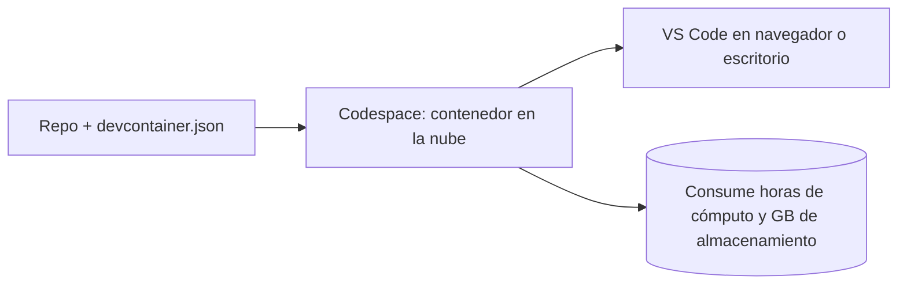

# GitHub Codespaces

Parte de: [[16-Laboratorios-Practica/05 Laboratorios temporales en el navegador/_Índice Laboratorios temporales en el navegador|Laboratorios temporales en el navegador]]

> [!info] Cómo avanzar
> `progreso`: **pendiente** → **viendo** (estudiando) → **visto** (contestaste la autoevaluación sin abrir las respuestas) → **dominado** (hiciste el laboratorio o lo aplicaste de verdad).

## Contenido

### Qué es
GitHub Codespaces es un **entorno de desarrollo en la nube**: un VS Code (en el navegador o conectado desde tu equipo) que se crea a partir de un repositorio y de su archivo `devcontainer.json`. En lugar de clonar y configurar todo en tu máquina, abres un codespace y tienes el proyecto listo, con sus dependencias, extensiones y herramientas ya instaladas. Es ideal cuando tu PC es modesta o cuando quieres un entorno idéntico y reproducible.

### Qué se practica ahí
Desarrollar en un entorno limpio y consistente, probar un `devcontainer`, trabajar desde cualquier equipo (incluso una tablet) y abrir rápido un proyecto de código abierto para contribuir sin instalar nada. Para ti, sirve para experimentar sin ensuciar tu máquina principal.

### Cómo funciona


El `devcontainer.json` define la imagen base, las extensiones y los comandos de arranque, así que todos obtienen el mismo entorno.

### Qué ofrece gratis
Las cuentas personales tienen una **cuota mensual incluida**:
- **GitHub Free**: **120 horas de cómputo** y **15 GB-mes** de almacenamiento.
- **GitHub Pro**: **180 horas** y **20 GB-mes**.

Las horas de cómputo dependen del tamaño de la máquina (una máquina de 2 núcleos consume la cuota al doble de velocidad que una de 1). Los números y la forma de medir cambian; verificar en la página oficial.

### Qué cuidados tiene
- **Detén o borra** los codespaces que no uses: el **almacenamiento cuenta aunque el codespace esté detenido**, solo el cómputo se libera al detener.
- Configura el **apagado por inactividad** (idle timeout) para no gastar horas sin querer.
- Guarda secretos en **Codespaces secrets** (a nivel de cuenta/repo), **no** en el código ni en el `devcontainer.json` ([[Secretos en repositorios]]).

### Cómo empezar paso a paso
1. En un repositorio, pulsa **Code → Codespaces → Create codespace**.
2. Espera a que se construya (si hay `devcontainer.json`, se aplica solo).
3. Trabaja en el VS Code del navegador o conéctate desde tu VS Code de escritorio.
4. Ajusta el **idle timeout** en tus settings de Codespaces.
5. Al terminar, **detén** el codespace; si ya no lo necesitas, **bórralo** para liberar almacenamiento.

### Ejemplo
Un `devcontainer.json` mínimo para una API .NET deja todo listo al abrir el codespace:

```json
{
  "image": "mcr.microsoft.com/devcontainers/dotnet:10.0",
  "customizations": {
    "vscode": { "extensions": ["ms-dotnettools.csharp"] }
  },
  "postCreateCommand": "dotnet restore"
}
```

Así, cualquiera que abra Itzamna.Dionisio en un codespace obtiene .NET 10 y la extensión de C# sin configurar nada.

### Cuándo usarlo y cuándo no
Úsalo para entornos reproducibles, PCs modestas o contribuir rápido a un repo. Para un entorno de Linux totalmente desechable sin ligar a un repo, [[Killercoda]] o [[Play with Docker]]. Para desarrollo diario pesado, tu VS Code local sigue siendo lo más rápido (y no consume cuota).

### Errores comunes
- **Dejar codespaces detenidos acumulando almacenamiento.** Bórralos si no los usarás.
- **No configurar el idle timeout.** Gastas horas con el codespace abierto y ocioso.
- **Poner secretos en el repo o el devcontainer.** Usa Codespaces secrets.
- **Crear una máquina enorme "por si acaso".** Más núcleos consumen la cuota más rápido.

### Para profundizar
- [GitHub Codespaces](https://github.com/features/codespaces)
- [Documentación de dev containers](https://containers.dev/)
- [Cómo se mide el uso de Codespaces](https://docs.github.com/en/billing/concepts/product-billing/github-codespaces)

## Autoevaluación

Contesta primero en voz alta o en papel; luego despliega la respuesta.

> [!question]- ¿Qué es Codespaces?
> Un entorno de desarrollo en la nube (VS Code en el navegador o conectado desde tu equipo) creado a partir de un repositorio y su `devcontainer.json`.

> [!question]- ¿Qué ofrece gratis?
> Una cuota mensual de horas de núcleo y almacenamiento para cuentas personales (verificar en la página oficial).

> [!question]- ¿Qué cuidados tiene?
> Detén o borra los codespaces que no uses (el almacenamiento cuenta aunque esté detenido), configura el tiempo de apagado por inactividad y guarda secretos en Codespaces secrets, no en el repo.

