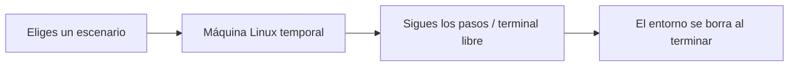

# Killercoda

Parte de: [[16-Laboratorios-Practica/05 Laboratorios temporales en el navegador/_Índice Laboratorios temporales en el navegador|Laboratorios temporales en el navegador]]

> [!info] Cómo avanzar
> `progreso`: **pendiente** → **viendo** (estudiando) → **visto** (contestaste la autoevaluación sin abrir las respuestas) → **dominado** (hiciste el laboratorio o lo aplicaste de verdad).

## Contenido

### Qué es
Killercoda es una plataforma de **escenarios interactivos en el navegador**: cada escenario te da una o varias máquinas Linux temporales con un entorno ya preparado (Kubernetes, Docker, Linux, Git) para que practiques comandos sin instalar nada. Es el sucesor espiritual de Katacoda y se usa mucho para prepararse a certificaciones de Kubernetes y para seguir tutoriales prácticos.

### Qué se practica ahí
Comandos de **Kubernetes** (`kubectl`, `kubeadm`), **Docker**, administración de **Linux**, **Git** y más. Hay escenarios creados por la comunidad y por proyectos (por ejemplo, entornos oficiales de práctica). Para alguien que prepara CKA/CKAD o quiere repasar `kubectl` antes de un examen, es muy cómodo.

### Cómo funciona


### Qué límites tiene
- Las **sesiones duran poco tiempo**: el plan gratuito permite escenarios de alrededor de **1 hora**; el entorno se **borra al terminar**.
- Hay un plan **PLUS de pago** (unos 7–8 USD/mes) que amplía la duración (hasta ~4 horas), permite varios escenarios a la vez y quita captchas (verificar en la página oficial).

### Para qué te sirve
Para **practicar comandos de Kubernetes o Linux de forma rápida y desechable**, por ejemplo repasar antes de un examen o probar algo que viste en un tutorial, sin montar un clúster local. Es más enfocado a "escenarios de práctica" que [[Play with Kubernetes]], que te da máquinas crudas para armar tú el clúster.

### Cómo empezar paso a paso
1. Entra a killercoda.com (puedes usar tu cuenta de GitHub).
2. Elige un escenario de la categoría que te interese (por ejemplo "Kubernetes").
3. Sigue las instrucciones del panel izquierdo; los comandos corren en la terminal de la derecha.
4. Si quieres libertad total, usa un **Playground** (entorno vacío) en vez de un escenario guiado.
5. Termina antes de que expire la sesión; guarda lo que quieras conservar fuera de la plataforma.

### Ejemplo
Un escenario de Kubernetes te pide crear un `Deployment` y exponerlo:

```bash
# Crear un despliegue y exponerlo con un Service
kubectl create deployment web --image=nginx
kubectl expose deployment web --port=80 --type=NodePort
kubectl get pods,svc
```

Practicar esto en Killercoda refuerza lo que estudiaste en [[Kubernetes - conceptos básicos]] sin necesidad de instalar kind o minikube.

### Cuándo usarlo y cuándo no
Úsalo para repasos rápidos de Kubernetes/Linux y para seguir tutoriales. Para un entorno ligado a un repo con tu código, [[GitHub Codespaces]]. Para construir un clúster multinodo con `kubeadm`, [[Play with Kubernetes]]. Para algo permanente, un clúster local o una VM en [[Oracle Cloud - Always Free]].

### Errores comunes
- **Confiar en que la sesión durará.** En gratis es ~1 hora; no dejes trabajo valioso sin respaldar.
- **Esperar persistencia.** Todo se borra al terminar.
- **Abrir varios escenarios en gratis.** La concurrencia es de pago.
- **Usarlo como entorno "real".** Es para practicar, no para alojar nada.

Un apunte sobre su uso típico: muchos lo aprovechan como "borrador" antes de un examen de Kubernetes, porque reproduce el estilo de terminal y pasos de la certificación. Para sesiones de estudio más largas o varios escenarios en paralelo tendrás que pasar al plan de pago; para repasos cortos y desechables, el gratuito basta y sobra.

### Para profundizar
- [Killercoda](https://killercoda.com/)
- [Escenarios de Kubernetes](https://killercoda.com/kubernetes)

## Autoevaluación

Contesta primero en voz alta o en papel; luego despliega la respuesta.

> [!question]- ¿Qué es Killercoda?
> Una plataforma de escenarios interactivos en el navegador con una máquina Linux temporal: Kubernetes, Docker, Linux, Git y más, sin instalar nada.

> [!question]- ¿Qué límites tiene?
> Las sesiones duran poco tiempo y el entorno se borra al terminar; hay un plan de pago con más tiempo (verificar en la página oficial).

> [!question]- ¿Para qué te sirve?
> Para practicar comandos de Kubernetes o Linux de forma rápida y desechable, por ejemplo antes de un examen.

