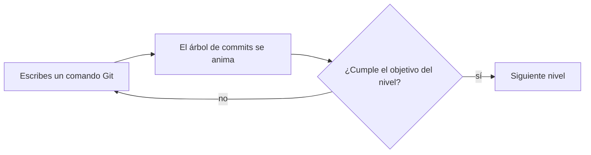

# Learn Git Branching

Parte de: [[16-Laboratorios-Practica/05 Laboratorios temporales en el navegador/_Índice Laboratorios temporales en el navegador|Laboratorios temporales en el navegador]]

> [!info] Cómo avanzar
> `progreso`: **pendiente** → **viendo** (estudiando) → **visto** (contestaste la autoevaluación sin abrir las respuestas) → **dominado** (hiciste el laboratorio o lo aplicaste de verdad).

## Contenido

### Qué es
Learn Git Branching es una aplicación web **gratuita y de código abierto** para aprender Git (ver [[Git - qué es y cómo funciona]]) de forma **visual e interactiva**. En vez de leer teoría, ejecutas comandos de Git en una consola y ves cómo se mueven los commits y las ramas en un diagrama animado. Es una de las mejores formas de entender qué hace realmente cada comando, sobre todo los que confunden al principio.

### Qué se practica ahí
Ramas (`branch`, `checkout`), fusiones (`merge`), **rebase**, `cherry-pick`, movimiento del `HEAD`, referencias relativas (`HEAD~2`), deshacer cambios (`reset`, `revert`) y operaciones con **remotos** (`fetch`, `pull`, `push`). Está organizado en niveles tipo juego, de lo básico a lo avanzado, con un reto en cada uno.

### Cómo funciona


Al ver el grafo de commits reaccionar a cada comando, conceptos como rebase dejan de ser abstractos.

### Qué ofrece
- Es **gratuito**, **de código abierto** y **no requiere cuenta**.
- Tiene un **modo sandbox** para probar comandos libremente, sin un reto que cumplir.
- Soporta varios idiomas (incluido español).

### Qué limitación tiene
**Simula un subconjunto de Git**: trabaja con el grafo de commits y ramas, pero **no maneja archivos reales, el área de preparación (staging) ni conflictos de contenido**. Es perfecto para entender la *topología* de ramas y commits, pero después debes practicar en un **repositorio real** para ver `git add`, resolver conflictos de archivos y usar `.gitignore`. Complementa el [[Lab 1 - Ramas, merge, rebase y conflictos en Git]].

### Cómo empezar paso a paso
1. Entra a learngitbranching.js.org.
2. Haz la secuencia "Introduction" (commits y ramas).
3. Pasa a "Ramas lejanas" y a los niveles de **rebase** y referencias relativas.
4. Usa el **sandbox** para reproducir un flujo que uses en el trabajo (por ejemplo una rama de feature y su rebase sobre main).
5. Repite el mismo flujo en un repo real para fijarlo.

### Ejemplo
Para entender la diferencia entre fusionar y rebasar una rama de feature, en el sandbox puedes probar ambos y comparar el grafo:

```bash
# En una rama de feature, traer los cambios de main de dos formas:
git merge main      # crea un commit de merge (historial con bifurcación)
# vs.
git rebase main     # reaplica tus commits encima de main (historial lineal)
```

### Cuándo usarlo y cuándo no
Úsalo cuando Git te confunda, sobre todo rebase, `HEAD` y referencias relativas: verlo animado lo aclara en minutos. No lo uses como único aprendizaje: para staging, conflictos de archivos y remotos reales, necesitas un repositorio de verdad (en GitHub o Azure DevOps).

### Qué limitación tiene (resumen)
No simula archivos, staging ni conflictos de contenido; practica eso aparte en un repo real.

### Errores comunes
- **Creer que ya dominas Git.** Falta la parte de archivos, staging y conflictos.
- **Memorizar comandos sin entender el grafo.** El valor es ver qué le pasa al árbol.
- **Saltarse el modo sandbox.** Es donde experimentas sin presión de niveles.

### Para profundizar
- [Learn Git Branching](https://learngitbranching.js.org/)
- [Pro Git (libro oficial, gratuito)](https://git-scm.com/book/es/v2)

## Autoevaluación

Contesta primero en voz alta o en papel; luego despliega la respuesta.

> [!question]- ¿Para qué sirve?
> Para aprender Git de forma visual e interactiva en el navegador: ramas, merge, rebase, cherry-pick y remotos, con niveles tipo juego.

> [!question]- ¿Qué ofrece?
> Es gratuito, de código abierto y no requiere cuenta. Tiene un modo sandbox para probar comandos libremente.

> [!question]- ¿Qué limitación tiene?
> Simula un subconjunto de Git; practica después en un repo real para ver conflictos y archivos de verdad.

