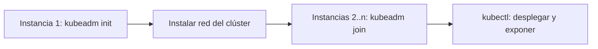

# Play with Kubernetes

Parte de: [[16-Laboratorios-Practica/05 Laboratorios temporales en el navegador/_Índice Laboratorios temporales en el navegador|Laboratorios temporales en el navegador]]

> [!info] Cómo avanzar
> `progreso`: **pendiente** → **viendo** (estudiando) → **visto** (contestaste la autoevaluación sin abrir las respuestas) → **dominado** (hiciste el laboratorio o lo aplicaste de verdad).

## Contenido

### Qué es
Play with Kubernetes (PWK) es la versión para Kubernetes de [[Play with Docker]]: un entorno **gratuito en el navegador** que te da varias instancias Linux para **construir tú mismo un clúster pequeño** con `kubeadm`. A diferencia de plataformas donde el clúster ya está listo, aquí practicas el **montaje** del clúster, que es justo lo que piden algunos exámenes.

### Qué se practica ahí
Inicializar un nodo maestro con `kubeadm init`, instalar un complemento de red (CNI), unir nodos trabajadores con `kubeadm join`, y luego desplegar y exponer aplicaciones con `kubectl`. Es útil para entender cómo se arma un clúster desde cero, no solo cómo usarlo.

### Cómo funciona


### Qué límites tiene
- **Sesiones cortas** que se **borran al terminar**.
- **Recursos limitados** y disponibilidad variable (verificar en la página oficial).
- Para algo más estable o guiado, usa [[Killercoda]] o un clúster local (**kind**, **minikube**).

### Qué practicarías ahí
Un flujo completo de principiante:
1. Crear el clúster (`kubeadm init` + red).
2. Unir uno o dos nodos.
3. Desplegar un `Deployment`.
4. Exponerlo con un `Service`.
5. Escalarlo.

### Cómo empezar paso a paso
1. Entra a labs.play-with-k8s.com e inicia sesión (Docker Hub o GitHub).
2. Crea la primera instancia y ejecuta la secuencia de `kubeadm init` que te muestra el entorno.
3. Instala el CNI indicado.
4. Añade instancias y únelas con el comando `kubeadm join` que generó el init.
5. Despliega una app de prueba:

```bash
# Desplegar, exponer y escalar una aplicación
kubectl create deployment web --image=nginx
kubectl expose deployment web --port=80 --type=NodePort
kubectl scale deployment web --replicas=3
kubectl get pods -o wide
```

### Ejemplo
Tras montar el clúster, desplegar y escalar un `Deployment` te deja ver cómo Kubernetes reparte las réplicas entre nodos, reforzando lo de [[Kubernetes - conceptos básicos]]. Si solo quieres practicar `kubectl` sin armar el clúster, [[Killercoda]] es más directo.

### Cuándo usarlo y cuándo no
Úsalo cuando quieras practicar el **montaje** de un clúster con `kubeadm`. Para practicar solo `kubectl`, Killercoda. Para un clúster estable en tu equipo, kind o minikube. Para producción o algo permanente, un Kubernetes gestionado (AKS/GKE/EKS) o una VM en [[Oracle Cloud - Always Free]].

### Errores comunes
- **Olvidar instalar el CNI.** Sin red del clúster, los pods no se comunican ni pasan a Ready.
- **Esperar persistencia.** La sesión se borra; no alojes nada.
- **Frustrarse con el tiempo.** Son sesiones cortas; ten los comandos a la mano.
- **Confundir montar con usar.** PWK es para armar el clúster; para usarlo, otras opciones rinden más.

Un apunte de contexto: montar el clúster a mano con `kubeadm` es justo lo que esconden los Kubernetes gestionados (AKS, GKE, EKS), así que hacerlo una vez aquí te ayuda a entender qué hay "debajo" de un clúster administrado. Para el día a día usarás un gestionado o un clúster local como kind; PWK es sobre todo un ejercicio de aprendizaje.

### Para profundizar
- [Play with Kubernetes](https://labs.play-with-k8s.com/)
- [kubeadm (documentación oficial)](https://kubernetes.io/docs/reference/setup-tools/kubeadm/)
- [kind (Kubernetes local)](https://kind.sigs.k8s.io/)

## Autoevaluación

Contesta primero en voz alta o en papel; luego despliega la respuesta.

> [!question]- ¿Qué es Play with Kubernetes?
> La versión para Kubernetes de Play with Docker: varias instancias en el navegador para crear un clúster pequeño con `kubeadm`.

> [!question]- ¿Qué límites tiene?
> Sesiones cortas que se borran al terminar, recursos limitados y disponibilidad variable (verificar en la página oficial). Para algo más estable usa [[Killercoda]] o un clúster local (kind, minikube).

> [!question]- ¿Qué practicarías ahí?
> Crear un clúster, desplegar un `Deployment`, exponerlo con un `Service` y escalarlo.

