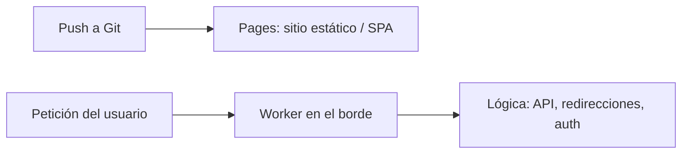

# Cloudflare (Pages y Workers)

Parte de: [[16-Laboratorios-Practica/06 Plataformas de despliegue con plan gratuito/_Índice Plataformas de despliegue con plan gratuito|Plataformas de despliegue con plan gratuito]]

> [!info] Cómo avanzar
> `progreso`: **pendiente** → **viendo** (estudiando) → **visto** (contestaste la autoevaluación sin abrir las respuestas) → **dominado** (hiciste el laboratorio o lo aplicaste de verdad).

## Contenido

### Qué es
Cloudflare ofrece dos productos para desplegar en el borde (edge) de su red global: **Pages**, para hospedar **sitios estáticos y SPAs** con despliegue desde Git; y **Workers**, para ejecutar **funciones serverless** muy cerca del usuario, sobre un runtime propio basado en estándares web. Juntos permiten publicar un front y añadirle lógica dinámica sin un servidor tradicional.

### Para qué sirven


- **Pages**: sitio estático con HTTPS y CDN global, previews por rama.
- **Workers**: endpoints, APIs ligeras, middleware, redirecciones y transformaciones, ejecutados en el borde con latencia muy baja.

### Qué ofrece el plan gratuito
Según la documentación vigente (verificar en la página oficial):
- **Pages (Free)**: **500 builds al mes**, 1 build concurrente, hasta **20,000 archivos** por sitio (25 MiB por archivo) y 100 dominios personalizados por proyecto.
- **Workers (Free)**: **100,000 peticiones al día** (reinicia a medianoche UTC), **10 ms de CPU por petición**, 128 MB de memoria por isolate. Al pasar el límite diario, Cloudflare responde con error 1027 (o deja pasar sin el Worker, según la configuración de la ruta).

### Qué cuidados tiene
- **Workers no es Node.js completo**: usa un runtime propio con APIs web (Fetch, Web Crypto). Muchas librerías de Node no funcionan tal cual; revisa compatibilidad (hay un modo de compatibilidad con Node, con límites).
- El **tope de 10 ms de CPU** por petición descarta cómputo pesado en el plan gratuito (la espera por red o KV no cuenta, solo CPU).
- Guarda **secretos con `wrangler secret`**, no en el código del Worker ([[Secretos en repositorios]]).

### Cómo empezar paso a paso
1. Instala la CLI **Wrangler** (`npm i -g wrangler`) e inicia sesión.
2. Para un sitio: conecta el repo en Pages y configura build (`npm run build`) y carpeta de salida.
3. Para un Worker: `wrangler init mi-worker`, escribe el handler y `wrangler deploy`.
4. Guarda secretos con `wrangler secret put NOMBRE`.
5. Prueba la URL `*.workers.dev` o `*.pages.dev` que te asignan.

### Ejemplo
Un Worker mínimo que responde según la ruta:

```javascript
export default {
  async fetch(request) {
    const url = new URL(request.url);
    if (url.pathname === "/salud") {
      return new Response(JSON.stringify({ ok: true }), {
        headers: { "content-type": "application/json" },
      });
    }
    return new Response("Hola desde el borde");
  },
};
```

### Cuándo usarlo y cuándo no
Úsalo para sitios estáticos con CDN global y para lógica ligera en el borde (redirecciones, auth, APIs pequeñas). Para una API .NET con base de datos, mejor [[Render]]. Para fronts con Next.js, [[Vercel]] puede ser más directo. Cloudflare brilla en latencia global y en casos de borde.

### Errores comunes
- **Usar librerías de Node incompatibles.** El runtime de Workers no es Node completo.
- **Meter cómputo pesado en un Worker gratis.** El límite de 10 ms de CPU lo corta.
- **Poner secretos en el código.** Usa `wrangler secret`.
- **Olvidar el redirect a index.html en una SPA en Pages.** Igual que en [[Netlify]], configura el fallback.

### Para profundizar
- [Cloudflare Workers](https://developers.cloudflare.com/workers/)
- [Cloudflare Pages](https://developers.cloudflare.com/pages/)
- [Límites de Workers](https://developers.cloudflare.com/workers/platform/limits/)

## Autoevaluación

Contesta primero en voz alta o en papel; luego despliega la respuesta.

> [!question]- ¿Para qué sirven?
> Pages: hospedar sitios estáticos y SPAs con despliegue desde Git. Workers: ejecutar funciones en el borde (edge) de la red de Cloudflare.

> [!question]- ¿Qué ofrece el plan gratuito?
> Despliegues de sitios con HTTPS y un número diario de peticiones a Workers con límites de CPU (verificar en la página oficial).

> [!question]- ¿Qué cuidados tiene?
> Workers no es Node.js completo (runtime propio con APIs web); revisa compatibilidad de librerías. Guarda secretos con `wrangler secret`, no en el código.

