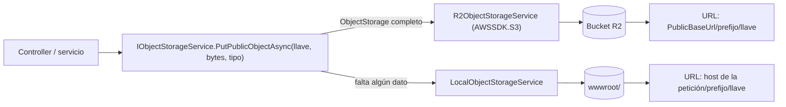

# Cloudflare R2

> Almacenamiento de objetos de Cloudflare **compatible con la API de S3** y **sin costo por salida de datos**. Visto en RaceCoreApi: un puerto `IObjectStorageService` que sube a R2 o, si no está configurado, a `wwwroot` local.

## Qué es y qué problema resuelve
Igual que [[Azure Blob Storage]] o S3: guardar archivos (imágenes, PDFs, comprobantes) fuera del servidor y servirlos por HTTPS. La diferencia: R2 **no cobra el egreso** (lo que se descarga), que en sitios con muchas imágenes públicas suele ser el costo mayor.

## Cómo funciona por dentro
- **Bucket** + **llave** (la "carpeta" es parte de la llave: `prod/uploads/admin-images/abc.webp`).
- **API S3**: se usa el SDK de AWS (`AWSSDK.S3`) apuntando al endpoint `https://<account_id>.r2.cloudflarestorage.com` con `ForcePathStyle = true`.
- **Credenciales**: Access Key + Secret Key de un token de R2.
- **Lectura pública**: por un dominio propio o `*.r2.dev`; la URL pública es distinta del endpoint de escritura (`PublicBaseUrl`).
- **Un bucket, varios entornos**: un prefijo de llave (`dev/`, `prod/`).



## Cuándo usarla y cuándo no
### Ventajas
- Sin costo de egreso; precio por GB bajo.
- Compatible con S3: el código sirve también para AWS S3, MinIO, Backblaze B2.
### Desventajas
- No tiene todo S3 (algunas funciones de ciclo de vida, eventos); revisar antes de depender de ellas.
- Si el bucket es público, cualquiera con la URL ve el archivo (no usarlo para comprobantes o documentos privados sin URLs firmadas).

## Alternativas
| Alternativa | En qué se diferencia |
|---|---|
| [[Azure Blob Storage]] | Lo que usa [[Itzamna.Dionisio]]; cobra egreso, SDK propio, contenedores privado/público |
| AWS S3 | Mismo API; cobra egreso |
| Disco local (`wwwroot`) | Solo desarrollo o una sola instancia |

## Cómo se vio en RaceCoreApi (referencia)
- **Puerto mínimo**: un solo método, `PutPublicObjectAsync(objectKey, content, contentType, ct)`, que regresa la **URL pública absoluta**.
- **Elección por configuración**: `ObjectStorageSettings.IsR2Enabled` es `true` solo si están `ServiceUrl`, `Bucket`, `AccessKey`, `SecretKey` y `PublicBaseUrl`; si falta uno, se registra el adaptador local. En desarrollo no hace falta nada.
- **`KeyPrefix`** separa `dev/` y `prod/` en el mismo bucket; `BuildObjectKey` normaliza `\` y `/` iniciales.
- **Adaptador local**: escribe bajo `wwwroot/` y arma la URL con el host de la petición (o `PublicSite:ApiPublicBaseUrl` si no hay petición).
- Las imágenes llegan ya convertidas a WebP ([[ImageSharp]]).

```csharp
// RaceCoreApi/Domain/ObjectStorageSettings.cs (referencia)
public string BuildObjectKey(string relativePath)
{
    var path = relativePath.Replace('\\', '/').TrimStart('/');
    var prefix = KeyPrefix.Trim().Trim('/');
    return string.IsNullOrEmpty(prefix) ? path : $"{prefix}/{path}";
}

public bool IsR2Enabled =>
    !string.IsNullOrWhiteSpace(ServiceUrl)
    && !string.IsNullOrWhiteSpace(Bucket)
    && !string.IsNullOrWhiteSpace(AccessKey)
    && !string.IsNullOrWhiteSpace(SecretKey)
    && !string.IsNullOrWhiteSpace(PublicBaseUrl);
```

```csharp
// RaceCoreApi/Services/R2ObjectStorageService.cs (referencia)
var config = new AmazonS3Config
{
    ServiceURL = _options.ServiceUrl.Trim().TrimEnd('/'),
    ForcePathStyle = true
};
_client = new AmazonS3Client(new BasicAWSCredentials(_options.AccessKey.Trim(), _options.SecretKey.Trim()), config);
// …
await _client.PutObjectAsync(new PutObjectRequest
{
    BucketName = _options.Bucket.Trim(), Key = key, InputStream = stream,
    ContentType = contentType, UseChunkEncoding = false
}, cancellationToken);
return $"{_publicBase}/{key}";
```

> [!tip] Reutilizable
> Puerto `IObjectStorageService` + adaptador S3 (R2) + adaptador local, elegido por "¿está completa la configuración?", con `KeyPrefix` por entorno. Para usarlo en un proyecto nuevo:
> - Registrar con `AddOptions<...>().ValidateOnStart()` fuera de Development, para que una llave faltante en producción **no caiga en silencio al disco local** ([[Options pattern]]).
> - Agregar `Cache-Control` y llaves únicas por contenido, como en [[Azure Blob Storage]].
> - No usar el bucket público para archivos privados.

## Errores comunes y buenas prácticas
- **Caer al disco local sin aviso en producción** porque faltó una llave (lo que haría el `IsR2Enabled` tal cual): hay que validar al arrancar.
- `UseChunkEncoding = false`: R2 no acepta la firma por partes que usa el SDK por defecto.
- Confundir el endpoint de escritura con la URL pública.
- Credenciales en `appsettings.json`.

## Qué estudiar después
- URLs prefirmadas (lectura privada temporal), dominio propio + caché de Cloudflare, [[Patrón Strategy]].

## Documentación oficial
- https://developers.cloudflare.com/r2/
- https://developers.cloudflare.com/r2/examples/aws/aws-sdk-net/

## Autoevaluación

Contesta primero en voz alta o en papel; luego despliega la respuesta.

> [!question]- ¿Qué es R2 y cuál es su principal ventaja?
> Almacenamiento de objetos compatible con la API de S3, sin cobro por salida de datos (egreso).

> [!question]- ¿Qué riesgo tiene un bucket público?
> Cualquiera con la URL puede ver el archivo. Para documentos privados usa URLs prefirmadas con expiración.

> [!question]- ¿Qué ajuste necesita el SDK de AWS para .NET con R2?
> `ForcePathStyle = true` y `UseChunkEncoding = false` en el `PutObjectRequest`, apuntando al endpoint de tu cuenta de R2.

