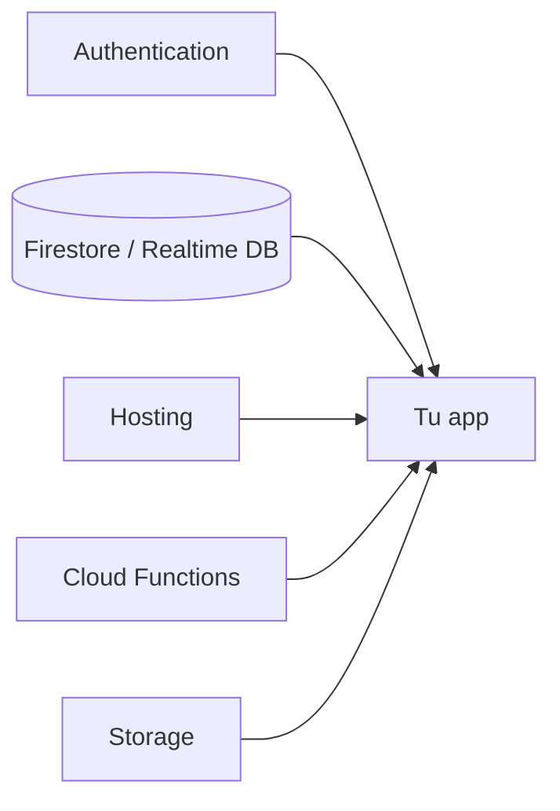
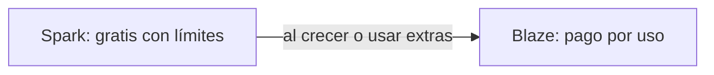

# Firebase

Parte de: [[16-Laboratorios-Practica/06 Plataformas de despliegue con plan gratuito/_Índice Plataformas de despliegue con plan gratuito|Plataformas de despliegue con plan gratuito]]

> [!info] Cómo avanzar
> `progreso`: **pendiente** → **viendo** (estudiando) → **visto** (contestaste la autoevaluación sin abrir las respuestas) → **dominado** (hiciste el laboratorio o lo aplicaste de verdad).

## Contenido

### Qué es
Firebase es la plataforma de Google para construir apps web y móviles con servicios gestionados: **Authentication** (login), **Firestore** y **Realtime Database** (bases NoSQL en tiempo real), **Hosting** (sitios estáticos), **Cloud Functions** (backend serverless), **Storage** (archivos) y analítica. Permite hacer una app con backend sin administrar servidores.

### Qué ofrece Firebase


Es especialmente popular para apps móviles y prototipos que necesitan login y una base en tiempo real sin montar infraestructura.

### Qué diferencia hay entre el plan Spark y el Blaze


- **Spark**: plan **gratuito** con cuotas. Sirve para prototipos y apps pequeñas.
- **Blaze**: plan de **pago por uso**. Es **necesario para ciertos servicios**, no solo para escalar. En particular, **Cloud Functions** (desde hace tiempo) y **Cloud Storage** requieren Blaze: desde **septiembre de 2024**, aprovisionar buckets de Cloud Storage (incluido el predeterminado) exige Blaze. Blaze **incluye** las cuotas gratuitas de Spark y cobra solo lo que las exceda.

### Qué cuidado de seguridad es clave
Configurar bien las **reglas de seguridad** de Firestore, Realtime Database y Storage. Unas reglas abiertas (`allow read, write: if true`) permiten a **cualquiera** leer o escribir tu base desde el cliente. Escribe reglas que validen autenticación y propiedad de los datos. Y en **Blaze**, como el cobro es por uso, configura **topes de gasto** (spend caps) donde el servicio lo permita: las **alertas de presupuesto avisan pero no detienen el gasto** ([[Cómo evitar cobros inesperados en la nube (presupuestos y alertas)]]).

### Cómo empezar paso a paso
1. Crea un proyecto en la consola de Firebase.
2. Elige los servicios: Authentication + Firestore para una app típica.
3. **Escribe reglas de seguridad** antes de abrir la app (nada de `if true`).
4. Si necesitas Cloud Functions o Storage, pasa a **Blaze** y pon un presupuesto con alerta.
5. Despliega el front con Hosting (`firebase deploy`).

### Ejemplo
Una regla de Firestore para que cada usuario solo acceda a sus documentos:

```
// Solo el dueño autenticado puede leer/escribir su documento
match /usuarios/{uid} {
  allow read, write: if request.auth != null && request.auth.uid == uid;
}
```

Es el mismo principio de autorización por recurso que cuidas en tu API .NET.

### Cuándo usarlo y cuándo no
Úsalo para apps móviles/web que necesiten login y base en tiempo real rápido, o para prototipos. Si prefieres SQL y código abierto, [[Supabase]] ofrece algo parecido sobre Postgres. Para un backend .NET propio, [[Render]] o Azure. Ten presente que varios servicios empujan a Blaze.

### Errores comunes
- **Reglas abiertas (`if true`).** Exponen toda la base; es el fallo más común.
- **Creer que Storage sigue en Spark.** Desde sep-2024 requiere Blaze.
- **Confiar en alertas para frenar el gasto.** No lo detienen; usa spend caps.
- **No poner presupuesto en Blaze.** El cobro por uso puede dispararse.

### Para profundizar
- [Firebase](https://firebase.google.com/)
- [Planes de precios (Spark y Blaze)](https://firebase.google.com/docs/projects/billing/firebase-pricing-plans)
- [Reglas de seguridad](https://firebase.google.com/docs/rules)

## Autoevaluación

Contesta primero en voz alta o en papel; luego despliega la respuesta.

> [!question]- ¿Qué ofrece Firebase?
> Servicios de Google para apps: Authentication, Firestore, Hosting, Cloud Functions, Storage y analítica.

> [!question]- ¿Qué diferencia hay entre el plan Spark y el Blaze?
> Spark es gratuito con límites; Blaze es de pago por uso y es necesario para algunos servicios (por ejemplo Cloud Functions) (verificar en la página oficial).

> [!question]- ¿Qué cuidado de seguridad es clave?
> Configurar bien las reglas de seguridad de Firestore y Storage: reglas abiertas permiten a cualquiera leer o escribir. En Blaze, configura alertas de presupuesto.

