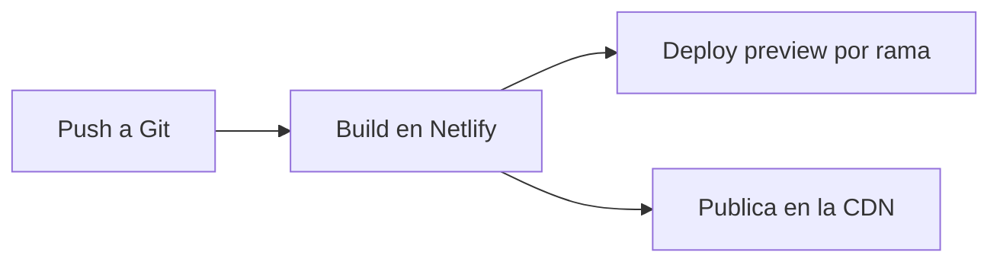

# Netlify

Parte de: [[16-Laboratorios-Practica/06 Plataformas de despliegue con plan gratuito/_Índice Plataformas de despliegue con plan gratuito|Plataformas de despliegue con plan gratuito]]

> [!info] Cómo avanzar
> `progreso`: **pendiente** → **viendo** (estudiando) → **visto** (contestaste la autoevaluación sin abrir las respuestas) → **dominado** (hiciste el laboratorio o lo aplicaste de verdad).

## Contenido

### Qué es
Netlify es una plataforma para hospedar **sitios estáticos y SPAs** con despliegue continuo desde Git. Fue de las primeras en popularizar el flujo "conecta tu repo y cada push se publica solo", con **previews por rama**, funciones serverless, formularios y redirecciones. Es una opción muy cómoda para fronts en React, Vite, Astro o Hugo.

### Para qué sirve
Hospedar un front con HTTPS automático, obtener una URL de preview por cada rama/PR, ejecutar funciones serverless ligeras y recibir envíos de formularios sin backend propio. Alternativa directa a [[Vercel]] y a [[Cloudflare (Pages y Workers)]].



### Qué límites tiene el plan gratuito
Importante: desde el **4 de septiembre de 2025**, las cuentas nuevas usan **planes basados en créditos**. El plan Free incluye **300 créditos al mes** con **tope fijo** (sin recarga): nunca te cobran, pero al agotarse el plan se detiene hasta el mes siguiente. Los créditos se consumen según el uso, por ejemplo (verificar en la página oficial):

| Recurso | Costo aprox. |
|---|---|
| Despliegue de producción | 15 créditos |
| 1 GB de ancho de banda | 20 créditos |
| 10,000 peticiones web | 2 créditos |
| 1 GB-hora de funciones | 10 créditos |

Las cuentas creadas antes de esa fecha siguen en el plan heredado (con cuotas de ancho de banda y minutos de build). Los deploy previews y branch deploys no consumen créditos.

### Qué cuidado común hay con SPAs
En una SPA (React Router, por ejemplo), las rutas del cliente como `/clientes/42` no existen como archivos, así que el servidor devuelve **404** si recargas ahí. La solución es una **regla de redirección** que mande todo a `index.html`:

```
# archivo _redirects en la carpeta de publicación
/*    /index.html   200
```

O su equivalente en `netlify.toml`. Sin esto, el enrutado del lado del cliente se rompe al recargar o al entrar por un enlace directo.

### Cómo empezar paso a paso
1. Conecta tu repo de Git a Netlify.
2. Configura el comando de build (`npm run build`) y la carpeta de publicación (`dist` en Vite).
3. Añade el archivo `_redirects` o la sección `[[redirects]]` en `netlify.toml` si es una SPA.
4. Define variables de entorno para la URL de tu API.
5. Haz push y revisa el deploy preview antes de fusionar.

### Ejemplo
Para desplegar Itzamna.Clio (Vite + React + React Router), el build genera `dist/`, publicas esa carpeta y agregas el `_redirects` de arriba para que [[React Router]] maneje las rutas sin 404.

### Cuándo usarlo y cuándo no
Úsalo para fronts estáticos y SPAs. Para APIs .NET con base de datos, usa [[Render]]. Entre Netlify, Vercel y Cloudflare Pages la elección es de preferencia; prueba cuál se ajusta a tu flujo. Vigila el consumo de créditos en el nuevo modelo.

### Errores comunes
- **Olvidar la redirección a index.html.** Las rutas de la SPA dan 404 al recargar.
- **Carpeta de publicación equivocada.** En Vite es `dist`, no `build`.
- **No vigilar los créditos.** En el nuevo modelo, agotar los 300 detiene el sitio hasta el mes siguiente.
- **Poner secretos en el repo.** Usa variables de entorno de Netlify.

### Para profundizar
- [Netlify](https://www.netlify.com/)
- [Redirecciones y rewrites](https://docs.netlify.com/routing/redirects/)
- [Planes basados en créditos](https://docs.netlify.com/manage/accounts-and-billing/billing/billing-for-credit-based-plans/credit-based-pricing-plans/)

## Autoevaluación

Contesta primero en voz alta o en papel; luego despliega la respuesta.

> [!question]- ¿Para qué sirve Netlify?
> Para hospedar sitios estáticos y SPAs con despliegue desde Git, previews de ramas, funciones serverless y formularios.

> [!question]- ¿Qué límites tiene el plan gratuito?
> Cuotas mensuales de ancho de banda, minutos de build y ejecuciones de funciones (verificar en la página oficial).

> [!question]- ¿Qué cuidado común hay con SPAs?
> Configurar la regla de redirección a `index.html` (archivo `_redirects` o `netlify.toml`) para que las rutas del router no den 404.

