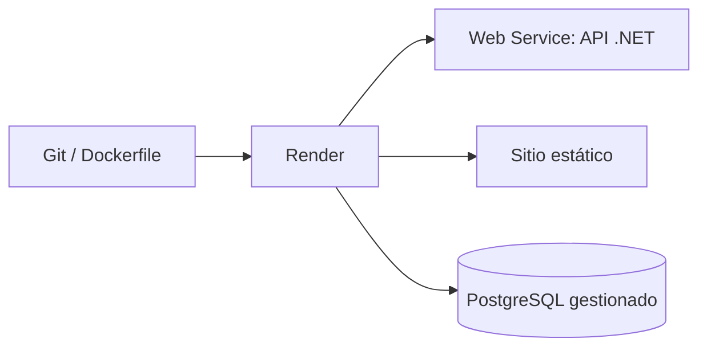

# Render

Parte de: [[16-Laboratorios-Practica/06 Plataformas de despliegue con plan gratuito/_Índice Plataformas de despliegue con plan gratuito|Plataformas de despliegue con plan gratuito]]

> [!info] Cómo avanzar
> `progreso`: **pendiente** → **viendo** (estudiando) → **visto** (contestaste la autoevaluación sin abrir las respuestas) → **dominado** (hiciste el laboratorio o lo aplicaste de verdad).

## Contenido

### Qué es
Render es una plataforma de despliegue tipo PaaS que, a diferencia de [[Vercel]] y [[Netlify]] (centradas en el front), también hospeda **servicios web de backend** desde Git o desde un contenedor. Puede desplegar **APIs .NET** en Docker, sitios estáticos, workers en segundo plano y bases **PostgreSQL** gestionadas. Es una buena opción gratuita para montar un backend completo de práctica.

### Para qué sirve


Desplegar una API, un front y una base de datos en el mismo lugar, con HTTPS y despliegue continuo. Ideal para subir a la nube un proyecto de aprendizaje de principio a fin.

### Qué cuidado tiene el plan gratuito de servicios web
Los **servicios web gratuitos se suspenden (spin down)** tras **15 minutos sin tráfico**. La siguiente petición los "despierta", lo que tarda cerca de **un minuto**: el usuario ve una pantalla de carga mientras arranca. Además hay un tope de **750 horas de instancia al mes por workspace**. Por eso el plan gratuito sirve para demos y aprendizaje, pero no para algo que deba responder siempre al instante.

### Y la base PostgreSQL gratuita
La base **PostgreSQL gratuita** tiene límites estrictos: tamaño fijo de **1 GB**, **expira 30 días después de crearse** (con un periodo de gracia de ~14 días para actualizar antes de que se borre), una sola base gratuita por workspace y **sin respaldos**. **No la uses para datos que debas conservar**: es para practicar, no para producción.

### Cómo empezar paso a paso
1. Conecta tu repo o prepara un `Dockerfile` para tu API .NET.
2. Crea un **Web Service**: Render detecta el Dockerfile y construye la imagen.
3. Crea una base **PostgreSQL** gratuita y copia su cadena de conexión (como secreto, con SSL).
4. Define variables de entorno (cadena de conexión, secretos) en el panel del servicio.
5. Despliega; la primera petición tras inactividad tardará en despertar.

### Ejemplo
Puedes desplegar una API .NET en contenedor que use Pochteca.Nomisma (Postgres). El `Dockerfile` publica la app y Render la expone con HTTPS:

```dockerfile
# Imagen base de .NET 10 para una API publicada
FROM mcr.microsoft.com/dotnet/aspnet:10.0
WORKDIR /app
COPY ./publish .
ENV ASPNETCORE_URLS=http://+:10000
EXPOSE 10000
ENTRYPOINT ["dotnet", "Itzamna.Dionisio.dll"]
```

Render inyecta el puerto por la variable `PORT`; asegúrate de escuchar en él.

### Cuándo usarlo y cuándo no
Úsalo cuando necesites **backend + base de datos** gratis para practicar, algo que Vercel/Netlify no cubren bien. Para fronts puros, esas dos o [[Cloudflare (Pages y Workers)]] son más directas. Para una base Postgres que debas conservar, usa [[Neon (PostgreSQL)]] o [[Supabase]], que tienen planes gratuitos pensados para persistir.

### Errores comunes
- **Esperar respuesta instantánea.** El spin down de 15 min hace que la primera petición tarde ~1 min.
- **Guardar datos importantes en la Postgres gratis.** Expira a los 30 días y no tiene respaldos.
- **No escuchar en el puerto que Render asigna.** Usa la variable `PORT`.
- **Dejar secretos en el repo.** Configúralos como variables de entorno.

### Para profundizar
- [Render: Deploy for Free](https://render.com/docs/free)
- [Desplegar con Docker](https://render.com/docs/docker)
- [Bases de datos PostgreSQL](https://render.com/docs/postgresql)

## Autoevaluación

Contesta primero en voz alta o en papel; luego despliega la respuesta.

> [!question]- ¿Para qué sirve Render?
> Para desplegar servicios web (incluidas APIs .NET en contenedor), sitios estáticos, workers y bases PostgreSQL desde Git.

> [!question]- ¿Qué cuidado tiene el plan gratuito de servicios web?
> Los servicios gratuitos se suspenden tras un tiempo sin tráfico y la primera petición tarda en "despertar" (verificar en la página oficial).

> [!question]- ¿Y la base PostgreSQL gratuita?
> Tiene límites de tamaño y expira después de cierto tiempo si no pasas a plan de pago (verificar en la página oficial). No la uses para datos que debas conservar.

