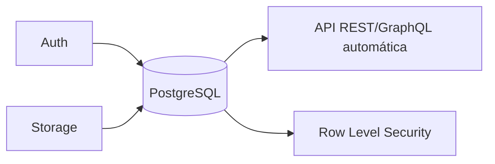

# Supabase

Parte de: [[16-Laboratorios-Practica/06 Plataformas de despliegue con plan gratuito/_Índice Plataformas de despliegue con plan gratuito|Plataformas de despliegue con plan gratuito]]

> [!info] Cómo avanzar
> `progreso`: **pendiente** → **viendo** (estudiando) → **visto** (contestaste la autoevaluación sin abrir las respuestas) → **dominado** (hiciste el laboratorio o lo aplicaste de verdad).

## Contenido

### Qué es
Supabase es una plataforma de backend construida **sobre PostgreSQL** que agrupa varios servicios listos para usar: base de datos Postgres, **autenticación**, **almacenamiento de archivos**, una **API REST y GraphQL automática** generada a partir de tus tablas, funciones *edge* y actualizaciones en **tiempo real**. Se promociona como alternativa de código abierto a Firebase, pero con SQL de verdad por debajo.

### Qué se practica ahí
Montar un backend completo sin escribir toda la plomería: defines tablas y obtienes una API; activas auth y tienes registro/login; subes archivos a Storage. Es ideal para prototipos de apps web o móviles y para practicar Postgres con herramientas modernas.

### Cómo funciona


La **API automática** expone tus tablas; la seguridad depende de las **políticas RLS** (Row Level Security) que definas en la base.

### Qué cuidado tiene el plan gratuito
Según la información vigente (verificar en la página oficial): hasta **2 proyectos activos**, **500 MB** de base por proyecto, **1 GB** de almacenamiento de archivos, **50,000** usuarios activos mensuales, **5 GB** de egress y **sin respaldos automáticos**. El límite más molesto: los **proyectos gratuitos se pausan tras ~7 días de inactividad** y hay que reactivarlos a mano. No guardes ahí nada que deba estar siempre disponible sin vigilancia.

### Qué error de seguridad es común
El error clásico: **exponer tablas sin políticas de Row Level Security (RLS)**. Como la **llave pública (anon)** viaja en el cliente, cualquier tabla sin RLS puede ser leída (o escrita) por cualquiera que tenga esa llave. Dos reglas:

1. **Activa RLS en cada tabla** y escribe políticas que limiten quién ve y modifica qué.
2. **Nunca uses la llave `service_role` en el front**: esa llave salta la RLS y da acceso total; va solo en el servidor.

### Cómo empezar paso a paso
1. Crea un proyecto en Supabase (elige región cercana).
2. Define tus tablas en el editor SQL o la interfaz.
3. **Activa RLS** en cada tabla y crea políticas (por ejemplo, "cada usuario solo ve sus filas").
4. Usa la llave **anon** en el cliente; guarda `service_role` solo en el backend.
5. Conéctate con el SDK o directo por Postgres para consultas.

### Ejemplo
Una política RLS para que cada usuario solo lea sus propios pedidos:

```sql
-- Habilitar RLS y permitir ver solo las filas propias
ALTER TABLE pedidos ENABLE ROW LEVEL SECURITY;

CREATE POLICY "pedidos_propios"
ON pedidos FOR SELECT
USING (auth.uid() = usuario_id);
```

Esto refleja el principio de [[Control de acceso roto e IDOR]]: la autorización se aplica en la base, no solo en el front.

### Cuándo usarlo y cuándo no
Úsalo cuando quieras un backend completo (base + auth + storage + API) rápido para prototipos. Si solo necesitas Postgres con branching, [[Neon (PostgreSQL)]]. Para desplegar tu propio backend .NET, [[Render]]. Para datos críticos siempre disponibles, cuida el pausado por inactividad o pasa a plan de pago.

### Errores comunes
- **Tablas sin RLS.** Cualquiera con la llave anon puede leerlas.
- **Usar `service_role` en el front.** Da acceso total; es solo de servidor.
- **Olvidar el pausado por inactividad.** El proyecto gratuito se pausa a los ~7 días.
- **Confiar en respaldos que no existen.** El plan gratuito no los trae.

### Para profundizar
- [Supabase](https://supabase.com/)
- [Row Level Security](https://supabase.com/docs/guides/database/postgres/row-level-security)
- [Precios y límites](https://supabase.com/pricing)

## Autoevaluación

Contesta primero en voz alta o en papel; luego despliega la respuesta.

> [!question]- ¿Qué es Supabase?
> Una plataforma sobre PostgreSQL con autenticación, almacenamiento de archivos, API REST/GraphQL automática, funciones y tiempo real.

> [!question]- ¿Qué cuidado tiene el plan gratuito?
> Los proyectos gratuitos se pausan tras un periodo sin actividad y hay límites de tamaño y de proyectos (verificar en la página oficial).

> [!question]- ¿Qué error de seguridad es común?
> Exponer tablas sin políticas de Row Level Security (RLS): la llave pública (anon) del cliente puede leerlas. Activa RLS en cada tabla y nunca uses la llave `service_role` en el front.

