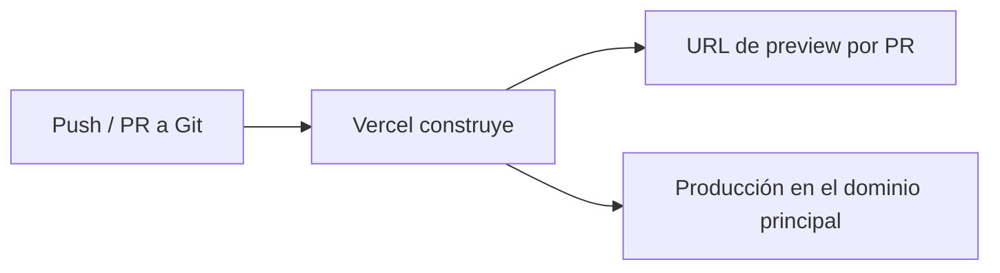

# Vercel

Parte de: [[16-Laboratorios-Practica/06 Plataformas de despliegue con plan gratuito/_Índice Plataformas de despliegue con plan gratuito|Plataformas de despliegue con plan gratuito]]

> [!info] Cómo avanzar
> `progreso`: **pendiente** → **viendo** (estudiando) → **visto** (contestaste la autoevaluación sin abrir las respuestas) → **dominado** (hiciste el laboratorio o lo aplicaste de verdad).

## Contenido

### Qué es
Vercel es una plataforma para desplegar **frontends y funciones serverless** directamente desde un repositorio de Git. Es la casa de Next.js, pero también despliega React, Vite, SvelteKit y sitios estáticos. Su gran atractivo es la integración con Git: cada push genera un despliegue, y cada pull request obtiene una **URL de preview** para revisar los cambios antes de fusionar.

### Para qué sirve

Hospedar un front (como Itzamna.Clio o una demo en React + [[Vite]]), con HTTPS automático, previews por rama y funciones serverless para pequeñas APIs o endpoints de borde.

### Qué cuidado tiene el plan Hobby
El plan gratuito se llama **Hobby** y su restricción clave es que es **solo para uso personal y no comercial**. Un proyecto de un cliente o de tu empresa requiere un plan de pago (Pro); Vercel puede pausar un proyecto Hobby que detecte como comercial. Para tus proyectos de aprendizaje y portafolio, Hobby está bien; para algo que facture, no.

### Qué otros límites revisar
Según la documentación vigente (verificar en la página oficial), el Hobby incluye cuotas mensuales como ~100 GB de transferencia de datos ("Fast Data Transfer"), 1,000,000 de invocaciones de función, cierto cómputo (CPU-horas) y hasta 100 despliegues al día, con una **duración máxima de función de 300 s (5 min)**. Si **excedes** un límite, en general debes **esperar a que pasen 30 días** antes de volver a usar esa función (no te cobran, pero se pausa). Las **variables de entorno por entorno** (Preview y Production) evitan mezclar secretos entre ambientes.

### Cómo empezar paso a paso
1. Conecta tu cuenta de GitHub/GitLab a Vercel.
2. Importa el repositorio del front; Vercel detecta el framework.
3. Define las **variables de entorno** (separando Production y Preview).
4. Haz un push: revisa la URL de preview del PR antes de fusionar.
5. Al fusionar a main, se publica en producción.

### Ejemplo
Para una app Vite + React que consume tu API .NET, configuras la URL del API como variable de entorno distinta en Preview y Production, de modo que las previews apunten a un entorno de pruebas y producción a la API real. Así evitas que una preview toque datos reales.

### Cuándo usarlo y cuándo no
Úsalo para fronts personales, demos y portafolio, sobre todo si usas Next.js. Para proyectos comerciales necesitas Pro o una alternativa ([[Netlify]], [[Cloudflare (Pages y Workers)]]). Para una API .NET con base de datos, mejor [[Render]] o [[Azure Static Web Apps]] con Functions. Vercel brilla en el front, no como host de APIs pesadas.

### Errores comunes
- **Desplegar un proyecto comercial en Hobby.** Viola los términos; puede pausarse.
- **Mezclar secretos entre Preview y Production.** Usa variables por entorno.
- **Funciones largas.** El tope de 300 s descarta procesos pesados; usa colas o un backend aparte.
- **Ignorar la transferencia de datos.** Un sitio con mucho tráfico puede pasar la cuota.

### Para profundizar
- [Vercel: plan Hobby](https://vercel.com/docs/plans/hobby)
- [Guías de frameworks](https://vercel.com/docs/frameworks)
- [Variables de entorno](https://vercel.com/docs/projects/environment-variables)

## Autoevaluación

Contesta primero en voz alta o en papel; luego despliega la respuesta.

> [!question]- ¿Para qué sirve Vercel?
> Para desplegar frontends (Next.js, React, Vite) y funciones serverless desde un repositorio de Git, con previews por pull request.

> [!question]- ¿Qué cuidado tiene el plan Hobby?
> Es para uso personal y no comercial; un proyecto de un cliente o empresa requiere un plan de pago (verificar en la página oficial).

> [!question]- ¿Qué otros límites revisar?
> Duración máxima de las funciones, ancho de banda y ejecuciones incluidas (verificar en la página oficial). Las variables de entorno por entorno (Preview, Production) evitan mezclar secretos.

